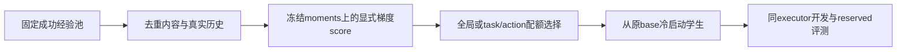
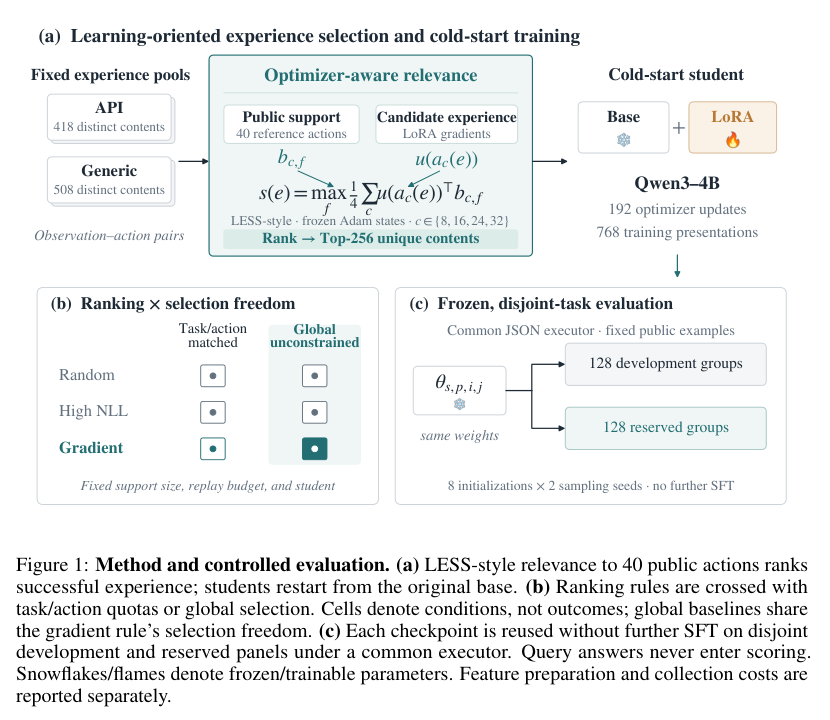

# From Acting to Learning：成功经验该选哪些，而不只是收集多少

[English](README-en.md)

> `component_only` / L1 CPU公式与调度诊断，`diagnostic_only=true`。不是Agent能力复现或Evolve集成。 首发为2026-11-20，发现/审查为2026-11-23，不称11月23日新首发。

## 论文信息

| 字段 | 内容 |
| --- | --- |
| 论文链接 | [From Acting to Learning: Experience Selection toward Continually Learning Agents](https://arxiv.org/abs/2611.27159v1)，固定v1 |
| 公司/机构/学校 | 一作Yaoyuan Yan；Country Garden Services AI Lab / Omni AI |
| 首次公开日期 | 2026-11-20 05:45:48 UTC，arXiv v1；当前修订同日同时间，没有另一次修订 |
| 公告/发现日期 | 本轮公告池未含此身份，公告日未核实；2026-11-23从官方arXiv元数据发现并审查 |
| 原作者开源代码 | 未找到/未核实论文专属公开源码：固定v1正文与TeX仅说明记录已版本化，未给出可核实仓库；不能将LESS或ALFWorld引用仓库当成本篇开源。 |
| 本地 Adapter / 方法 | `adapter: null`；CPU组件key `acting-to-learning` |
| 本地复现代码目录 | `src/auto_research/agent_research/acting_to_learning.py`；测试 `tests/test_nov23_acting_to_learning.py` |

## 原始论文总结

### 背景与主要改动

论文把成功交互后的经验选择单独隔离：历史池先固定，选择规则决定训练哪些action记录，所有学生使用同一训练预算与部署executor。它不是一个新通用梯度影响公式；打分沿用LESS式优化器感知梯度，贡献是Agent学习中的严格对照，尤其把排序规则和可选择的覆盖空间交叉。完整研究只有一次选择—训练阶段，没有验证多轮持续学习、遗忘或自主修改harness。

候选LoRA梯度在warmup第8/16/24/32个checkpoint上，与冻结Adam一、二阶矩构成ranking feature；省略bias correction，不能称作完整AdamW更新。每个公共support梯度先单独归一化，再按任务family取均值；候选feature归一化后与之做点积，先平均checkpoint，再在family间取最大。40条公开support action不含评测query答案。全局选择先按完整messages内容精确去重，保留首代表索引，选256种内容，再三次shuffle共768次展示；matched版本保持reference每个task/action位置与不同内容配额。最终学生从原始base重新开始，不能继承打分warmup权重。



<!-- paper-figure:start -->
### 原论文关键图

[](https://arxiv.org/pdf/2611.27159v1#page=2)

图片来自[原论文](https://arxiv.org/pdf/2611.27159v1#page=2)第2页Figure 1与完整图注，版权归原作者所有。仅裁掉无关正文和留白，科学内容未修改；已目视核对。[源PDF/裁剪SHA256与坐标](assets/provenance.json)。原图不是本地实验。
<!-- paper-figure:end -->

### 核心公式

$$
a_c(e)=\frac{\beta_1m_c+(1-\beta_1)g_c(e)}{\sqrt{\beta_2v_c+(1-\beta_2)g_c(e)^2+\epsilon}},\quad s(e)=\max_f\frac14\sum_{c\in\{8,16,24,32\}}u(a_c(e))^\top b_{c,f}.
$$

### 论文离线与线上效果

作者比较2个固定ALFWorld经验池、9种selector、8个初始化×2个sampling seed，共288个4B学生；每个checkpoint在128个development task groups上用同一executor评价。全局gradient相对同等自由度的random提升8.25/5.96个百分点，相对high-NLL提升4.10/4.05点。另128个reserved task groups的等来源提升为7.03/5.03点。它们不是官方ALFWorld seen/unseen test；8×2不是16个独立初始化。固定展示次数不等于相同token或FLOPs；长度机制控制未通过，不能声称已排除长度解释。未报告生产线上A/B。

## 本地复现与边界

### 数据协议与代码映射

本地独立实现NumPy float64公式核：显式梯度/冻结moments转feature、逐support向量归一化、checkpoint平均后family最大值、按完整字符串精确去重、全局top/random和三轮调度、按reference逐位置匹配stratum并保持不同内容配额的选择。零范数方向原文未定义，明确拒绝而不补造0分；feature中间溢出也拒绝。测试用显式合成梯度与历史action字符串，不把梯度相似度换成词项相似度。没有自动抽LoRA梯度、warmup训练、ALFWorld、Qwen checkpoint、部署executor、学生SFT或能力比较；调用方必须保证support来自公开训练侧而非query答案。

```bash
PYTHONPATH=src python -c 'from auto_research.agent_research.acting_to_learning import diagnostic; print(diagnostic(42))'
PYTHONPATH=src python -m pytest tests/test_nov23_acting_to_learning.py -q
```

冻结源码后由统一runner记录[42/43/44三seed CPU机制结果](metrics/component-cpu-seeds42-44.json)。输入是显式合成控制，不加载能力benchmark、不据test选参数。三seed不是三次模型训练，不提升L1证据等级。

### 同主题比较与边界

与已读旧代表[agent-research:ace-data](../2608.27260-ace-data/README.md)对照：ACE Lens把Accuracy、学习者相对Complexity和Diversity作为数据准入维度；本篇进一步问同样成功的action在当前学生/optimizer状态下，对公开任务family有多大梯度相关性，并把coverage自由度作为对照的一部分。两者都不能把“成功”自动等同于“最值得学”；较低NLL只表示容易预测，不是更高训练收益。ACE旧页的mini-suite也不是本篇ALFWorld训练对照，不能横向比较其满分与本文提升。

负控核对checkpoint/family运算顺序、support均值不再归一化、重复行不增加random抽样概率、得分并列按首代表索引、每个shuffle pass访问全部选中内容、matched仍可选择reference以外的同stratum内容、跨stratum重复内容拒绝、NaN/负二阶矩/中间溢出拒绝。seed只改变合成输入与调度，不是独立训练。

### 高成本完整实验

原文Qwen3-4B-Instruct-2507（revision cdbee75f17c01a7cc42f958dc650907174af0554），rank16 LoRA，每学生192 updates、768 presentations、2048序列；两池721/732条action记录、418/508种内容。作者主研究62.146累计GPU小时，补64学生17.419小时、97 checkpoint reserved评测24.240小时，合计至少103.805 GPU小时，历史采集另计。单A100/A30或Mac不能在本轮短时预算内完整重做该多臂矩阵，完整实验不复现，不下载权重/数据、不试训。CPU数组核预期秒级；这是估计，具体耗时以统一runner回执为准。 **成本过高，不复现（审查 DONE）。** 完整实验是终态成本决定，不进入自动重试/实现队列，不因便宜组件通过而升级为完整论文复现。

### 来源核对

固定v1 PDF SHA256：`026d8420aa7bfa7e63d17c5f7b54f3c24353460894cb770a45bc095d7ba05cd2`。核对位置：Problem and Selection Procedure: optimizer-aware score and Algorithm 1；Experimental Design: student, shared executor and task groups；Costs and Limitations；Reproducibility appendix。本页是有限增量选题，不推进全库11月15日审查水位，也不宣称Google/Meta或全部Agent文献已穷尽。
