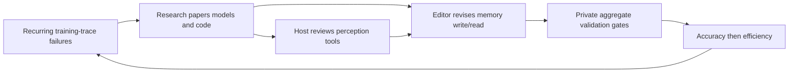
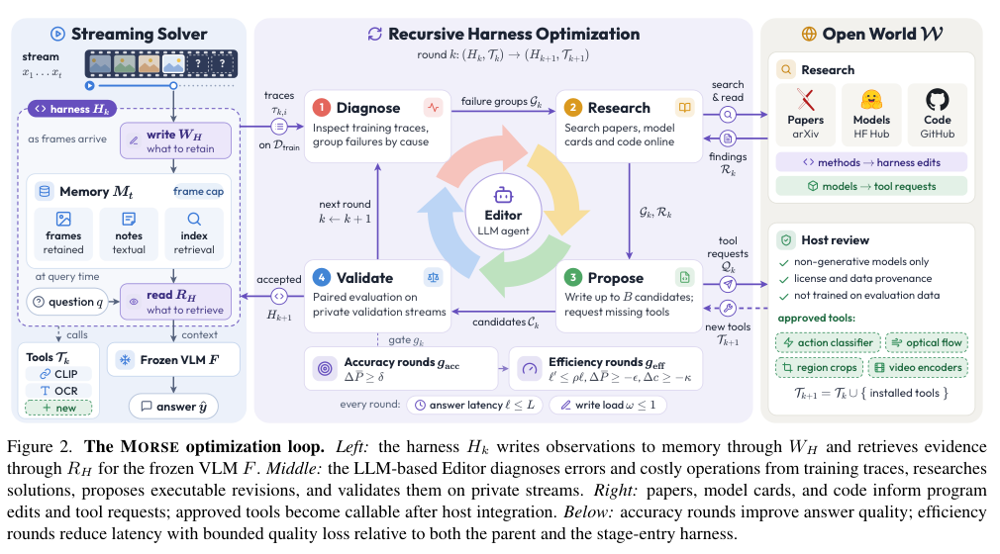

# MORSE: Optimizing Streaming Memory Design via Open-World Auto-Research

<!-- source-sha256: c595ce2784525d97645fa3b1ac219503e405b1015866a17fd786f29d72009029 -->

[简体中文](README.md)

> `deferred_high_cost` / review-only, not implemented or run. First released2026-11-23; discovered/reviewed2026-11-24, not a Nov24 first release. Not eligible for Evolve promotion.

## Paper information

| Field | Value |
| --- | --- |
| Paper | [Fixed arXiv v1](https://arxiv.org/abs/2611.30011v1) |
| Institution | First authorCe Zhang; Carnegie Mellon University / Northwestern University / University of Illinois Urbana-Champaign / University of Pittsburgh |
| Original publication | 2026-11-23 04:11:45 UTC; update has the same timestamp, no separate revision |
| Announcement/discovery | Identity absent from this batch's announcement pool; announcement date unverified. Discovered/reviewed2026-11-24 |
| Author source code | No verifiable public method repository was found in fixed v1 or the [author project page](https://zhangce01.github.io/morse/). A project showcase and third-party tools read by the editor are not a method source release. |
| Local adapter/key | `adapter: null`; `morse` |
| Local reproduction code | None: review-only; no local algorithm/reproduction-code directory |

## Original paper summary

### Background and changes

Streaming memory must retain evidence in one pass before future queries are known. MORSE's editor diagnoses recurring failures in training traces, researches papers/model cards/code and edits write/read harnesses around a frozen VLM. Missing perception capabilities can be requested but require host review of licensing, training provenance and cost before deployment. The defining mechanism is the research/implementation/validation editor plus expandable services, not a fixed candidate list or gate formula alone.

Twenty accuracy rounds precede five efficiency rounds. Accuracy requires at least.004 mean correct-option-probability gain. Efficiency requires latency at most.9 of the parent, per-update losses at most.003 probability/two correct answers, and stage-entry cumulative losses at most.008/four answers. Both enforce latency at most1 second, write load at most1 and unchanged validation question counts. Accuracy may select qualified archive entries; efficiency excludes the archive. Merges are revalidated. The64-frame persistent cap is separate from a16-second recent window, and text/vectors have no global cap; total memory is not constant. The editor sees training traces and aggregate validation feedback; the broker blocks benchmark/answer sources.

### Architecture

### Key original figure

Original Figure 2 and its full caption/algorithm title from fixed-v1 PDF page3. Copyright belongs to the authors. Only unrelated text/whitespace is cropped; scientific content is unchanged and visually reviewed. [Source](https://arxiv.org/pdf/2611.30011v1#page=3) and [SHA256/crop provenance](assets/provenance.json). Not local evidence.

### Core equations

$$
M_t=W_H(M_{t-1},x_t;\mathcal T),\quad\hat y=F(q,R_H(M_t,q;\mathcal T)),\quad g_{eff}:\ell(H')\le\rho\ell(H),\ \Delta\bar P\ge-\epsilon,\ \Delta c\ge-\kappa.
$$

### Reported offline and online results

For Qwen3-VL8B, the paper reports75.1% OVO-Bench,78.9% StreamingBench and71.6% StreamBench, beating the next evaluated same-backbone harness by3.1/2.7/6.3 points, with.30-second mean OVO answer latency. Training/validation comprise780 questions on370 streams and388 on182 streams, with test-video separation. Evolution uses fixed linear service-cost estimates; test latency is measured on oneH100. Neither is local timing. No production A/B or local agent measurement is reported.

## Local reproduction and limits

### Data protocol and code mapping

Review-only delivery records fixed-v1 sources/metadata, access boundaries, costs and a same-topic comparison. No local algorithm module, editor, research broker, video service, harness evolution, benchmark, GPU trial or Evolve operator is created. Gate arithmetic alone would not reproduce MORSE; review-only disposition requires no invented three-seed metrics or GPU receipt.

No local experiment command, metrics or GPU receipt exists. Review-only closure needs no invented execution evidence.

### Same-topic comparison and limits

Reviewed older representative [agent-research:harness2](../2610.14224-harness2/README-en.md): Harness² improves current-task harnesses through Propose/Probe/Compose execution contrasts and saves cross-task lessons within a fixed tool surface. MORSE adds online literature research and host-approved perception acquisition to streaming-memory design while iterating a persistent head. Their feedback, candidate selection and tool-admission contracts differ. Harness²'s anonymous selector is not MORSE's validation probability/cost scorer. The local Harness² diagnostic and this review-only entry have no comparable agent scores.

The review distinguishes estimated from measured latency, frame caps from uncapped text/vectors, installed from adopted services, and reused rejected diffs from revalidated candidates. Gold-dependent validation metrics belong to host/evaluator boundaries, not the solver/editor. No local success-rate or performance controls are measured.

### Full experiments and cost decision

Each backbone uses25 rounds with up to six initial candidates per round plus merges. Three separate backbones are Qwen2.5-VL7B,Qwen3-VL8B andQwen3.8-27B, with Claude Opus5.5 editing, multiple CLIP/OCR/VideoMAE/encoder services,780 training/388 validation questions and three test video benchmarks. Host limits allow20000 service calls per episode and131072 context tokens per call. The singleH100 is test-timing hardware, not a complete evolution budget. This clearly exceeds the short one-A100/A30-or-Mac scope; the full system is terminally not reproduced without model/video downloads, services, paid calls or probes. **Too costly; not reproduced (review DONE).** The full campaign enters no automatic retry/implementation queue. Passing CPU controls does not reproduce the complete paper.

### Source review

PDF SHA256: `186e24c7573f349e60484fcfc5fa4b5b8e825c8731cf6209852964fa8e7da7be`; fixed-v1 TeX SHA256: `f442f3596f6762d99d09c6e01f9c23362b6c99713e3269417c24ca5f3ac6bd69`. This finite incremental selection does not move the global Nov15 review watermark or claim exhaustive Google/Meta/Agent coverage.
