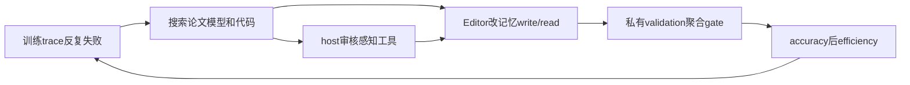
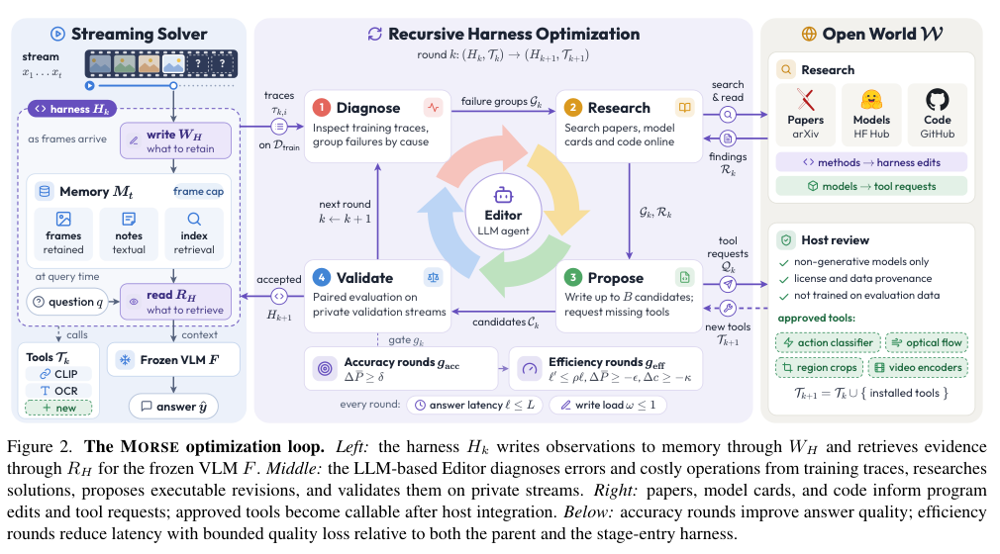

# MORSE：用反复出现的记忆失败驱动在线研究与工具扩展

[English](README-en.md)

> `deferred_high_cost` / 仅资料收录，未实现、未运行。 2026-11-23首发、2026-11-24发现/审查，不称11月24日新首发；不接入Evolve晋级。

## 论文信息

| 字段 | 内容 |
| --- | --- |
| 论文链接 | [MORSE: Optimizing Streaming Memory Design via Open-World Auto-Research](https://arxiv.org/abs/2611.30011v1)，本轮固定v1 |
| 公司/机构/学校 | 一作Ce Zhang；Carnegie Mellon University / Northwestern University / University of Illinois Urbana-Champaign / University of Pittsburgh |
| 首次公开日期 | 2026-11-23 04:11:45 UTC，arXiv v1；updated与首发相同，无另一次修订 |
| 公告/发现日期 | 本轮公告池无此身份，公告日未核实；发现/审查日2026-11-24 |
| 原作者开源代码 | 固定v1与[作者项目页](https://zhangce01.github.io/morse/)未找到可核实的公开方法代码仓库；项目展示页不是源码发布，不把Editor读过的第三方工具当本方法开源。 |
| 本地 Adapter / 方法 | `adapter: null`；key `morse` |
| 本地复现代码目录 | 无：review-only，未创建本地算法或复现代码目录 |

## 原始论文总结

### 背景与主要改动

流式视频记忆必须在不知道未来query时单遍决定保留哪些帧。MORSE让冻结VLM外的Editor从训练trace归因反复失败，主动搜索论文、model cards与code，再改write/read harness；缺感知能力可请求新模型，但需host核查license、训练来源和成本后部署。核心是研究—实现—验证的自主Editor与可扩展服务，不是固定候选列表或门控公式本身。

20轮accuracy后5轮efficiency。accuracy要求平均correct-option probability至少增加0.004；efficiency要求延迟≤父代0.9，允许每轮概率/正确数损失0.003/2，同时相对stage-entry累计损失≤0.008/4。都须延迟≤1s、write load≤1、完整validation问题数不变。accuracy可从qualified archive选，efficiency不取archive；合并后必须重新验证。64张persistent帧之外另有16秒近期窗口，text/vector无全局存储上限，不能宣传总memory恒定。Editor只看训练逐题trace及validation聚合；benchmark/答案链接经broker禁止。

<!-- paper-figure:start -->
### 原论文关键图

原图/算法来自[固定v1论文](https://arxiv.org/pdf/2611.30011v1#page=3)第3页Figure 2，完整保留图注/算法标题与内容，版权归原作者。仅裁无关正文/留白，科学内容未修改，已目视核对。[来源SHA256、裁剪坐标](assets/provenance.json)。它不是本地实验。
<!-- paper-figure:end -->

### 核心公式

$$
M_t=W_H(M_{t-1},x_t;\mathcal T),\quad\hat y=F(q,R_H(M_t,q;\mathcal T)),\quad g_{eff}:\ell(H')\le\rho\ell(H),\ \Delta\bar P\ge-\epsilon,\ \Delta c\ge-\kappa.
$$

### 论文离线与线上效果

Qwen3-VL8B上作者报告OVO-Bench75.1%、StreamingBench78.9%、StreamBench71.6%，同backbone较次优harness高3.1/2.7/6.3点；OVO平均答复0.30s。训练/validation为780题370streams与388题182streams，测试视频隔离。evolution latency用固定线性服务成本模型，test latency才在单H100实测，两者不能混写成本地计时。未报告生产线上A/B；没有本地Agent测量。

## 本地复现与边界

### 数据协议与代码映射

仅资料收录与成本审查：固定v1、来源/元数据、访问边界、成本和同主题比较。没有本地算法模块、Editor、研究broker、视频服务、harness代码演化、benchmark、GPU试跑或Evolve operator。不能实现几个gate后称已复现MORSE，也不需要给review-only制造三seed指标或GPU receipt。

无本地实验命令、metrics或GPU回执；review-only终态不需要伪造执行证据。

### 同主题比较与边界

已读旧代表[agent-research:harness2](../2610.14224-harness2/README.md)：Harness²固定工具表面，用Propose–Probe–Compose执行对照改当前任务harness，再跨任务保存经验；MORSE在流式记忆设计中把在线文献研究和host批准的感知工具获取纳入搜索，保留当前head迭代。二者不能简化为同一“反思循环”：MORSE的validation概率/成本gate与持续服务扩展有专门契约，Harness²匿名selector也不是其scorer。本地Harness²机制替身与本篇review-only没有可比较Agent分数。

审查保留估计latency与实测latency、frame cap与无限text/vector、已装服务与实际采用服务、rejected diff复用与重新验证的区别。作者用gold计算validation指标只发生在host/evaluator侧，不允许把gold给Solver/Editor。本地没有通过率或性能负控实测。

### 完整实验与成本决定

每个backbone25轮、每轮最多6初始candidate另有merge；三套独立backbone为Qwen2.5-VL7B、Qwen3-VL8B、Qwen3.8-27B，Editor Claude Opus5.5，多种CLIP/OCR/VideoMAE/encoder等服务、780train/388validation与三test视频bench；最多20000service calls/episode、131072context/call。单H100是test计时硬件，不是完整演化耗时预算。相对单A100/A30或Mac的短时任务明显高成本，完整系统终态不复现，不下载模型/视频、不部署服务、不付费调用或试跑。 **成本过高，不复现（审查 DONE）**；完整campaign不进入自动重试/实现队列。CPU组件通过不是完整论文数值复现。

### 来源核对

PDF SHA256：`186e24c7573f349e60484fcfc5fa4b5b8e825c8731cf6209852964fa8e7da7be`；固定v1 TeX SHA256：`f442f3596f6762d99d09c6e01f9c23362b6c99713e3269417c24ca5f3ac6bd69`。有限增量选题不推进全库11月15日审查水位，不宣称已穷尽Google/Meta或整个Agent领域。
