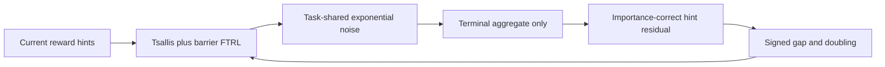
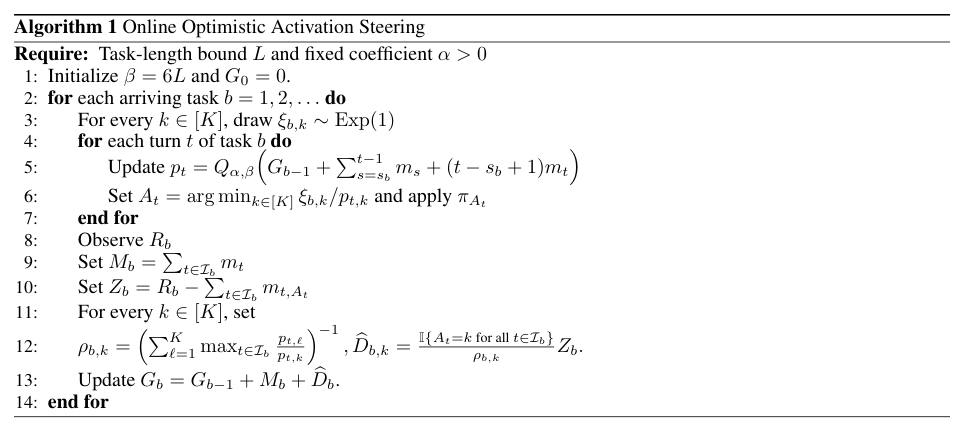

# Optimistic Online Learning for Coding Agents with Aggregate Feedback

<!-- source-sha256: 165271aa805a2ba8cd12f79d8003ac2e27e586d1d372982113c0f1c69b3243de -->

[简体中文](README.md)

> `component_only` / L1 CPU mathematical diagnostics, `diagnostic_only=true`; not agent-capability reproduction. First released2026-11-23; discovered/reviewed2026-11-24, not a Nov24 first release. Not eligible for Evolve promotion.

## Paper information

| Field | Value |
| --- | --- |
| Paper | [Fixed arXiv v1](https://arxiv.org/abs/2611.30405v1) |
| Institution | First authorHao Luan; National University of Singapore, School of Computing / Institute of Data Science |
| Original publication | 2026-11-23 10:05:39 UTC; update has the same timestamp, no separate revision |
| Announcement/discovery | Identity absent from this batch's announcement pool; announcement date unverified. Discovered/reviewed2026-11-24 |
| Author source code | No verified method-specific source release was found in fixed v1. GitHub API documentation and the referenced TACT method are not a release of this paper. |
| Local adapter/key | `adapter: null`; `ooas` |
| Local reproduction code | `src/auto_research/agent_research/ooas.py`; `tests/test_nov24_agent_components.py` |

## Original paper summary

### Background and changes

OOAS models activation-steering selection as a turn-level bandit. Each turn reveals reward hints for all candidate policies; only the selected sequence's aggregate reward arrives at task completion. The method corrects cumulative hint errors without observing individual rewards. Its theory assumes reward vectors, hints and the task partition are fixed independently of learner randomization. Stateful coding-agent trajectories do not automatically satisfy that assumption.

The distribution is not softmax: FTRL combines Tsallis and log-barrier terms. It uses completed-task scores, previous hints in the current task and the current hint weighted by elapsed turns. A task draws one Exp(1) noise vector shared across all turns and selects argmin noise/probability. The probability rho that arm k wins every turn uses maxima of probability ratios, not products of marginals. Only that event receives residual Z/rho; switched tasks have zero residual correction while every arm still receives accumulated hints. Algorithm2 doubles its threshold when a signed cumulative observable potential gap strictly exceeds it, resetting score and gap rather than clipping negative gaps.

### Architecture



### Key original figure

[](https://arxiv.org/pdf/2611.30405v1#page=5)

Original Algorithm 1 and its full caption/algorithm title from fixed-v1 PDF page5. Copyright belongs to the authors. Only unrelated text/whitespace is cropped; scientific content is unchanged and visually reviewed. [Source](https://arxiv.org/pdf/2611.30405v1#page=5) and [SHA256/crop provenance](assets/provenance.json). Not local evidence.

### Core equations

$$
\psi(p)=2\alpha(\sqrt K-\sum_k\sqrt{p_k})+\beta\sum_k\log\frac1{Kp_k},\quad \rho_{b,k}=\left(\sum_\ell\max_{t\in I_b}\frac{p_{t,\ell}}{p_{t,k}}\right)^{-1},\quad \widehat D_{b,k}=\frac{\mathbf1[A_t=k\ \forall t\in I_b]}{\rho_{b,k}}Z_b.
$$

### Reported offline and online results

With Qwen3.5-27B and mini-swe-agent, the paper reports adaptive Cap resolve rates of65.0%/34.8% on500 SWE-V and89 TB2 tasks versus62.0%/32.6% for static Cap. Adaptive Gate reaches63.0%/32.6% versus57.0%/30.3%. Only Algorithm2 is evaluated with real agents; Algorithm1's oracle prediction-error budget in simulations is not observable tuning. Hint-dependent theoretical regret and log-like simulated curves are not universal guarantees for arbitrary agent environments. No production A/B is reported.

## Local reproduction and limits

### Data protocol and code mapping

The independent standard-library CPU kernel solves FTRL's KKT equations: Gk+alpha/sqrt(pk)+beta/pk share a multiplier, found by score translation and bisection rather than a softmax substitute. It implements shared exponential sampling, rho, aggregate residuals, the potential and Algorithm2 restarts. The begin/choose/finish API receives current hints and one terminal aggregate, not turn reward vectors or gold answers/plans. Injected noise is for mathematical controls only. No LLM, activation probe, TACT intervention, code executor, real-task score or Evolve mapping runs. The float64 root solver has numerical tolerance, not infinite precision.

```bash
PYTHONPATH=src python -c 'from auto_research.agent_research.ooas import diagnostic; print(diagnostic(42))'
PYTHONPATH=src python -m pytest tests/test_nov24_agent_components.py -q
```

The shared runner records [seed42/43/44 mechanism metrics](metrics/component-cpu-seeds42-44.json) after source freeze. Synthetic mathematical controls load no capability benchmark and use no test-based tuning. Three seeds are not three model trainings and do not upgrade evidence.

### Same-topic comparison and limits

Reviewed older representative [agent-research:acting-to-learning](../2611.27159-acting-to-learning/README-en.md): From Acting to Learning selects SFT action records from fixed history pools and cold-starts students. OOAS selects steering arms during execution and corrects hints after each task. Gradient relevance is not a reward hint, and shared task noise is not replay shuffling. Both require separation of selection information from final evaluation; neither local slice compares agent capability.

Controls check KKT residuals, translation invariance, shared-noise event probabilities versus independent products, zero residual attribution after switching, elapsed-turn hint weighting, task bounds, lifecycle errors, preserved pending state after invalid aggregates, signed negative gaps and restart resets. Analytic event partitions check importance weighting; a small Monte Carlo run is not advertised as proof of unbiasedness.

### Full experiments and cost decision

The full campaign uses a27B model,589 real coding/terminal tasks, Cap/Gate multi-arm comparisons and baselines, with up to256/128 turns. Simulations span10^7-10^8 turns,50 seeds and up to512 arms. This long-rollout/multi-arm campaign exceeds the short one-A100/A30-or-Mac budget and is terminally not reproduced. No checkpoints, benchmarks, APIs or trial runs are launched. Only bounded small-K/L CPU controls run, estimated in seconds pending shared-runner timing. **Too costly; not reproduced (review DONE).** The full campaign enters no automatic retry/implementation queue. Passing CPU controls does not reproduce the complete paper.

### Source review

PDF SHA256: `7b976fa4eb802030e0fd09c0c57b171dd7fa2ee26a6ef387ab92327aa3bdec44`; fixed-v1 TeX SHA256: `3edf9ce1111d877666c445b688d024541b80b0cfd8780177b2179433f9c88ae5`. This finite incremental selection does not move the global Nov15 review watermark or claim exhaustive Google/Meta/Agent coverage.
