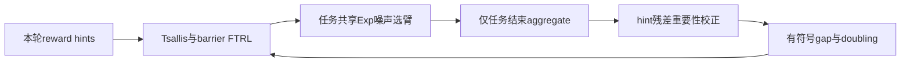
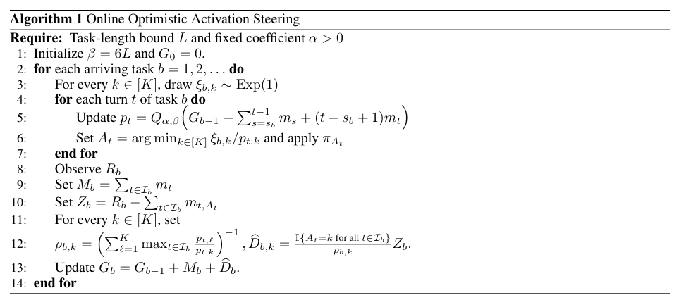

# OOAS：只看到任务总回报，也能用逐轮hint学习策略

[English](README-en.md)

> `component_only` / L1 CPU数学机制诊断，`diagnostic_only=true`；不是Agent能力复现。 2026-11-23首发、2026-11-24发现/审查，不称11月24日新首发；不接入Evolve晋级。

## 论文信息

| 字段 | 内容 |
| --- | --- |
| 论文链接 | [Optimistic Online Learning for Coding Agents with Aggregate Feedback](https://arxiv.org/abs/2611.30405v1)，本轮固定v1 |
| 公司/机构/学校 | 一作Hao Luan；National University of Singapore, School of Computing / Institute of Data Science |
| 首次公开日期 | 2026-11-23 10:05:39 UTC，arXiv v1；updated与首发相同，无另一次修订 |
| 公告/发现日期 | 本轮公告池无此身份，公告日未核实；发现/审查日2026-11-24 |
| 原作者开源代码 | 固定v1全文未找到本方法专属已核实源码；文内GitHub链接是API文档，引用TACT也不等同本篇开源。 |
| 本地 Adapter / 方法 | `adapter: null`；key `ooas` |
| 本地复现代码目录 | `src/auto_research/agent_research/ooas.py`；`tests/test_nov24_agent_components.py` |

## 原始论文总结

### 背景与主要改动

OOAS把activation steering候选选择建模为逐turn多臂bandit。每轮先见所有候选的reward hint，选一个策略；任务结束只见已选序列的加和reward，不见逐轮贡献。它不是猜哪条编辑会通过隐藏测试，而是在聚合反馈粒度下修正累计hint误差。论文理论要求reward向量、hint和任务划分预先固定、独立于学习者随机数；真实编码Agent的状态依赖轨迹不自动满足该假设。

分布不是softmax：FTRL同时使用Tsallis项和log barrier。turn t把已完成任务score、当前任务此前hint和本轮hint乘已过turn数相加，再求内点最优分布。每任务只抽一次K个Exp(1)噪声，所有turn共享，以argmin ξ/p选臂。整任务都选同一臂k的概率ρ由各turn概率比的最大值计算，不能用边缘概率相乘；只有该事件发生时才以Z/ρ修正此臂，发生切臂则残差修正全0，但所有臂仍加hint之和。Alg2用可观察potential gap的有符号累积触发严格大于阈值的doubling，重启score与gap，不把负gap裁为0。



<!-- paper-figure:start -->
### 原论文关键图

[](https://arxiv.org/pdf/2611.30405v1#page=5)

原图/算法来自[固定v1论文](https://arxiv.org/pdf/2611.30405v1#page=5)第5页Algorithm 1，完整保留图注/算法标题与内容，版权归原作者。仅裁无关正文/留白，科学内容未修改，已目视核对。[来源SHA256、裁剪坐标](assets/provenance.json)。它不是本地实验。
<!-- paper-figure:end -->

### 核心公式

$$
\psi(p)=2\alpha(\sqrt K-\sum_k\sqrt{p_k})+\beta\sum_k\log\frac1{Kp_k},\quad \rho_{b,k}=\left(\sum_\ell\max_{t\in I_b}\frac{p_{t,\ell}}{p_{t,k}}\right)^{-1},\quad \widehat D_{b,k}=\frac{\mathbf1[A_t=k\ \forall t\in I_b]}{\rho_{b,k}}Z_b.
$$

### 论文离线与线上效果

作者在Qwen3.5-27B+mini-swe-agent的SWE-V（500题）和TB2（89题）报告adaptive Cap resolve rate65.0%/34.8%，static Cap为62.0%/32.6%；Gate为63.0%/32.6%，static Gate57.0%/30.3%。真实Agent只测Alg2，不把Alg1 oracle误差预算模拟当可观测调参。理论leading regret依赖hint误差，但10^8 turn模拟中的log样式曲线不是任意Agent环境的统一保证。未报告生产线上A/B。

## 本地复现与边界

### 数据协议与代码映射

独立标准库CPU核实际解FTRL的KKT方程：Gk+α/√pk+β/pk为共同乘子，通过平移score与二分求解，而非softmax替身；实现共享Exp采样、ρ、聚合残差、potential和Alg2重启。begin→choose→finish只接受当前hint和最终aggregate，不接受turn reward向量或gold答案/计划。噪声注入只供数学控制。没有LLM、activation probe、TACT干预、代码执行器、真实任务分数或Evolve映射。数值求根是有公差的float64近似，不声称无限精度理论实现。

```bash
PYTHONPATH=src python -c 'from auto_research.agent_research.ooas import diagnostic; print(diagnostic(42))'
PYTHONPATH=src python -m pytest tests/test_nov24_agent_components.py -q
```

源码冻结后的[42/43/44三seed机制指标](metrics/component-cpu-seeds42-44.json)由统一runner生成。合成数学控制无能力benchmark、无test调参；三seed不是三次模型训练，也不提升证据层级。

### 同主题比较与边界

已读旧代表[agent-research:acting-to-learning](../2611.27159-acting-to-learning/README.md)：From Acting to Learning在固定历史池里选SFT action记录，选择后冷启动学生；OOAS在任务执行中选steering臂，并在任务结束后修正hint。前者的梯度相关性不是后者的reward预测，后者的共享noise也不是经验重放的shuffle。两者都必须分开选择信息与最终评测；本地均没有真实Agent能力比较。

负控覆盖KKT残差、分布平移不变、共享noise的整任务事件概率不等于独立概率乘积、切臂时无残差归因、每turn的hint倍率、任务长度上限、重复begin/finish拒绝、aggregate越界不丢pending状态、保留负potential gap及重启后score归零。使用分析事件分区核对importance权重，不用少量Monte Carlo冒充无偏证明。

### 完整实验与成本决定

完整Agent矩阵需27B模型、589个真实编码/终端任务、Cap/Gate多臂与baseline，最长256/128turn；完整模拟用10^7–10^8turn、50seeds、最多512臂。单A100/A30或Mac的短时预算不承担此长rollout/多臂研究，完整实验直接终态不复现，不下载checkpoint/benchmark、不调用API或探跑。仅小K/L CPU核，预估秒级，实测以统一runner为准。 **成本过高，不复现（审查 DONE）**；完整campaign不进入自动重试/实现队列。CPU组件通过不是完整论文数值复现。

### 来源核对

PDF SHA256：`7b976fa4eb802030e0fd09c0c57b171dd7fa2ee26a6ef387ab92327aa3bdec44`；固定v1 TeX SHA256：`3edf9ce1111d877666c445b688d024541b80b0cfd8780177b2179433f9c88ae5`。有限增量选题不推进全库11月15日审查水位，不宣称已穷尽Google/Meta或整个Agent领域。
