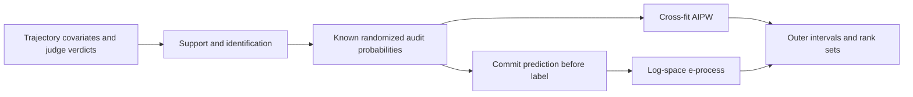
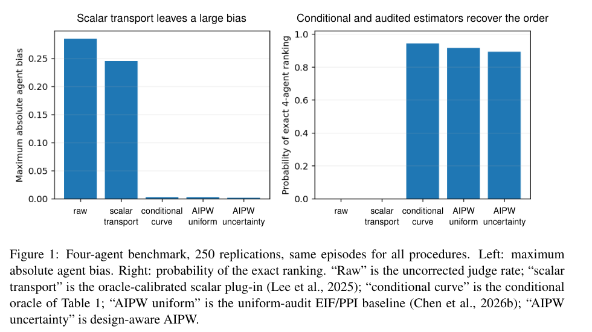

# Transport-Safe Evaluation of LLM Agents: Trajectory-Dependent Judge Error and Anytime-Valid Auditing

<!-- source-sha256: 343a0e9432618dc051092ae67801585261381d76c7485ecc399b8d5a9dff5866 -->

[简体中文](README.md)

> `component_only` / L1 CPU mathematical diagnostics, `diagnostic_only=true`; not agent-capability reproduction. First released2026-11-23; discovered/reviewed2026-11-24, not a Nov24 first release. Not eligible for Evolve promotion.

## Paper information

| Field | Value |
| --- | --- |
| Paper | [Fixed arXiv v1](https://arxiv.org/abs/2611.30742v1) |
| Institution | First authorYulliwas Ameur; Efrei Research Lab, Université Paris-Panthéon-Assas / CEDRIC, Conservatoire National des Arts et Métiers |
| Original publication | 2026-11-23 14:19:52 UTC; update has the same timestamp, no separate revision |
| Announcement/discovery | Identity absent from this batch's announcement pool; announcement date unverified. Discovered/reviewed2026-11-24 |
| Author source code | No verifiable paper-specific source repository is supplied in fixed-v1 text/TeX. Referenced statistical methods and AgentRewardBench are not a code release for this paper. |
| Local adapter/key | `adapter: null`; `transport-safe-audit` |
| Local reproduction code | `src/auto_research/agent_research/transport_safe_audit.py`; `tests/test_nov24_agent_components.py` |

## Original paper summary

### Background and changes

Agents induce different trajectory distributions. Even a judge blind to agent identity given(X,Y) may have different averaged sensitivity/specificity under those distributions. The paper connects scalar-transport bias, support/identification, randomized human auditing, anytime monitoring and rank sets; these statistical tools are not individually new. Evidence is mainly semi-synthetic. Prior public-agent analyses are not independently rerun, and no causal effect of trajectory length is established.

With known randomized audit propensities bounded away from zero, AIPW adds R/phi(Y-m) to out-of-fold imputations; unaudited rows use m only, and estimates are not clipped to[0,1]. Bounded allocation uses min(1,max(floor,lambda*sqrt(m(1-m)))) under an attainable budget. Online e-processes require past-chosen prediction/audit functions evaluated at new V, without using the current label. The target must be frozen and stable across independently drawn tasks. Missing support produces outer sets rather than invented point estimates, and ranks use strict interval separation rather than midpoint ordering.

### Architecture



### Key original figure

[](https://arxiv.org/pdf/2611.30742v1#page=6)

Original Figure 1 and its full caption/algorithm title from fixed-v1 PDF page6. Copyright belongs to the authors. Only unrelated text/whitespace is cropped; scientific content is unchanged and visually reviewed. [Source](https://arxiv.org/pdf/2611.30742v1#page=6) and [SHA256/crop provenance](assets/provenance.json). Not local evidence.

### Core equations

$$
\widehat\theta=\frac1n\sum_i\left[\widehat m_{-k(i)}(V_i)+\frac{R_i}{\varphi_i}(Y_i-\widehat m_{-k(i)}(V_i))\right],\quad E_t(\theta)=\frac1{2|\Lambda|}\sum_{\lambda\in\Lambda}\left[\prod_{i\le t}(1+\lambda W_i(\theta))+\prod_{i\le t}(1-\lambda W_i(\theta))\right].
$$

### Reported offline and online results

In the four-agent semi-synthetic study, oracle-calibrated scalar correction has maximum bias.245, mean pointwise coverage.016 and exact ranking recovery0/250. Uniform/design-aware audit AIPW has maximum bias below.003 and coverage.939/.950. Across200 stable simulated streams inspected after each episode, joint coverage is.535 for repeated Wald intervals and.995 for the confidence sequence, which is wider. These are simulation frequencies, not new agent capability or production A/B. Human labels are a reference, not proven error-free truth. No production A/B is reported.

## Local reproduction and limits

### Data protocol and code mapping

The evaluator-side standard-library slice implements scalar bias, AIPW with declared fold provenance, finite-stratum bounded allocation, support outer sets, strict interval rank sets and a log-space hedged e-process. Plan commits m/phi before drawing an audit; observe accepts binary labels only for audited rows and requires None otherwise. Every episode updates. Changed targets, nonfrozen/nonindependent task declarations and lambda not strictly below the positivity floor are rejected. Inversion is only on a predeclared finite theta grid: accepted_grid is not continuous CS endpoints or coverage for off-grid truth. No nuisance fitting, human collection, LLM judge, three-judge latent model, cluster bootstrap or live leaderboard runs. Timing/fold declarations are external statistical contracts, not adversarial information-flow security proofs.

```bash
PYTHONPATH=src python -c 'from auto_research.agent_research.transport_safe_audit import diagnostic; print(diagnostic(42))'
PYTHONPATH=src python -m pytest tests/test_nov24_agent_components.py -q
```

The shared runner records [seed42/43/44 mechanism metrics](metrics/component-cpu-seeds42-44.json) after source freeze. Synthetic mathematical controls load no capability benchmark and use no test-based tuning. Three seeds are not three model trainings and do not upgrade evidence.

### Same-topic comparison and limits

Reviewed older representative [agent-research:coevobench](../2611.27116-coevobench/README-en.md): CoEvoBench protects Selection/Test material and audits training lineage, addressing prohibited access and generalization. This paper asks whether judge errors transport across trajectory distributions even when access isolation is correct. Neither substitutes for the other: no leakage does not ensure calibration, and AIPW cannot undo gold contamination of an evaluated agent. There are no local live-judge results to compare with CoEvoBench.

Exact enumeration of a small Bernoulli audit design checks unbiasedness despite wrong imputation. Controls cover unclipped estimates above1, own-fold rejection, allocation/positivity/zero-variance strata, agreement with direct products, log-space long-stream stability, rejection of unaudited labels and changed targets, and unresolved overlapping/touching intervals. Three seeds are mathematical controls, not an empirical estimate of95% coverage.

### Full experiments and cost decision

This is CPU statistical research, not a study that necessarily requires GPUs. The full allocation campaign reaches500 replications by500000 episodes(about250 million episode records), plus250 four-agent replications,48-cell stress tests,200 by3000-step monitoring streams and1000 rank experiments. Some target sizes/executable scripts are not supplied, so full reproduction cost cannot be cheaply established from metadata. The cost gate closes the full campaign without a costly probe; only bounded small-array/exact-design controls execute. No live-judge, human-labeling or GPU cost is measured or invented. **Too costly; not reproduced (review DONE).** The full campaign enters no automatic retry/implementation queue. Passing CPU controls does not reproduce the complete paper.

### Source review

PDF SHA256: `6798d8f34473451811adce548d42dac5a3f0509649f8c561d0d6b7cc7ee29ab2`; fixed-v1 TeX SHA256: `a1bbc77383e0d63164d955dc3bd3c7e11c0486534b9f96188f41397470b6f116`. This finite incremental selection does not move the global Nov15 review watermark or claim exhaustive Google/Meta/Agent coverage.
