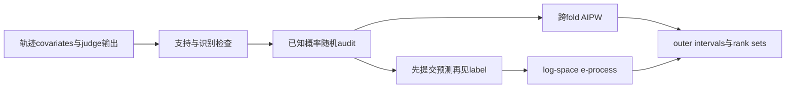
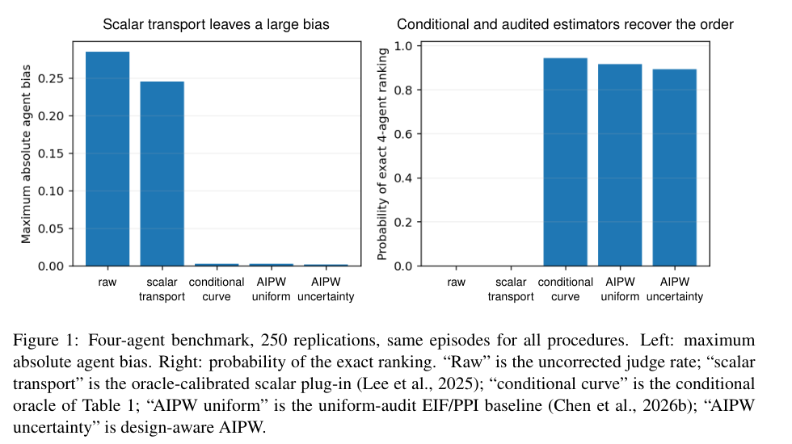

# Transport-safe audit：校准过的LLM裁判也未必能跨Agent搬用

[English](README-en.md)

> `component_only` / L1 CPU数学机制诊断，`diagnostic_only=true`；不是Agent能力复现。 2026-11-23首发、2026-11-24发现/审查，不称11月24日新首发；不接入Evolve晋级。

## 论文信息

| 字段 | 内容 |
| --- | --- |
| 论文链接 | [Transport-Safe Evaluation of LLM Agents: Trajectory-Dependent Judge Error and Anytime-Valid Auditing](https://arxiv.org/abs/2611.30742v1)，本轮固定v1 |
| 公司/机构/学校 | 一作Yulliwas Ameur；Efrei Research Lab, Université Paris-Panthéon-Assas / CEDRIC, Conservatoire National des Arts et Métiers |
| 首次公开日期 | 2026-11-23 14:19:52 UTC，arXiv v1；updated与首发相同，无另一次修订 |
| 公告/发现日期 | 本轮公告池无此身份，公告日未核实；发现/审查日2026-11-24 |
| 原作者开源代码 | 固定v1官方TeX与正文未给出可核实的本篇专属公开源码仓库，未找到/未核实；引用统计方法或AgentRewardBench不是本篇代码发布。 |
| 本地 Adapter / 方法 | `adapter: null`；key `transport-safe-audit` |
| 本地复现代码目录 | `src/auto_research/agent_research/transport_safe_audit.py`；`tests/test_nov24_agent_components.py` |

## 原始论文总结

### 背景与主要改动

不同Agent产生不同轨迹；即使裁判在给定(X,Y)时看不到Agent身份，其sensitivity/specificity的平均值也会随成功/失败轨迹分布改变。论文连接scalar transport偏差、支持与识别、随机人工audit、anytime monitoring和rank sets；这些统计工具本身不是新发明。主要证据是semi-synthetic，公共Agent数据的既有分析未在本文独立重跑，不据此声称轨迹长度有因果作用。

已知随机audit概率φ有正下界时，AIPW用out-of-fold预测m加R/φ(Y−m)修正；未audit样本只用m，估计值不强裁[0,1]。bounded allocation令φ=min(1,max(φmin,λ√m(1−m)))满足可达预算。在线e-process要求预测函数和audit规则由过去选定、新V到达后求值，当前label不能反过来改它们；目标必须固定且逐任务独立稳定。支持缺失时给outer set而不补造点估计，rank只用严格区间分离而非中点硬排。



<!-- paper-figure:start -->
### 原论文关键图

[](https://arxiv.org/pdf/2611.30742v1#page=6)

原图/算法来自[固定v1论文](https://arxiv.org/pdf/2611.30742v1#page=6)第6页Figure 1，完整保留图注/算法标题与内容，版权归原作者。仅裁无关正文/留白，科学内容未修改，已目视核对。[来源SHA256、裁剪坐标](assets/provenance.json)。它不是本地实验。
<!-- paper-figure:end -->

### 核心公式

$$
\widehat\theta=\frac1n\sum_i\left[\widehat m_{-k(i)}(V_i)+\frac{R_i}{\varphi_i}(Y_i-\widehat m_{-k(i)}(V_i))\right],\quad E_t(\theta)=\frac1{2|\Lambda|}\sum_{\lambda\in\Lambda}\left[\prod_{i\le t}(1+\lambda W_i(\theta))+\prod_{i\le t}(1-\lambda W_i(\theta))\right].
$$

### 论文离线与线上效果

四Agent semi-synthetic主实验中，scalar oracle calibration最大偏差0.245、mean pointwise coverage0.016、完整排名恢复0/250；uniform/design-aware audit AIPW最大偏差<0.003，coverage0.939/0.950。200条稳定模拟stream逐episode反复查看，Wald共同coverage0.535、confidence sequence0.995，后者更宽。它们是模拟覆盖频率，不是新Agent能力或生产线上A/B；真人label被视为参考，不代表无噪声真理。未报告生产线上A/B。

## 本地复现与边界

### 数据协议与代码映射

本地是evaluator侧标准库算术：scalar transport偏差、带显式fold声明的AIPW、finite-strata bounded allocation、支持缺失outer set、严格区间rank sets和log-space hedged e-process。plan先提交m与φ再随机决定audit；observe只收已audit的0/1，未audit必须None，并逐episode更新。拒绝换target、未冻结/非独立任务声明和λ不严格小于φmin。仅对预先固定有限θ网格反演，accepted_grid不是连续CS端点，真值不在网格时没有网格覆盖说法。没有nuisance拟合、真人采集、LLM裁判、三judge潜变量模型、cluster bootstrap或live leaderboard；时序/fold声明是外部统计契约，不是恶意调用方不可绕过的安全证明。

```bash
PYTHONPATH=src python -c 'from auto_research.agent_research.transport_safe_audit import diagnostic; print(diagnostic(42))'
PYTHONPATH=src python -m pytest tests/test_nov24_agent_components.py -q
```

源码冻结后的[42/43/44三seed机制指标](metrics/component-cpu-seeds42-44.json)由统一runner生成。合成数学控制无能力benchmark、无test调参；三seed不是三次模型训练，也不提升证据层级。

### 同主题比较与边界

已读旧代表[agent-research:coevobench](../2611.27116-coevobench/README.md)：CoEvoBench保护Selection/Test内容并审计训练血缘，回答候选是否越界及能否泛化；本篇问即使访问隔离正确，LLM judge误差是否能跨轨迹分布transport。二者不能替代：无数据泄漏不等于judge已校准，AIPW也不能消除被评Agent读了gold造成的污染。CoEvo完整系统本地未跑，本篇也没有live judge结果可横比。

精确枚举小型Bernoulli audit设计，验证错误imputation仍design-unbiased；检查AIPW可超1而不裁剪、同fold训练拒绝、预算/positivity/零方差stratum、log-space与直接乘积相同、长stream不溢出、未audit真值拒绝、未知target拒绝、重叠/恰接区间不硬定序。三seed只是数学控制，不是coverage达到0.95的经验估计。

### 完整实验与成本决定

论文是CPU统计研究，不能伪称必须GPU。完整allocation研究最多500次重复×500000 episodes（约2.5亿episode级记录），另有250次四Agent、48cell、200×3000step anytime与1000次rank实验；部分target样本量/可执行脚本未给，完整重做总成本无法仅凭元数据廉价核定。按成本门禁不为证明费用启动整套试跑，完整campaign本轮终态不复现；保留秒级小数组/精确设计枚举。无live LLM judge、人类标注费或GPU小时实测，也不补造这些费用。 **成本过高，不复现（审查 DONE）**；完整campaign不进入自动重试/实现队列。CPU组件通过不是完整论文数值复现。

### 来源核对

PDF SHA256：`6798d8f34473451811adce548d42dac5a3f0509649f8c561d0d6b7cc7ee29ab2`；固定v1 TeX SHA256：`a1bbc77383e0d63164d955dc3bd3c7e11c0486534b9f96188f41397470b6f116`。有限增量选题不推进全库11月15日审查水位，不宣称已穷尽Google/Meta或整个Agent领域。
