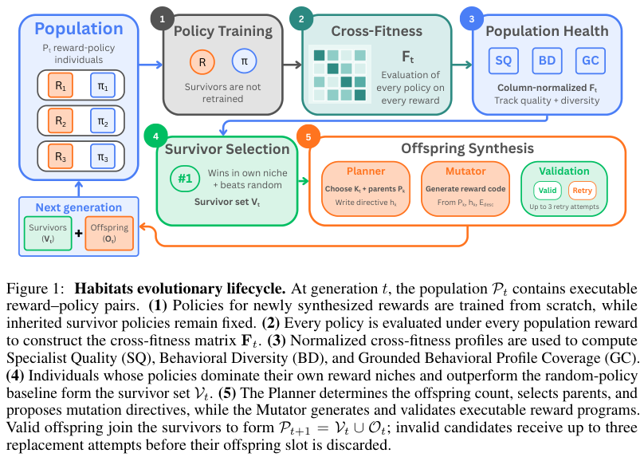

# Habitats: evolving objectives rather than optimizing only a fixed reward

<!-- source-sha256: d3029c119998c3a522fce34094f94c0bb660fbe723c9d0db76f8aba646e541ae -->

[简体中文](README.md)

> `component_only`, L1 CPU cross-fitness and selection mathematics. Not complete Habitats, an LLM Planner/Mutator, or agent/RSI capability. The full campaign is **not reproduced for high cost, review DONE**, with no automatic retry or Evolve promotion.

## Paper information

| Field | Content |
| --- | --- |
| Paper | [Habitats: A Framework for Open-Ended Evolution of Agent Objectives](https://arxiv.org/abs/2611.31160v1), fixed v1; [OpenReview citation](https://openreview.net/forum?id=NbzAfPbkxU) |
| Institutions | Nicolas Bolouri, Gaya Mehenni and Daniel Toyama: Google DeepMind, Montréal, Canada, verified on PDF page 1; do not infer affiliation from an email domain |
| Original publication | Verified arXiv release: 2026-11-23 18:23:16 UTC. OpenReview API/PDF return 403 and its forum only a verification page; any earlier OpenReview release date remains unresolved |
| Announcement/discovery | Official cs.AI new announcement: 2026-11-24; already present in the November 25 pool. Cataloged on 2026-11-28 following the new author citation, not a today's-first-release claim |
| Author code | [google-deepmind/habitats](https://github.com/google-deepmind/habitats), Apache-2.0; pinned [e25a5de](https://github.com/google-deepmind/habitats/commit/e25a5de85d5d58d892e874efaf410faa8434c804). Its 2026-11-27 21:59:02 UTC commit adds 15 README citation lines, not a new algorithm |
| Local adapter/key | `adapter: null`; `habitats`; `auto_research.agent_research.habitats.diagnostic` |
| Local code | `src/auto_research/agent_research/habitats.py`; `tests/test_nov28_habitats_components.py` |

## Original method

### Motivation and changes

Habitats evolves executable rewards paired with trained policies. Population-wide cross-evaluation grounds diversity in learned behavior. A Planner selects parents and mutation directives; a separate Mutator produces validated reward programs. New policies train from scratch, while survivors remain frozen. Different reward code need not induce different behavior.


<!-- paper-figure:start -->
### Original figure

[](https://arxiv.org/pdf/2611.31160v1#page=4)

Original image from the [paper](https://arxiv.org/pdf/2611.31160v1#page=4), page 4, Figure 1. Copyright belongs to the original authors, CC BY 4.0. The complete figure and caption are retained; only unrelated prose/whitespace is cropped, with visual review. [Provenance](assets/provenance.json). Local implementation covers only mathematical evaluation/selection, not this full loop. 图片来自原论文，版权归原作者所有。
<!-- paper-figure:end -->

### Equations

F[i,j] averages completed-episode, undiscounted cumulative returns from policy i under reward j. Appendix C defines policy-only column min-max normalization, with epsilon=1e-8:

$$
\widetilde F[i,j]=\frac{F[i,j]-\min_kF[k,j]}{\max_kF[k,j]-\min_kF[k,j]+\epsilon},\qquad
survive_i=[F[i,i]=\max_kF[k,i]]\land[F[i,i]>\mu_i^{rand}].
$$

$$
SQ=\frac1N\sum_i\widetilde F[i,i],\qquad
BD=\frac{2}{M(M-1)}\sum_{i<j}\left(1-\frac{f_i\cdot f_j}{\|f_i\|\|f_j\|+\epsilon}\right).
$$

Here $f_i=\widetilde F[i,:]$ is a normalized policy-row profile, and $M$ is the number of rows remaining after excluding zero-norm profiles. Survival allows tied raw-column maxima but requires strictly beating the random mean. BD is zero when $M<2$. Grounding requires valid reward execution and $(F[i,i]-\mu_i^{rand})/(\sigma_i^{rand}+\epsilon)>0.5$. GC deduplicates grounded normalized profiles rounded to one decimal within each generation; GC-AUC sums generation counts. Grounding does not require niche dominance and must not be conflated with survival.

### Reported results

Final macro SQ is 0.8533/0.8222/0.7471 and BD 0.3825/0.2180/0.1552 for Habitats/Direct Mutation/Independent. Habitats is not best on every environment/metric. Its downstream win rate at 10,000 adaptation episodes is 0.617±0.058 against 20,000-episode Scratch (mean±standard deviation across three seeds, Appendix H), excluding library-evolution cost. No production A/B is reported. These are author results, not local measurements.

## Local scope

### Protocol and mapping

The module consumes explicit N×N×E completed-episode returns or an aggregated matrix. It executes averaging, paper normalization, survivor selection and SQ/BD/GC. It does not generate returns, train policies, call an LLM or evaluate an agent; no gold answer is supplied to a learner. Callers of a future real environment evaluator remain responsible for per-episode reward resets and rollout isolation. This module supplies no untrusted-code sandbox.

```bash
PYTHONPATH=src python -c 'from auto_research.agent_research.habitats import diagnostic; print(diagnostic(42))'
PYTHONPATH=src python -m pytest tests/test_nov28_habitats_components.py -q
```

### Controls and limits

Independent references cover constant columns, strict random comparisons, tied maxima, zero profiles, the strict grounding threshold, invalid rewards, quantization and per-generation accumulation. Invalid shapes, NaN/Inf, mixed booleans, negative deviations, devices and seeds reject. Stable norms preserve tiny nonzero profiles. Copies/read-only outputs are not process isolation.

Paired positive/negative rollout perturbations cancel around the same diagnostic matrix. Three seeds replay mathematical controls, not independent capability comparisons. A constant population can have SQ=0 yet GC=1 when its valid rewards beat random. Tests do not establish behavioral discovery, downstream gains, RL or full reproduction.

The actual CPU run at frozen source `7d69c2c8116a03135d29548260b61f3d68493b69` passed seeds 42/43/44 in approximately **0.0596s** total. [Formal component results](metrics/component-cpu-seeds42-44.json) and the [raw run record](../../research-audits/nov28-latest/raw-cpu.json) retain per-seed checks and source fingerprints. This measures only the small-matrix mathematics kernel, not complete Habitats, real RL/agent execution or the paper's experimental campaign.

### Paper versus author source

Pinned `habitats/lib/metrics.py` includes the random row in min/max, maps constants to one and rounds to four decimals; its BD unit-normalizes then clips without the paper denominator epsilon. Local formulas intentionally follow fixed Appendix C, not bitwise source compatibility. These conventions are not interchangeable.

### Same-topic comparison

Reviewed peer [AlphaEvolve](../2506.13131-alphaevolve/README.md) belongs to `harness-and-self-improvement`. AlphaEvolve evolves programs under a human-fixed evaluation contract; Habitats keeps dynamics fixed but evolves rewards and compares trained-policy profiles. Textual diversity is not functional diversity. AlphaEvolve is review-only here and Habitats mathematics-only, with no comparable discovery success rates or executable Evolve integration.

### Full-experiment cost decision

The configuration uses 20,000 episodes per new card policy, with training horizon 500, and 100,000 environment steps per continuous PPO policy. Cross-evaluation uses ten rollouts per policy-reward pair, with horizons 100 for cards and 1,000 for continuous control. Card runs have 15 generations and three initial individuals; continuous runs have six generations and four initial individuals. Population sizes change endogenously. Default Gemini 3.5 Flash and 3.8 Flash/4 Argon ablations add external calls, as do validation replacements and API retries.

Appendix E reports roughly one hour per Q-learning experiment on 8 CPUs/32GB and two hours per PPO experiment on H100, not local measurements or total campaign runtime. Four environments×three methods×three seeds, horizon/backbone ablations, ten downstream tasks×five budgets and quadratic cross-evaluation exceed the bounded single-A100/A30-or-Mac scope; the exact total is unreported and no exact cost is invented.

**Not reproduced for high cost, review DONE**: `not_reproduced_high_cost`, `full_experiment_review_done=true`. No paid API training, model/data downloads, costly probes, automatic retries or implementation queue. CPU-only mathematics requires no GPU receipt.

### Sources

Fixed PDF SHA256: `d508f7db9dbdf8dfeb4e159826419f56bef345bb100e124f85e9648c84d94a59`. Method Sections 3/C, experiments 4–5/G–H, costs E. The new citation links OpenReview, whose publication/version remains unresolved; readable fixed arXiv v1 independently supports this entry. Historical Google identity completion does not advance the overall review watermark.
