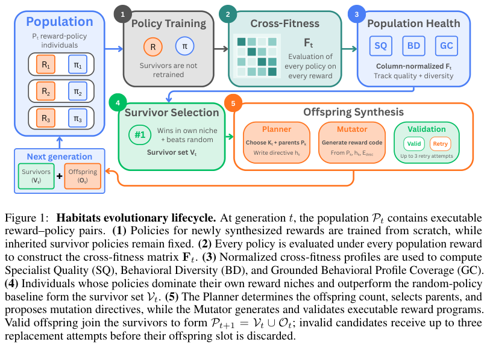

# Habitats：让目标本身进化，而不是只优化固定奖励

[English](README-en.md)

> `component_only` / L1 CPU 交叉适应度与选择数学核；不是完整 Habitats、LLM Planner/Mutator 或 Agent/RSI 能力复现。完整实验**成本过高，不复现（审查 DONE）**，不自动重试、不晋级 Evolve。

## 论文信息

| 字段 | 内容 |
| --- | --- |
| 论文链接 | [Habitats: A Framework for Open-Ended Evolution of Agent Objectives](https://arxiv.org/abs/2611.31160v1)，固定 v1；[OpenReview 引用入口](https://openreview.net/forum?id=NbzAfPbkxU) |
| 公司/机构/学校 | Nicolas Bolouri、Gaya Mehenni、Daniel Toyama 均署名 Google DeepMind，Montréal, Canada；按固定 PDF 第1页，不从邮箱反推一作机构 |
| 首次公开日期 | 可核 arXiv 首发：2026-11-23 18:23:16 UTC；OpenReview API/PDF 返回403、forum仅验证页面，其更早公开时间未核，不能把 arXiv 日期断言为所有渠道最早日期 |
| 公告/发现日期 | 官方 cs.AI new 公告2026-11-24；11月25日池已有该身份。本轮2026-11-28因作者仓库新增 citation 关联补录，不是今日首发 |
| 原作者开源代码 | [google-deepmind/habitats](https://github.com/google-deepmind/habitats)，Apache-2.0；固定 [e25a5de](https://github.com/google-deepmind/habitats/commit/e25a5de85d5d58d892e874efaf410faa8434c804)，2026-11-27 21:59:02 UTC仅新增README引用15行，不是算法新版本 |
| 本地 Adapter / 方法 | `adapter: null`；key `habitats`；`auto_research.agent_research.habitats.diagnostic` |
| 本地复现代码目录 | `src/auto_research/agent_research/habitats.py`；`tests/test_nov28_habitats_components.py` |

## 原始论文总结

### 背景与主要改动

固定任务通常先由人定义奖励，再训练策略。Habitats同时维护奖励程序与其训练策略，让奖励目标本身成为进化对象。种群内每个策略在每个奖励下交叉评估，观察学会程度、迁移与行为差异；Planner根据种群健康选父代与变异指令，Mutator将指令实现为可执行奖励。仅新奖励对应的策略从头训练，存活策略冻结保留。奖励代码不同不等于学到的行为不同。


<!-- paper-figure:start -->
### 原论文关键图

[](https://arxiv.org/pdf/2611.31160v1#page=4)

图片来自[原论文](https://arxiv.org/pdf/2611.31160v1#page=4)第4页Figure 1，版权归原作者所有（CC BY 4.0）。保留完整原图和图注，仅裁无关正文/留白，已目视核对；[来源指纹与坐标](assets/provenance.json)。本地只覆盖其中的数学评价/选择，不覆盖图中完整闭环。
<!-- paper-figure:end -->

### 核心公式

设 $F[i,j]$ 为策略 $i$ 在奖励 $j$ 下多条完整episode的非折扣累计回报均值。论文C.2仅在种群策略行内逐列归一化，$\epsilon=10^{-8}$：

$$
\widetilde F[i,j]=\frac{F[i,j]-\min_kF[k,j]}{\max_kF[k,j]-\min_kF[k,j]+\epsilon},\qquad
survive_i=[F[i,i]=\max_kF[k,i]]\land[F[i,i]>\mu_i^{rand}].
$$

$$
SQ=\frac1N\sum_i\widetilde F[i,i],\qquad
BD=\frac{2}{M(M-1)}\sum_{i<j}\left(1-\frac{f_i\cdot f_j}{\|f_i\|\|f_j\|+\epsilon}\right).
$$

这里 $f_i=\widetilde F[i,:]$ 是归一化后的策略行profile，$M$ 为排除零范数profile后的行数；$M<2$ 时BD为0。Grounded要求奖励有效执行且 $(F[i,i]-\mu_i^{rand})/(\sigma_i^{rand}+\epsilon)>0.5$；GC在本代grounded profile逐坐标round至1位小数后去重，GC-AUC为各代GC之和。Grounded不要求niche胜出，不能和survivor混用。

### 论文离线与线上效果

四环境、三方法、三seed的最终宏平均SQ：Habitats 0.8533、Direct Mutation 0.8222、Independent 0.7471；最终BD分别0.3825、0.2180、0.1552。Habitats并非每个环境/每个指标最优。十个预先固定、未用于进化的Card下游任务，在10,000适应episode时，对20,000-episode Scratch的paired win rate为0.617±0.058（跨三seed的均值±标准差，附录H）；该比较**不计构建策略库的进化成本**。未报告生产线上A/B；以上均为论文结果，不是本地测量。

## 本地复现与边界

### 数据协议与代码映射

本地接受显式的 `N×N×E` episode-return数组或已聚合F，真实执行均值、论文归一化、生存选择和SQ/BD/GC。它不生成回报、训练策略或调用LLM，也没有把固定奖励/金答案交给被评估Agent；本轮根本没有被评估Agent。需要真实环境的调用方负责奖励状态按episode reset与rollout隔离，本模块不提供恶意代码隔离或安全沙箱。

```bash
PYTHONPATH=src python -c 'from auto_research.agent_research.habitats import diagnostic; print(diagnostic(42))'
PYTHONPATH=src python -m pytest tests/test_nov28_habitats_components.py -q
```

### 结果、负控与边界

独立参考公式核均值、常数列、随机基线严格比较、最高分并列、零profile、grounding严格阈值、无效奖励、量化去重与按代累加。负控包括shape、NaN/Inf、混合bool、负标准差、非CPU与seed边界；极小非零profile用稳定范数，不能因平方下溢误排。输入复制且输出归一化数组只读，**不是进程安全隔离**。

诊断的两个rollout以正负小扰动抵消来核公式；不同seed仍围绕同一控制矩阵，不是独立Agent能力比较。常数列的SQ可为0，但有效奖励仍可能grounded，重复零profile的GC可为1。不得把指标可计算、重复三seed或测试通过说成行为发现、下游提升、真实RL或完整复现。

冻结源码 `7d69c2c8116a03135d29548260b61f3d68493b69` 的CPU三seed（42/43/44）实际运行通过，合计实测约 **0.0596s**；[正式组件结果](metrics/component-cpu-seeds42-44.json)与[原始运行记录](../../research-audits/nov28-latest/raw-cpu.json)保留逐seed检查和源码指纹。该时间仅对应小矩阵数学核，不是完整Habitats、真实RL/Agent或论文实验矩阵的运行时间。

### 论文与作者源码的区别

固定作者源码 `habitats/lib/metrics.py` 的 `normalize_by_columns` 将随机策略也计入列min/max，常数列映为1，结果round4；论文C.2排除random、常数列0、保留epsilon。源码BD先单位化再clip，没有论文分母epsilon。本地**有意按固定论文公式**，不是该commit的逐位兼容实现，不把两种口径混成相同指标。

### 同主题比较与边界

已实读[AlphaEvolve](../2506.13131-alphaevolve/README.md)，同属 `harness-and-self-improvement`。AlphaEvolve在人给定评价合同下进化程序；Habitats固定环境动力学，却进化奖励目标，并用训练策略的交叉profile判断行为区别。两者都依赖实际执行评价，代码文本多样性不是功能多样性。本库AlphaEvolve仅高成本审查，本篇仅数学核，无可比较的Agent发现成功率；不能把这个数值函数注册成可执行进化操作就称Evolve集成。

### 完整实验与成本决定

正文/附录E：Card每新策略20,000 episode、训练horizon500；MuJoCo每新策略100,000环境步，PPO；每策略-奖励10条评估rollout，horizon分别100/1,000。Card15代初始3个体，连续环境6代初始4个体，种群随进化变化。默认Gemini 3.5 Flash，另3.8 Flash/4 Argon消融，验证替换及API重试进一步增加调用。

作者报告一次Q-learning实验约1h（8CPU/32GB），一次PPO实验约2h（H100），不是本地实测，也不是全矩阵总时间。四环境×三方法×三seed，加长代数/模型消融、十下游任务×五预算及二次交叉评估，超出单A100/A30或本地Mac的本轮短时预算；总成本未给，不编造精确花费。**成本过高，不复现（审查 DONE）**：`not_reproduced_high_cost`、`full_experiment_review_done=true`。无API训练/模型或数据下载、无试跑高成本探针、无自动重试/实施队列；CPU数学核不需要GPU凭据。

### 来源核对

固定PDF SHA256：`d508f7db9dbdf8dfeb4e159826419f56bef345bb100e124f85e9648c84d94a59`。公式§3/C、实验§4–5/G–H、成本E。OpenReview身份关联来自作者新citation，官方日期/版本仍source-unresolved；本篇方法/日期独立依据可读arXiv固定v1。此次是Google历史身份补录，不推进全库审查水位。
