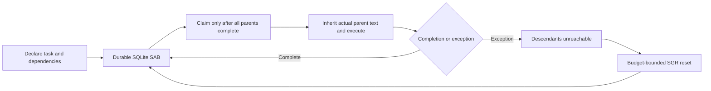
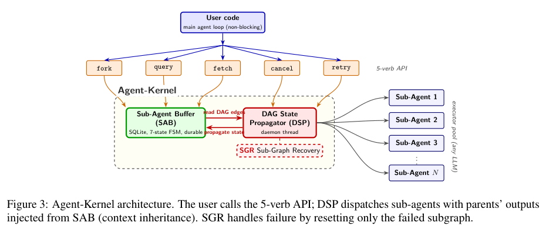

# Agent-Kernel: retry the failed subgraph without discarding completed siblings

<!-- source-sha256: 591608992b3551fbedb187b6125bf2008c08e1ec03b005f54e79c42fb5974ceb -->

[简体中文](README.md)

> `component_only` / L1 CPU orchestration diagnostic, `diagnostic_only=true`, not an LLM-agent capability reproduction. First published November 24; discovered/reviewed November 25, 2026. No Evolve promotion.

## Paper information

| Field | Content |
| --- | --- |
| Paper | [fork() for Agents: Agent Kernel for Non-blocking LLM Orchestration](https://arxiv.org/abs/2611.31727v1), fixed v1 |
| Authors / institution | Ankit Chadha and Pratyay Banerjee; Amazon, AGI / Sunnyvale, USA, PDF p.1 |
| Original publication | November 24, 2026, 00:33:20 UTC; v1, updated at the same timestamp |
| Announcement / discovery | Identity absent from this announcement pool; announcement date unverified. Discovered/reviewed November 25 |
| Original source code | No verifiable paper-specific author repository found in fixed-v1 text, Appendix G or bounded search. Cited LangGraph/LlamaIndex repositories are not this release |
| Local adapter / key | `adapter: null`; `agent-kernel` |
| Local code | `src/auto_research/agent_research/agent_kernel.py`; `tests/test_nov25_agent_components.py` |

## Original paper

### Background and method

Sub-Graph Recovery (SGR) adapts established dependency-sensitive recovery to the LLM content plane; it does not invent selective recovery. An exception marks downstream nodes unreachable while independent siblings can finish. Retrying resets the failed node and its unreachable descendants. SQLite SAB stores state and output text; DSP dispatches a child only after every parent completes, inserting actual parent outputs in declared order. The five verbs are fork, retry, cancel, query and fetch. Here fork creates a DAG task, not an OS process clone.



<!-- paper-figure:start -->
### Original figure

[](https://arxiv.org/pdf/2611.31727v1#page=13)

图片来自[原论文](https://arxiv.org/pdf/2611.31727v1#page=13)，版权归原作者所有。Figure 3 on PDF p.13; the complete diagram and caption were visually inspected. Only unrelated text/whitespace was cropped; [provenance](assets/provenance.json). This is not a local experiment.
<!-- paper-figure:end -->

### Core invariant

For failed node $f$, let $F=\{f\}\cup\operatorname{Desc}(f)$ and $C=V\setminus F$:

$$
\forall c\in C:\quad (state_c,outputs_c)_{after\ retry}=(state_c,outputs_c)_{before\ retry}.
$$

Retry requires a failed node and resets only unreachable descendants. Dispatch requires all parents complete. The invariant covers SAB records, not exactly-once external effects: a payment followed by an exception can be repeated. Prompt-mutation in Appendices H/Q is a preliminary extension, not the shipped core recovery loop.

### Reported results

The authors report 14,434 runs. In the controlled failure slice, SGR, per-step retry B3 and adapted Sherlock-generous all recover 100%, versus 55% for whole-trajectory replay. The differentiator is largely latency, not exclusive recovery ability. On the real-inference K=8/L=8 grid, their times are 21, 135 and 149 seconds. Failures are predefined first-attempt exceptions. AsyncLM-style recovery violates dependencies. Framework-strategy reimplementations and real-binary integration tests are distinguished in the paper. These are author results, not local measurements; no production online A/B is reported.

## Local component and limits

### Interface and data protocol

Standard-library SQLite/WAL implements the seven-state SAB, five verbs, transactional claims, failure/cancel cascades, SGR and actual predecessor-text inheritance. `fork` does not wait for execution; `run` is a bounded thread-pool driver that callers may put on a background thread, not a distributed daemon service. An executor receives `Claim` task, role, prompt and parent outputs, never reference answers/plans. Injected exceptions test retry scope only.

Explicit single-scheduler ownership handover uses `recover_running=True`: reopening requeues running nodes and increments their generation, rejecting late completions from old claims. This is not a distributed lease or multi-owner fault-tolerance proof. A character admission cap rejects oversized raw context without truncating parent output; model-token budgeting, retrieval/summarization and prompt mutation are not reproduced. SQL transactions do not protect external files, network calls or payments.

```bash
PYTHONPATH=src python -c 'from auto_research.agent_research.agent_kernel import diagnostic; print(diagnostic(42))'
PYTHONPATH=src python -m pytest tests/test_nov25_agent_components.py -q
```

### Results and negative controls

[CPU diagnostics, seeds 42/43/44](metrics/component-cpu-seeds42-44.json): four nodes complete in five executor calls; siblings b/c execute once each; the join sees actual A/B/C outputs in order; reopening preserves all four completed nodes. This is a small-DAG control, not a capability or latency benchmark.

Tests also check unique concurrent claims, withholding a join while another parent remains failed, stale/duplicate completion rejection, cancellation, missing/self dependencies and context admission. A deliberate exception after an external mutation produces two mutations over two attempts: the negative control demonstrates the absence of exactly-once effects. No LLM, real tool service, tau-bench/Gaia2 or formal multi-seed capability comparison runs.

### Same-topic comparison

The complete [RuntimeTickets write-up](../2611.03772-runtime-tickets/README.md) was reviewed after confirming its membership in `tools-and-collaboration`. RuntimeTickets freezes permissions/obligations before effects and avoids automatic resend after callback uncertainty. SGR preserves content-DAG dependencies and sibling records while reexecuting failed nodes. The layers can compose, but successful retry is not authorization and state preservation is not network exactly-once. Neither local kernel establishes agent security/capability performance.

### Full-campaign cost decision

The full campaign uses Sonnet 4.5 APIs plus Haiku/Opus, 14,434 runs, widths up to K=32, deep DAGs, external benchmarks and framework comparisons. Proposed future Qwen LoRA is not an evaluated open-backbone result. This long-rollout, multi-arm API campaign exceeds the short one-A100/A30-or-Mac scope: **成本过高，不复现（审查 DONE）** / high cost, not reproduced, review DONE. No paid APIs, model/benchmark downloads, automatic retries or Evolve integration. CPU controls do not reproduce the reported speedups.

### Sources

Fixed-v1 PDF SHA256: `9a3b12274394c82f3d7d805396184e3fe060dee279d29f9cb48f5312c2e53ded`. Method: §3 and Appendices G/H/J/Q; results: Table 3 and Appendices B/M/N. This finite intake does not claim exhaustive Google/Meta or agent-literature coverage.
