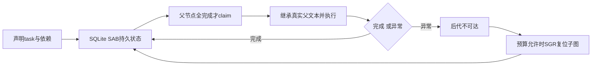
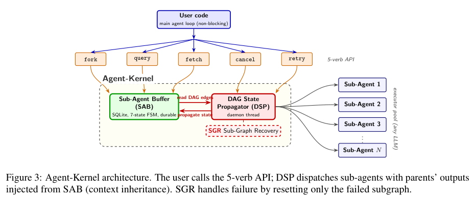

# Agent-Kernel：重试失败子图，而不丢弃已完成兄弟节点

[English](README-en.md)

> `component_only` / L1 CPU编排机制诊断，`diagnostic_only=true`，不是LLM Agent能力复现。2026-11-24首发、2026-11-25发现/审查；不接入Evolve晋级。

## 论文信息

| 字段 | 内容 |
| --- | --- |
| 论文链接 | [fork() for Agents: Agent Kernel for Non-blocking LLM Orchestration](https://arxiv.org/abs/2611.31727v1)，本轮固定v1 |
| 公司/机构/学校 | Ankit Chadha、Pratyay Banerjee；Amazon, AGI / Sunnyvale, USA，按PDF第1页署名 |
| 首次公开日期 | 2026-11-24 00:33:20 UTC，arXiv v1；updated与首发相同 |
| 公告/发现日期 | 本轮公告池无此身份，公告日未核实；发现/审查2026-11-25 |
| 原作者开源代码 | 固定v1全文、附录G及本轮有界搜索未找到可核实的本篇作者源码仓库；引用的LangGraph、LlamaIndex等不是本篇发布 |
| 本地 Adapter / 方法 | `adapter: null`；key `agent-kernel` |
| 本地复现代码目录 | `src/auto_research/agent_research/agent_kernel.py`；`tests/test_nov25_agent_components.py` |

## 原始论文总结

### 背景与主要改动

SGR（Sub-Graph Recovery）不是新发明依赖恢复：它把已知的子图选择性重试放入LLM内容编排层。异常先令下游不可达，独立兄弟仍可完成；重试只复位失败节点及其不可达后代。SQLite SAB保存状态/文本，DSP在所有父节点完成后才调度子节点，并按声明顺序把真实父输出拼入提示。五个动词是fork、retry、cancel、query、fetch。fork是创建DAG任务，不是操作系统进程克隆。



<!-- paper-figure:start -->
### 原论文关键图

[](https://arxiv.org/pdf/2611.31727v1#page=13)

图片来自[原论文](https://arxiv.org/pdf/2611.31727v1#page=13)第13页Figure 3，版权归原作者所有。保留完整架构与图注，只裁无关正文及留白，已实际目视核对；[来源和裁剪坐标](assets/provenance.json)。原图不是本地实验。
<!-- paper-figure:end -->

### 核心公式

设失败节点为$f$，$F=\{f\}\cup\operatorname{Desc}(f)$，$C=V\setminus F$：

$$
\forall c\in C:\quad (state_c,outputs_c)_{after\ retry}=(state_c,outputs_c)_{before\ retry}.
$$

只有$state_f=failed$才可retry；仅将F中unreachable后代复位waiting。dispatch要求每个父节点都是complete。此保证针对SAB记录，不是外部副作用exactly-once；已付款后抛异常再重试，可能重复付款。prompt-mutation是附录H/Q的探针扩展，不是论文已交付恢复主循环，不能混写。

### 论文离线与线上效果

作者共14,434次运行。受控失败切片中SGR、逐步重试B3、适配的Sherlock-generous都达到100%恢复，整轨迹重放55%；区别主要在墙钟而非只有SGR能恢复。真实推理K=8/L=8网格，SGR 21秒、B3 135秒、适配Sherlock 149秒。失败是预设首轮异常；AsyncLM-style虽恢复却破坏依赖。作者区分框架策略重实现与真实二进制集成；上述不是本地测量，未报告生产线上A/B。

## 本地复现与边界

### 数据协议与代码映射

标准库SQLite/WAL实现7态SAB、五动词、事务claim、失败/取消级联、SGR与实际父文本继承。`fork`不等待执行；`run`是可由调用方放到后台的有界线程池driver，不是另建分布式服务。executor只收`Claim`的task、role、prompt和父输出，不接收答案或计划；受控异常只检验恢复范围。

本地单scheduler所有权交接必须显式`recover_running=True`：重开把running复位并递增generation，旧claim的晚到完成会被拒绝；这不是分布式租约/多owner容错证明。上下文按字符上限做准入，超限拒绝，不截断父输出；未复现模型tokenizer预算、检索/摘要压缩或prompt-mutation。外部文件/网络/付款副作用不受SQL事务保护，不承诺exactly-once。

```bash
PYTHONPATH=src python -c 'from auto_research.agent_research.agent_kernel import diagnostic; print(diagnostic(42))'
PYTHONPATH=src python -m pytest tests/test_nov25_agent_components.py -q
```

### 结果、负控与边界

[42/43/44三seed CPU诊断](metrics/component-cpu-seeds42-44.json)：4节点完成、5次executor调用，兄弟b/c各执行一次，join读取A/B/C实际文本顺序，重开保留4个complete节点。这是小DAG机制控制，不是任务能力或延迟基准。

测试还覆盖并发claim唯一性、失败双父中一个未恢复时不提前执行、取消后陈旧完成拒绝、重复完成拒绝、依赖不存在/自依赖拒绝、上下文超限不claim，以及“副作用后异常”在两次重试中确实产生两次外部mutation的负控。没有LLM、真实工具服务、tau-bench/Gaia2或正式多seed能力比较。

### 同主题比较与边界

已完整审读[RuntimeTickets](../2611.03772-runtime-tickets/README.md)，并核对其属于`tools-and-collaboration`。RuntimeTickets在副作用前冻结权限/obligation并处理callback不确定性，出错时不自动重发；SGR维护内容DAG的依赖和兄弟状态，默认可重执行失败节点。二者可分层组合，但“重试成功”不能替代授权，也不能从SGR状态保持推出网络exactly-once。两篇本地都是受限内核，不能横比Agent防御/能力。

### 完整实验与成本决定

完整矩阵使用Claude Sonnet 4.5 API并加Haiku/Opus、14,434 runs、最长K=32和多层DAG、外部benchmark与框架比较；附录未来Qwen LoRA不是已测开源backbone。单A100/A30或Mac预算不承担该长rollout/API多臂矩阵：**成本过高，不复现（审查 DONE）**。不调用付费API、不下载模型/benchmark、不进入自动重试或Evolve。仅执行秒级CPU组件，不冒称论文加速复现。

### 来源核对

固定v1 PDF SHA256：`9a3b12274394c82f3d7d805396184e3fe060dee279d29f9cb48f5312c2e53ded`；机制§3、附录G/H/J/Q，结果Table3及Appendix B/M/N。有限增量选题，不代表穷尽Google/Meta或整个Agent领域。
