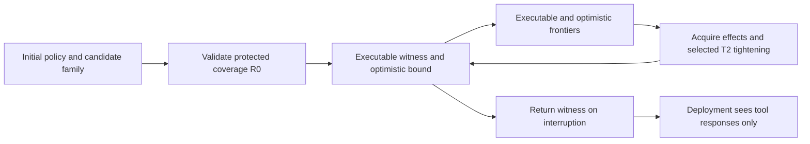
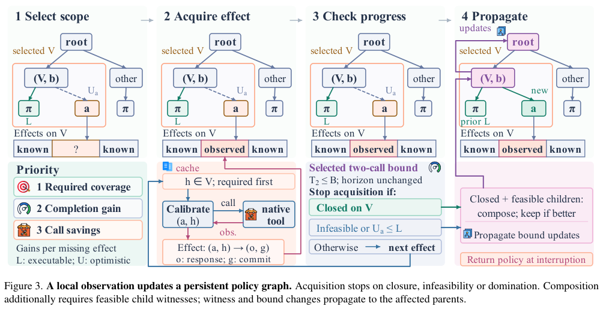

# CAPE: let the executable policy determine what to calibrate next

<!-- source-sha256: adc6b4c3082ee2d00caa4a8538ed32b2cccb2ae2bab14c235221f4fca5eef8e7 -->

[简体中文](README.md)

> `component_only` / L1 finite CPU-compiler diagnostic, `diagnostic_only=true`, not an LLM tool-success reproduction. First published November 24; discovered/reviewed November 25, 2026. No Evolve integration.

## Paper information

| Field | Content |
| --- | --- |
| Paper | [CAPE: Coordinating Calibration and Search for Tool-Use Policies](https://arxiv.org/abs/2611.31938v1), fixed v1 |
| Authors / institution | Jiahao Wang, Xiaoxuan Chen, Aijun Yang, Xiaohua Wang; State Key Laboratory of Electrical Insulation and Power Equipment, Xi’an Jiaotong University |
| Original publication | November 24, 2026, 04:43:02 UTC; v1, unchanged update timestamp |
| Announcement / discovery | Identity absent from this announcement pool; announcement date unverified. Discovered/reviewed November 25 |
| Author source code | No verifiable paper-specific repository found in fixed-v1 text/supplement or bounded search. Vega data, DuckDB and pandas documentation are not the author's code release |
| Local adapter / key | `adapter: null`; `cape` |
| Local code | `src/auto_research/agent_research/cape.py`; `tests/test_nov25_agent_components.py` |

## Original paper

### Background and method

A correct operation can still be misread under a hidden parser configuration. CAPE calibrates calls offline on a reproducible candidate family H, then compiles a policy that branches only on responses at deployment. It does not wait for a complete effect table: an action becomes executable once its effects on the reached scope V are known (local closure). Persistent executable witnesses and optimistic bounds guide calibration toward cells that can improve the policy.



<!-- paper-figure:start -->
### Original figure

[](https://arxiv.org/pdf/2611.31938v1#page=5)

图片来自[原论文](https://arxiv.org/pdf/2611.31938v1#page=5)，版权归原作者所有。Figure 3 on PDF p.5, including its complete caption, was visually inspected. Only unrelated text/whitespace was cropped; [provenance](assets/provenance.json). Not a local result.
<!-- paper-figure:end -->

### Core equations

An effect $f(a,h)=(o,g)$ contains the observation and commit bit. Probes never commit; noncommitting actions leave future task state unchanged. The initial success set R0 must be preserved configuration by configuration, not merely in expectation:

$$
J(\pi)=(|S(\pi;H,C)|,-M(\pi;H,C)),\quad R_0\subseteq S(\pi;H,C).
$$

Closed actions compose success sets and call mass through actual response cells:

$$
S_a=G_a(V)\cup\bigcup_o S_o,\qquad M_a=|V|+\sum_o M_o.
$$

An unknown program optimistically commits immediately; an unknown probe optimistically separates each configuration. With potential program-success union G and largest single-program support d, the cheap bound is $(|G|,-[|V|+|G|-d])$. The selected operator $T_2(V)=\max_a U_a(V,2;B)$ tightens two-call continuations of the currently acquired action, without shortening the real deployment horizon. A certificate requires equality of valid root lower/upper values.

### Reported results

The main study uses 64 requests, 64 CSV/88 JSON configurations, C=3/5 and a 30-second compilation allowance. CAPE attains the independent optimum in 502/504 compilations, averaging 11.449 seconds versus eager search's 14.673 (22.0% lower). At 128 configurations, completion is 88.28% versus 66.41% eager and 74.22% matched AND/OR. This is not universal acceleration: in the 64-configuration scaling study, CAPE takes 15.14 seconds versus eager's 14.17. Including compilation, fixed-endpoint totals over 1/8/32 executions remain slower than LLM retry. These are author results, not local measurements. No production online A/B is reported.

## Local component and limits

### Interface and data protocol

`CapeCompiler` accepts a declared finite family, action catalog, initial policy and calibration callback: one to eight configurations and one to four deployment calls. It implements local closure, persistent witnesses, per-configuration R0, the Eq.1–7 optimistic relaxations, executable/optimistic frontiers and required-coverage/completion/call-saving acquisition tiers. Effects are acquired once. At table completion the finite-horizon recurrence is exact.

`Policy` contains actions, response branches and fallbacks only. `execute(policy,tool,call_limit)` sends actions and receives observations/commit status; it accepts no active hidden configuration, full effect table, gold answer or reference. Access to named calibration candidates is not access to the active deployment configuration. The separate complete-information `exhaustive_oracle` is evaluator-only. Commit checking belongs to the tool; this interface is not an adversarial same-process security boundary.

A deterministic query-count allowance replaces the paper's wall-clock budget, so compilation timing is not reproduced. Small teaching tables are not the native DuckDB/pandas transactions, CSV/JSON data or LLM proposals. Guarantees fail if noncommitting actions change task state, the family omits the true configuration, or calibration and deployment effects differ.

```bash
PYTHONPATH=src python -c 'from auto_research.agent_research.cape import diagnostic; print(diagnostic(42))'
PYTHONPATH=src python -m pytest tests/test_nov25_agent_components.py -q
```

### Results and negative controls

[CPU diagnostics, seeds 42/43/44](metrics/component-cpu-seeds42-44.json): all four configurations complete in eight total deployment calls, agree with the independent oracle and receive a certificate; the initial three configurations remain protected. All 20 effect cells are calibrated: **there is no local calibration saving**, and the paper's 22% speedup is not a local result. Seeds change the teaching configuration iteration order, not independent model training.

Tests check lower≤independent optimum≤upper at recorded steps, monotone bounds, initial coverage under allowances 0–24, certificates on random finite tables, local closure without outside-scope effects, no duplicate acquisition, probe-commit rejection and failure on unseen deployment responses rather than reading h. No capability ranking or model tuning is performed.

### Same-topic comparison

The complete [CapLite write-up](../2611.17115-caplite/README.md) was reviewed after confirming membership in `tools-and-collaboration`. CapLite freezes trusted write sequences and authority grounding to decide whether a call is authorized. CAPE calibrates parser effects and searches how to represent an already selected operation. Correct commits are not authorization; preserving R0 is not write-prefix safety. A compiler-optimality certificate is not an agent-security certificate.

### Full-campaign cost decision

The complete study includes 64 requests, two interfaces, multiple compilers/ablations, a 14-model proposal panel, 240 scaling measurements, 960 measurements across 5–240-second allowances and 80,756 native calls, plus DeepSeek online retry. It is CPU/API research, not necessarily CUDA research. Fresh-process multi-condition timing and API campaigns exceed this short one-A100/A30-or-Mac scope: **成本过高，不复现（审查 DONE）** / high cost, not reproduced, review DONE. Only small-H compilation runs; no large data/models, paid APIs, automatic retries or Evolve. This cost basis is the paper configuration, not a measured local full-campaign bill.

### Sources

Fixed-v1 PDF SHA256: `529ace5a686d8a6ed892132888969207803de27110effb799acde902d86f0e35`. Method: §3–4 Eq.1–7 and Supplement Algorithm 1; full results/cost: §5 and Supplement C/G. A bounded intake is not exhaustive domain coverage.
