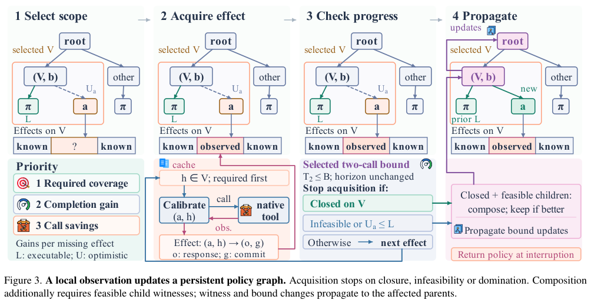

# CAPE：让已可执行策略决定还要校准什么

[English](README-en.md)

> `component_only` / L1 CPU有限编译器诊断，`diagnostic_only=true`；不是LLM工具胜率复现。2026-11-24首发、2026-11-25发现/审查；不接入Evolve。

## 论文信息

| 字段 | 内容 |
| --- | --- |
| 论文链接 | [CAPE: Coordinating Calibration and Search for Tool-Use Policies](https://arxiv.org/abs/2611.31938v1)，固定v1 |
| 公司/机构/学校 | Jiahao Wang、Xiaoxuan Chen、Aijun Yang、Xiaohua Wang；State Key Laboratory of Electrical Insulation and Power Equipment, Xi’an Jiaotong University |
| 首次公开日期 | 2026-11-24 04:43:02 UTC，arXiv v1；updated相同 |
| 公告/发现日期 | 本轮公告池无此身份，公告日未核实；发现/审查2026-11-25 |
| 原作者开源代码 | 固定v1正文/补充材料与有界搜索未找到可核实的本篇作者源码；Vega数据仓、DuckDB/pandas文档不是作者代码发布 |
| 本地 Adapter / 方法 | `adapter: null`；key `cape` |
| 本地复现代码目录 | `src/auto_research/agent_research/cape.py`；`tests/test_nov25_agent_components.py` |

## 原始论文总结

### 背景与主要改动

操作本身正确，序列化仍可能被隐藏parser配置误读。CAPE离线在可复制的候选配置族H上校准调用，编译一个部署时只按响应分支的策略。关键不是先全校准再搜索，而是在已到达配置子集V上动作效果全已知（local closure）就可用；持续维护可执行witness和未知效果的乐观上界，把有限编译预算用于可能改善策略的格子。


<!-- paper-figure:start -->
### 原论文关键图

[](https://arxiv.org/pdf/2611.31938v1#page=5)

图片来自[原论文](https://arxiv.org/pdf/2611.31938v1#page=5)第5页Figure 3，版权归原作者所有。保留图形及完整图注，只裁无关正文/留白，已实际目视核对；[来源和坐标](assets/provenance.json)。不是本地实验图。
<!-- paper-figure:end -->

### 核心公式

效果$f(a,h)=(o,g)$含响应和commit位；probe不能commit，失败不改变后续任务状态。初始策略成功集R0必须逐配置保留，不只是平均不掉分：

$$
J(\pi)=(|S(\pi;H,C)|,-M(\pi;H,C)),\quad R_0\subseteq S(\pi;H,C).
$$

closed动作的成功集和调用总量按真实响应单元组合：

$$
S_a=G_a(V)\cup\bigcup_o S_o,\qquad M_a=|V|+\sum_o M_o.
$$

unknown program乐观地立即成功；unknown probe乐观地把配置逐个区分。设所有program潜在成功并集G、单program最大覆盖d，cheap上界为$(|G|,-[|V|+|G|-d])$。selected两调用算子$T_2(V)=\max_a U_a(V,2;B)$只收紧当前待获取动作的两调用续段，不缩短实际策略horizon。root的可执行下界等于有效上界才发最优证书。

### 论文离线与线上效果

原文64请求、CSV64配置/JSON88配置、C=3/5、30秒编译预算；502/504次达到独立最优，平均编译11.449秒对eager14.673秒（22.0%节省）。128配置时CAPE完成88.28%、eager66.41%、matched AND/OR74.22%。这些不是普适加速：64配置扩展研究CAPE15.14秒反而慢于eager14.17秒；编译成本计入后，固定端点1/8/32次执行仍比LLM retry更慢。未报告生产线上A/B，论文表与本地诊断分开。

## 本地复现与边界

### 数据协议与代码映射

`CapeCompiler`接受已声明的有限H、action catalog、初始策略和calibration callback，可向离线可复制h查询；1–8配置、1–4调用。实现local closure、持久witness、逐配置R0、Eq1–7乐观界、可执行/乐观双frontier与required/completion/call-savings三级获取。效果只获取一次，已取得效果不可由后续查询改写。完全获取后同一有限horizon递推成为精确搜索。

`Policy`只有action、response branches和fallback；`execute(policy,tool,call_limit)`只把action发给tool并接收响应/commit，不接受活跃隐藏配置、完整effect表、gold或reference。校准可见候选h不等于部署可看活跃h。独立`exhaustive_oracle`仅供评估侧完整信息有限搜索，不能送入部署policy。工具负责commit验证；本地不证明同进程恶意调用者不能绕过接口。

查询次数上限替代论文wall-clock编译预算，明确不是原生成器/编译时间复现。小表是教学有限环境，不是DuckDB/pandas原生事务、真实CSV/JSON数据或LLM proposal；任何非commit动作改变任务状态、配置族不完整、校准/部署效果不一致时，论文保证都不适用。

```bash
PYTHONPATH=src python -c 'from auto_research.agent_research.cape import diagnostic; print(diagnostic(42))'
PYTHONPATH=src python -m pytest tests/test_nov25_agent_components.py -q
```

### 结果、负控与边界

[42/43/44三seed CPU机制指标](metrics/component-cpu-seeds42-44.json)：4配置全完成、合计8次部署调用，与独立oracle一致并获证书；保护初始3配置。实际校准全部20个effect格子，**没有校准节省**，不能复述论文22%加速为本地结果。seed仅改变教学配置迭代顺序，不是独立LLM训练。

测试检查每个记录时刻lower≤独立最优≤upper、lower单调/upper单调、0–24格任意中断保持R0、随机有限表证书、local closure不要求V外效果、重复effect不查询、probe commit拒绝、未知部署响应失败而不偷看h。没有benchmark能力排名或模型调参。

### 同主题比较与边界

已完整审读[CapLite](../2611.17115-caplite/README.md)，先核对其属于`tools-and-collaboration`。CapLite冻结可信写序列和authority grounding，回答调用是否被授权；CAPE在候选parser配置上校准响应并搜索可完成策略，回答已选操作怎样表示。commit验证正确不等于用户授权，覆盖R0也不保证write-prefix安全；两层不能互相替代，更不能把compile最优证书写成Agent安全证书。

### 完整实验与成本决定

完整研究含64请求、两接口、多编译器/消融、14模型proposal panel、240条扩展测量、960条5–240秒预算扫描及80,756次native调用；另有DeepSeek API在线retry。论文完整配置是CPU/API研究，不假称需要CUDA。大量跨条件新进程测量及API矩阵超出本轮短时单A100/A30或Mac预算，**成本过高，不复现（审查 DONE）**。仅小H编译器，不下载大数据/模型、不开付费API、不自动重试或接Evolve；成本基于论文配置，非本地完整矩阵实测。

### 来源核对

固定v1 PDF SHA256：`529ace5a686d8a6ed892132888969207803de27110effb799acde902d86f0e35`；机制§3–4 Eq1–7与Supplement Alg1，成本/完整结果§5及Supplement C/G。有限增量审查，不宣称整个领域穷尽。
