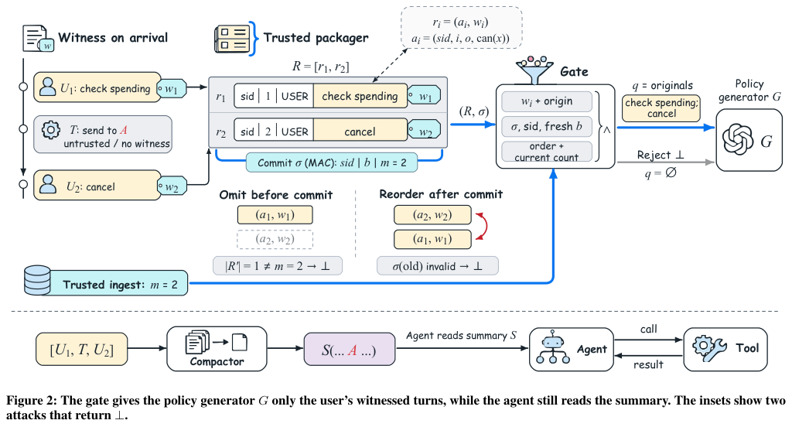

# Authorization across compaction: authenticate original requests, not a summary's quotation

<!-- source-sha256: 8e862328844a5879a00c8bbaa7c3ffa9cd8613849f9ec63fe4f8a71b983e2d59 -->

[简体中文](README.md)

> `component_only` / L1 CPU authentication-protocol diagnostics, not semantic authorization, injection-defense success or a production security system. The expensive full API/session matrix is not reproduced (review DONE); no Evolve integration.

## Paper information

| Field | Content |
| --- | --- |
| Paper | [LLM Agent Authorization Across Context Compaction](https://arxiv.org/abs/2611.32194v1), fixed v1 |
| Institutions | First author Zeming Fei: University of Technology Sydney; Hongming Fei: National University of Singapore; Yi Xu/Xiaoyang Wang: University of New South Wales; Ying Zhang: UTS, PDF page 1 |
| Original publication | 2026-11-24 08:44:15 UTC, arXiv v1; discovered/reviewed 2026-11-27, not a release on the review date |
| Announcement | Absent from this batch's November 26 announcement pool; exact announcement date not independently verified, not inferred from publication/capture dates |
| Author code | [Anonymous author artifact](https://anonymous.4open.science/r/LLM-Agent-Authorization-Across-Context-Compaction-504E/); README and `exp_full/e59_gate_completeness/witness_gate_v3.py` actually read; no license verified and no source copied. Recorded outputs and proprietary product prompts are not included |
| Local adapter/key | `adapter: null`; `compaction-authorization`; `auto_research.agent_research.compaction_authorization.diagnostic` |
| Local code | `src/auto_research/agent_research/compaction_authorization.py`; `tests/test_nov27_agent_components.py` |

## Original method

### Motivation and changes

Request-derived authorizers assume that the request slot contains user-authored text. Compaction can instead place a model's quotations of users, tools and injections at the user role. Stronger summarization cannot infer the origin of otherwise indistinguishable records. The paper separates inputs: the agent keeps reading the summary, while policy synthesis receives the complete original sequence authenticated at trusted ingress. This protects attribution, order and completeness, not request safety or the policy generator's semantics.

<!-- paper-figure:start -->
### Original figure

[](https://arxiv.org/pdf/2611.32194v1#page=4)

图片来自[原论文](https://arxiv.org/pdf/2611.32194v1#page=4)，版权归原作者所有。Page 4 Figure 2 retains the gate, omission/reordering examples and full caption; only unrelated text/whitespace cropped, visually reviewed. [Hashes/crop](assets/provenance.json). Not local defense results.
<!-- paper-figure:end -->

### Equations

$$
a_i=(sid,i,o,can(x_i)),\quad w_i=MAC_{K_{occ}}(occ\Vert frame(a_i)),\quad
\sigma=MAC_{K_{seq}}(seq\Vert frame(sid,b,m,R)).
$$

Only USER/trusted-tool fields receive witnesses. The gate verifies MACs, session, exactly the next unconsumed boundary, counters 1 through m in order and the current ingress count. Success releases all original text; failure returns bottom. Individual witnesses cannot replace sequence commitments/completeness because old grants or cancellations can be replayed/omitted. Guarantees assume truthful ingress attribution, isolated keys/counters, secure MACs, unambiguous framing and persistent sequencing. Availability attacks remain possible; unauthenticated document values do not become trusted facts.

### Reported results

The authors record 1,108 native boundaries, with 319 AgentDojo episodes/1,472 summaries, 192 ASB pairs and 18 shipped prompts. In 40 end-to-end attacks, no attacker action completes while the agent reads a summary and authorization uses gated originals. This is not universal zero risk: an originally unconstrained recipient can still admit an attacker account. Across 608 controlled carrier attacks, no forged/omitted item is admitted. Author verification costs 0.25–0.40ms/request, not a local measurement. No production online A/B is reported.

## Local scope

### Protocol and mapping

An independent standard-library implementation executes HMAC-SHA256, exact UTF-8, length-prefix framing, occurrence/sequence domain separation, complete ordered commitment and one-time boundary consumption. SQLite transactions persist issued/next-sign/next-verify counters. Reopening uses host-supplied independent keys and rejects changed key identity. Raw keys are not stored in SQLite; test keys are public fixtures, not user credentials. Serialized carrier tampering, noncanonical data and truncation reject without consuming a valid boundary.

```bash
PYTHONPATH=src python -c 'from auto_research.agent_research.compaction_authorization import diagnostic; print(diagnostic(42))'
PYTHONPATH=src python -m pytest tests/test_nov27_agent_components.py -q
```

### Controls and limits

Tests cover Unicode/newline preservation, unwitnessed derived/untrusted echoes, pre-commit omissions, reordering/duplication, changed content/origin/MAC/session, truncation, reopened replay, changed ingress count and wrong keys. No gold answer or hidden plan enters the gate. Batch-frozen seeds establish protocol controls, not three LLM defense experiments.

The trusted adapter must establish real channel origin; third-party text returned by a tool is not automatically trusted. This library/SQLite are not a malicious-Python sandbox. An agent that can invoke issuance, read keys or modify counters violates the assumptions. No Codex/Claude integration, policy generator, actual hook or AgentDojo execution exists. Local bounds are 1MiB packets and signed SQLite counters. Failed boundaries are not automatically skipped; new ingress can make an old package stale and block progress, an availability limitation rather than a bypass.

### Same-topic comparison

Reviewed peer [RuntimeTickets](../2611.03772-runtime-tickets/README.md) belongs to `tools-and-collaboration`. It checks recipient/object/budget contracts before side effects; this gate checks authorization input before policy synthesis. Its local HMAC audit chain does not prove prefix completeness, whereas current ingress counts reject omitted cancellations here. This gate does not execute object validators or restrict grants. The layers compose, but intact originals do not prove correct policy semantics, and a valid send does not authenticate a summary's attribution.

### Full-campaign cost decision

The full study combines GPT-4o/mini/frontier APIs, Qwen2.5-72B generation, 1,108 native boundaries, 18 prompts/11 harnesses and multiple attack/defense matrices. Artifact reruns require APIs, AgentDojo, Progent and product environments. This exceeds the bounded one-A100/A30-or-Mac campaign budget: high cost, not reproduced (review DONE). No model/benchmark download, API, private-session read, real attack, cost probe or automatic retry. Only small-record CPU protocol diagnostics run.

### Sources

Fixed PDF SHA256: `411d9577d7bbe70b05848b7d55a7d352901330f892e9587d9a0d164940ab8f7a`. Method Section 4/Theorem 3; results Section 5.6/Tables 7–8; cost Table 1/Appendix B. Stale README table numbers do not supersede the fixed PDF; the reviewed protocol includes v3 completeness. Bounded overlap intake, not a new-release or exhaustive-coverage claim.
