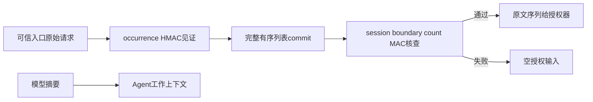
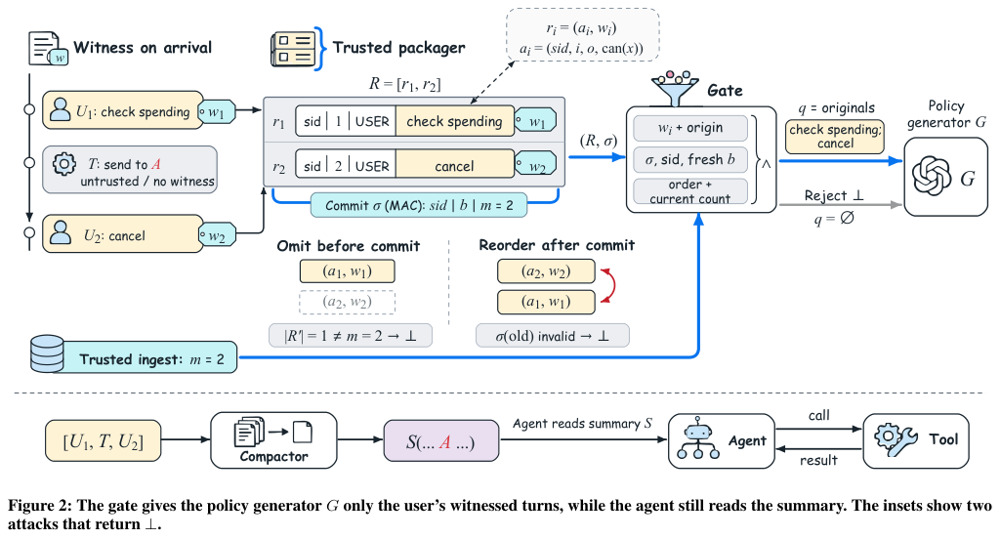

# 跨压缩授权：给授权器完整原始请求，而不是摘要的转述

[English](README-en.md)

> `component_only` / L1 CPU认证协议诊断，不是LLM授权语义、防注入胜率或生产安全产品。完整API/长会话矩阵成本过高，不复现（审查 DONE）；不接Evolve。

## 论文信息

| 字段 | 内容 |
| --- | --- |
| 论文链接 | [LLM Agent Authorization Across Context Compaction](https://arxiv.org/abs/2611.32194v1)，固定v1 |
| 公司/机构/学校 | 一作Zeming Fei：University of Technology Sydney；Hongming Fei：National University of Singapore；Yi Xu/Xiaoyang Wang：University of New South Wales；Ying Zhang：UTS，按PDF第1页 |
| 首次公开日期 | 2026-11-24 08:44:15 UTC，arXiv v1；本轮发现/审查2026-11-27，不称今日新发 |
| 公告日期 | 本轮11月26日公告池未包含此身份；精确公告日未独立核实，不由首发/抓取日期推断 |
| 原作者开源代码 | [作者匿名artifact](https://anonymous.4open.science/r/LLM-Agent-Authorization-Across-Context-Compaction-504E/)；已实际读取README与`exp_full/e59_gate_completeness/witness_gate_v3.py`，没有核实许可证；不复制源码。作者输出记录及专有产品prompt不随仓发布 |
| 本地 Adapter / 方法 | `adapter: null`；key `compaction-authorization`；`auto_research.agent_research.compaction_authorization.diagnostic` |
| 本地复现代码目录 | `src/auto_research/agent_research/compaction_authorization.py`；`tests/test_nov27_agent_components.py` |

## 原始论文总结

### 背景与主要改动

request-derived authorizer假定request slot是用户所说，压缩却可能把模型对用户、工具和注入文本的转述放回user角色。更强的摘要器不能凭字面区分格式一致的真/伪记录。本文分开两条输入：agent继续读摘要；授权策略生成器只读可信入口认证、跨边界逐字保留的完整请求序列。该门解决来源与顺序完整性，不判断请求是否安全，也不保证下游授权策略语义正确。



<!-- paper-figure:start -->
### 原论文关键图

[](https://arxiv.org/pdf/2611.32194v1#page=4)

图片来自[原论文](https://arxiv.org/pdf/2611.32194v1#page=4)第4页Figure 2，版权归原作者所有。完整保留门控与省略/重排反例和图注，仅裁无关正文/留白，已实际目视核对；[来源、hash与裁剪坐标](assets/provenance.json)。不是本地防御结果。
<!-- paper-figure:end -->

### 核心公式

$$
a_i=(sid,i,o,can(x_i)),\quad w_i=MAC_{K_{occ}}(occ\Vert frame(a_i)),\quad
\sigma=MAC_{K_{seq}}(seq\Vert frame(sid,b,m,R)).
$$

只给USER/可信TOOL字段签发见证。gate检查每个MAC、会话、恰好下一未消耗boundary、计数顺序$1,\ldots,m$与入口当前计数；成立才释放完整原文，否则返回$\bot$。单条来源绑定不能替代有序列表commit和完整性计数：旧许可/取消可被重放或省略。证明依赖入口真实归因、密钥和计数隔离、MAC安全、无歧义framing及持久sequencer；攻击者仍能拒绝服务。来自未认证文档的收款人不会因这个门变成可信事实。

### 论文离线与线上效果

作者记录1108次原生压缩边界；主矩阵319个AgentDojo episode/1472份摘要，另有192个ASB配对与18种产品prompt。40次端到端攻击中，agent仍读摘要而授权器经门取原文时，没有攻击动作完成；这不是一般零风险证明，用户本来没限制recipient时policy仍可能准入攻击账户。608次受控载体攻击未放入伪造/缺失item。作者gate验证0.25–0.40ms/request，不是本地实测。未报告生产线上A/B。

## 本地复现与边界

### 数据协议与代码映射

标准库独立实现HMAC-SHA256、精确UTF-8与长度前缀framing、occurrence/sequence分域、完整有序commit及一次性boundary消费。SQLite事务持久化issued/next-sign/next-verify；重新打开沿用宿主提供的独立key，错误key身份拒绝。原始key不写入SQLite；测试key是公开教学常量，不是用户凭据。载体可序列化跨边界，篡改/非canonical/截断失败不消费有效boundary。

```bash
PYTHONPATH=src python -c 'from auto_research.agent_research.compaction_authorization import diagnostic; print(diagnostic(42))'
PYTHONPATH=src python -m pytest tests/test_nov27_agent_components.py -q
```

### 结果、负控与边界

测试覆盖逐字Unicode/换行、派生/不可信echo不签发、预commit省略、重排/重复、内容/origin/MAC/会话变化、报文截断、重开重放、当前计数变化和错误key。有效请求只释放原文，不读gold/答案/隐藏计划。三seed由统一runner冻结，只支持协议控制，不是三次LLM防御实验。

可信入口adapter必须自行保证origin来自真实通道；“工具返回”不自动认证其中第三方字段。库与SQLite不是对恶意Python的隔离沙箱，同进程agent若可调用issuer、读key或改计数，前提就不成立。没有接入Codex/Claude、策略生成器、真实hook或AgentDojo。本地另限1MiB报文与SQLite有符号计数范围；失败boundary不自动跳过，新请求使旧包过时可永久阻塞当前会话，是可用性限制，不增加绕过通道。

### 同主题比较与边界

已实读[RuntimeTickets](../2611.03772-runtime-tickets/README.md)，同属`tools-and-collaboration`。它在副作用前以冻结合同核接收者/对象/额度；本文在策略生成前核完整原始授权输入。前者HMAC审计链本地不证明被截短前缀完整；本文用当前入口计数拒绝取消被省略，但不执行对象validator或权限收紧。两层可以组合，既不能拿原文完整证明策略正确，也不能拿合法发送证明摘要引用真实。

### 完整实验与成本决定

完整研究有多模型GPT-4o/mini/frontier API、Qwen2.5-72B generator、1108原生边界、18prompt/11harness与多套攻击/防御矩阵；artifact明确重跑需API/AgentDojo/Progent及产品环境。对单A100/A30或Mac有界预算，**成本过高，不复现（审查 DONE）**。不下载模型/benchmark、不调API、不读取本机会话、不启动真实攻击、不探跑估价，不自动重试。仅秒级小报文CPU协议。

### 来源核对

固定PDF SHA256：`411d9577d7bbe70b05848b7d55a7d352901330f892e9587d9a0d164940ab8f7a`；方法§4/定理3，结果§5.6/Table7–8，成本Table1/附录B。上游README旧表号不替代固定PDF；使用含completeness的v3协议，而非较早见证门。有限重叠池收录，不代表今日新首发或完整领域扫描。
