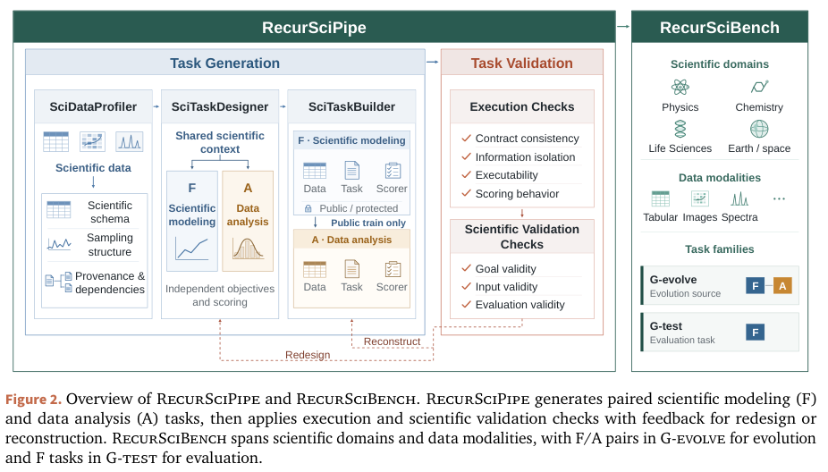

# RecurSciBench: test self-evolved experience on independent tasks

<!-- source-sha256: d02a9774157bab68e7e673927e3bd17c1c979babe9445e9290643e66ca26ab06 -->

[简体中文](README.md)

> `deferred_high_cost` / review-only, not implemented or run. **成本过高，不复现（审查 DONE）** / high cost, not reproduced, review DONE. Original publication November 24; discovered/reviewed November 25, 2026. The cover's November 25 is not the arXiv first-publication date.

## Paper information

| Field | Content |
| --- | --- |
| Paper | [RecurSciBench: Benchmarking Recursive Self-Improvement in Data-Driven Scientific Research](https://arxiv.org/abs/2611.32508v1), fixed v1 |
| Authors / institutions | First author Wenxi Xu; Data Intelligence for Scientific Innovation Lab, Computer Network Information Center, Chinese Academy of Sciences. Le Zhang and Jingbo Zhou are affiliated with Baidu Inc. |
| Original publication | November 24, 2026, 12:38:22 UTC; v1, unchanged update timestamp. PDF cover separately says November 25 |
| Announcement / discovery | Identity absent from this announcement pool; announcement date unverified. Discovered/reviewed November 25 |
| Author source code | The paper announces an [online platform](https://www.scihorizon.cn/SelfEvolution), but fixed v1 gives no verified dedicated source repository; not found/verified. EvoScientist and RSI-Exam repositories belong to cited work |
| Local adapter / key | `adapter: null`; review key `recurscibench` |
| Local code directory | None: review-only; no algorithm, adapter or execution command |

## Original paper

### Background and method

Improvement on a source task does not establish transferable scientific capability. RecurSciPipe constructs modeling F and analysis A tasks sharing scientific context. It first checks contracts, information isolation, executability and scorer behavior, then scientific validity of goals, inputs and evaluation. Design failures return to the Designer; implementation failures return to the Builder. Both tasks must pass before admission.

The 58 families comprise 38 G-evolve F/A pairs and 20 independent G-test F tasks: 96 tasks across four domains. Four RSI systems each evolve under six source settings, producing 24 frozen evolved states. Independent initial/evolved copies solve the same G-test tasks without carrying test-task experience between evaluations. Test targets and scores remain invisible to evaluated agents.

```mermaid
flowchart LR
  A[Scientific data and provenance] --> B[Profile and jointly design F/A]
  B --> C[Build public/protected packages]
  C --> D[Four execution and three scientific checks]
  D --> E[Evolve on source tasks]
  E --> F[Select using source information and freeze]
  F --> G[Independent initial/evolved G-test copies]
  G --> H[Normalize within task then aggregate transfer]
```

<!-- paper-figure:start -->
### Original figure

图片来自[原论文](https://arxiv.org/pdf/2611.32508v1#page=5)，版权归原作者所有。Figure 2 on PDF p.5, with its complete caption, was visually inspected. Only unrelated text/whitespace was cropped; [provenance](assets/provenance.json). Not a local result.
<!-- paper-figure:end -->

### Core equations

Agent state is $A_t=(R_t,M_t,H_t,I_t,\theta_t)$: solutions, memory, harness, improvement strategy and weights. The systems change different subsets of the first four; backbone weights stay frozen. Metrics with different scales/directions are normalized using distance to each optimum:

$$
e_{i,r}=|m_{i,r}-o_i|,\quad q_{i,r}=\frac{e_i^{ref}}{e_i^{ref}+e_{i,r}},\quad e_i^{ref}>0.
$$

Valid runs are averaged within a task to obtain $S_i$, then tasks receive equal weight. Evolution Gain averages task-relative changes, not the relative change in aggregate score:

$$
\Delta^*=\frac1N\sum_i\frac{S_i^*-S_i^0}{S_i^0}\times100\%,\quad S_i^0>0.
$$

The reference scores 0.5 and the optimum 1. Reference solutions are not agent-visible target answers. Normalization depends on reference quality and does not establish equal task difficulty.

### Reported results

Half of the 24 evolved states have negative overall gain, and positive aggregate gain can coexist with task-level regressions. Across four cross-domain sources, EvoScientist's overall gains range from +0.39% to +2.24%, while all four SIA-H gains are negative, from −1.65% to −0.46%. Chemistry experience can help Physics without measurable Chemistry improvement; a persistent preference for simple models can hurt a task requiring covariates. These are author-held-out G-test results, not local measurements. No production online A/B is reported.

## Local review and limits

### Data protocol and code boundary

This delivery reviews fixed v1, F/A lineage and isolation, frozen-state evaluation, cost and same-topic distinctions only. It does not run GLM, RSI systems, scientific task generation, scorers, reference solutions, training or benchmarks. Implementing only the normalization would not reproduce the paper. There are no invented three-seed metrics, GPU receipts, executable Evolve mappings or automatic implementation queues.

Source feedback differs by system: Appendix A says EvoScientist's native workflow does not read source held-out scores; SIA-H, InternAgent and HyperAgents see their permitted source metrics. All hide final G-test targets/scores. Access to source metrics is not access to gold answers; a stated isolation contract is not an empirical proof of containment.

### Same-topic comparison

The complete [CoEvoBench write-up](../2611.27116-coevobench/README.md) was reviewed after confirming its membership in `harness-and-self-improvement`. CoEvoBench lets a researcher choose weight/harness interventions under Visible/Selection/Test separation. RecurSciBench freezes backbone weights and measures within-type, cross-type and cross-domain transfer of experience. The former tests intervention choice; the latter tests conditions under which experience transfers. Source-task gains or gold-reading fixtures establish neither. Both local entries are review-only, so no local capability comparison is available.

### Full-campaign cost decision

Each task receives one A800, 15 logical CPU cores, 96 GiB RAM and a six-hour limit. Four systems across six source settings produce 24 evolved states, evaluated with initial states on 20 G-test tasks using up to three valid runs. There is also GLM-5.3 task construction, high-effort GLM-5.3-Flash, 400-step AutoSkills, 120-turn revisions and multi-candidate scientific experiments. Six hours is a cap, not measured task duration; no total GPU-hour or API bill is invented. The full multi-domain long-rollout campaign exceeds one A100/A30 or a Mac: **成本过高，不复现（审查 DONE）** / high cost, not reproduced, review DONE. No large scientific data/model downloads, probes or automatic retries. Review DONE does not mean implemented or validated.

### Sources

Fixed-v1 PDF SHA256: `b7b1598d830c84fe637907c73f89448bf301e6b2ac38332c5744e139c90142c4`. Method: §3–4 and Eq.1–3; cost: §5.1/Appendix A; conclusions: §7. This finite intake does not claim exhaustive RSI or Google/Meta coverage.
