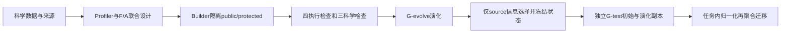
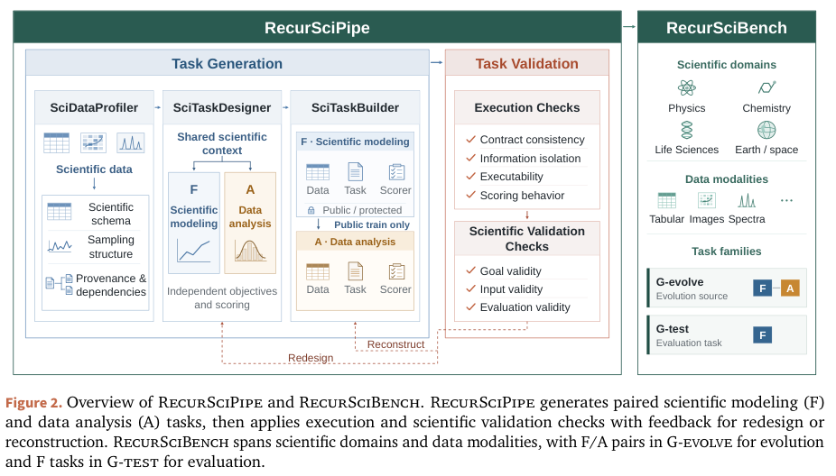

# RecurSciBench：自进化经验能否迁移，要在独立任务上问

[English](README-en.md)

> `deferred_high_cost` / review-only资料收录，未实现、未运行；**成本过高，不复现（审查 DONE）**。首发2026-11-24，发现/审查2026-11-25；封面November25不是arXiv首发日。

## 论文信息

| 字段 | 内容 |
| --- | --- |
| 论文链接 | [RecurSciBench: Benchmarking Recursive Self-Improvement in Data-Driven Scientific Research](https://arxiv.org/abs/2611.32508v1)，固定v1 |
| 公司/机构/学校 | 一作Wenxi Xu；Data Intelligence for Scientific Innovation Lab, Computer Network Information Center, Chinese Academy of Sciences；合作者Le Zhang、Jingbo Zhou署Baidu Inc. |
| 首次公开日期 | 2026-11-24 12:38:22 UTC，arXiv v1；updated相同；PDF封面2026-11-25另记 |
| 公告/发现日期 | 本轮公告池无此身份，公告日未核实；发现/审查2026-11-25 |
| 原作者开源代码 | 论文公布[在线平台](https://www.scihorizon.cn/SelfEvolution)，但固定v1未给可核实的本篇专属源码仓；未找到/未核实。文中EvoScientist及RSI-Exam仓是被引工作，不算本篇开源 |
| 本地 Adapter / 方法 | `adapter: null`；资料key `recurscibench` |
| 本地复现代码目录 | 无：review-only，没有创建算法、adapter或运行命令 |

## 原始论文总结

### 背景与主要改动

任务内涨分不等于获得可迁移的科研能力。RecurSciPipe从原始科学数据生成共享背景的建模F/分析A任务，先查合同、信息隔离、可执行、scorer行为，再查目标、输入和评价的科学有效性；设计错回Designer，实施错回Builder，两任务全过才准入。

58 families分成38个G-evolve F/A配对和20个独立G-test F，共96任务、四科学域。四种RSI各在六种source设置演化，共24个冻结evolved states；初始/演化状态独立副本在同一G-test执行，不携带测试任务间经验。测试targets和scores不向被测Agent暴露。

<!-- paper-figure:start -->
### 原论文关键图

图片来自[原论文](https://arxiv.org/pdf/2611.32508v1#page=5)第5页Figure 2，版权归原作者所有。保留完整流程和图注，只裁无关正文/留白，已实际目视核对；[来源和坐标](assets/provenance.json)。图不是本地结果。
<!-- paper-figure:end -->

### 核心公式

Agent状态为$A_t=(R_t,M_t,H_t,I_t,\theta_t)$：解、记忆、harness、改进策略、权重。四系统修改前四者的不同子集，权重全冻结。各任务不同方向/尺度的原始指标按距optimum的gap归一化：

$$
e_{i,r}=|m_{i,r}-o_i|,\quad q_{i,r}=\frac{e_i^{ref}}{e_i^{ref}+e_{i,r}},\quad e_i^{ref}>0.
$$

先在任务内平均有效run得到$S_i$，再等权平均任务；Evolution Gain是任务相对变化的均值，不是总分相对变化：

$$
\Delta^*=\frac1N\sum_i\frac{S_i^*-S_i^0}{S_i^0}\times100\%,\quad S_i^0>0.
$$

reference得0.5，optimum得1；reference不是目标答案，不能交给Agent。该归一化与参考解质量相关，不证明不同任务同样难。

### 论文离线与线上效果

作者报告24个evolved states中一半总体gain为负；总体正gain仍可伴随单任务退化。跨域时EvoScientist四种来源的总体gain为+0.39%至+2.24%，SIA-H四种均为−1.65%至−0.46%。化学经验可让Physics提高而Chemistry无可测提升；“简单模型优先”的记忆也会伤害需要协变量的任务。它们是作者独立G-test离线结果，不是本地；未报告生产线上A/B。

## 本地复现与边界

### 数据协议与代码映射

本地仅审查固定v1、F/A来源与隔离契约、冻结评估协议、成本及同主题差异。没有运行GLM、RSI系统、科学任务构建、scorer、参考解、模型训练或benchmark；仅重写归一化公式不构成本论文复现。不造三seed指标、GPU收据、可执行Evolve映射或自动实现队列。

源任务反馈并不统一：附录A明确EvoScientist原生workflow不读source held-out score；SIA-H、InternAgent、HyperAgents可读各自source指标，最终G-test targets/scores都不可见。不能把“source score可见”简化成Agent能看gold，也不能把测试合同声明当实际防泄漏证明。

### 同主题比较与边界

已完整审读[CoEvoBench](../2611.27116-coevobench/README.md)，核对其确为`harness-and-self-improvement`成员。CoEvo允许researcher选择修改模型权重与harness，并用Visible/Selection/Test隔离开发及评价；RecurSciBench固定backbone，比较不同来源经验对独立科学任务的within-type/cross-type/cross-domain迁移。前者考察干预选择，后者考察经验适用条件。都不能以源任务涨分或读过gold的fixture证明自主改进；两篇此处都仅审查，不能横比本地能力。

### 高成本完整实验

每任务分配1×A800、15逻辑CPU核、96GiB内存、6小时上限；4系统×6source形成24个evolved states，每个与初始状态在20个G-test任务最多3次有效运行。另有GLM-5.3构建、GLM-5.3-Flash高推理、400step AutoSkills、120turn改写和多候选科研实验。6小时是上限，不是每任务实测；不据此虚构总GPU小时或API账单。单A100/A30或Mac不承担完整多域长rollout矩阵：**成本过高，不复现（审查 DONE）**。不下载科学大数据/模型、不做试跑、不自动重试；review DONE不等于实现或验证。

### 来源核对

固定v1 PDF SHA256：`b7b1598d830c84fe637907c73f89448bf301e6b2ac38332c5744e139c90142c4`；机制§3–4、Eq1–3，成本§5.1/Appendix A、结论§7。有限增量收录，不宣称穷尽所有RSI或Google/Meta论文。
