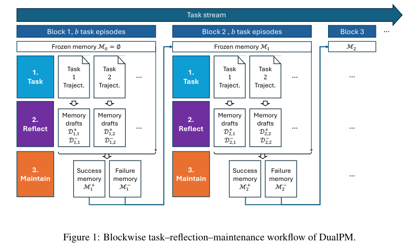

# DualPM: freeze memory within blocks and maintain both polarities separately

<!-- source-sha256: a4bdd361fdc640bc318a165e754b984ddd823967b2f3d02078bfdf2726c0f1d0 -->

[简体中文](README.md)

> `component_only` / **`l0_interface`**: CPU callback/state/provenance contracts only. Controlled fixtures are not LLM reflection, memory quality or agent capability. The high-cost full campaign is not reproduced (review DONE); no Evolve promotion.

## Paper information

| Field | Content |
| --- | --- |
| Paper | [Failure Broadens, Success Sharpens: Continual Adaptation of Tool-Use Agents Across Diverse Tasks with Dual-Polarity Memory](https://arxiv.org/abs/2611.33612v1), fixed v1 |
| Institutions | First author Tianmai M. Zhang: University of Washington, work during Microsoft internship; other affiliations Microsoft, PDF page 1 |
| Original publication | 2026-11-25 01:38:15 UTC, arXiv v1; announced/discovered/reviewed 2026-11-26; announcement verified against this batch's captured pool |
| Author code | No verifiable dedicated author repository found in fixed-v1 full text, arXiv entry and bounded title search; cited TRAJECT-Bench/EvoMemBench code is not this method's release |
| Local adapter/key | `adapter: null`; `dualpm`; `auto_research.agent_research.dualpm.diagnostic` |
| Local code | `src/auto_research/agent_research/dualpm.py`; `tests/test_nov26_agent_components.py` |

## Original method

### Motivation and changes

A successful episode can contain ineffective actions, and a failed episode useful actions. DualPM partitions the stream into blocks, freezing memory for every task within a block. After completion, an LLM reflects on each trajectory; a second call drafts both lesson polarities. Two independent maintenance calls consolidate success/failure pools into complete next-block memory lists. The whole list enters context; no task-specific retrieval is performed.

<!-- paper-figure:start -->
### Original figure

[](https://arxiv.org/pdf/2611.33612v1#page=3)

图片来自[原论文](https://arxiv.org/pdf/2611.33612v1#page=3)，版权归原作者所有。Figure 1, page 3, complete caption preserved and visually reviewed; only unrelated text/whitespace cropped. [Provenance](assets/provenance.json). Not a local experiment.
<!-- paper-figure:end -->

### Equations

$$
\tau_i\sim\pi(t_i,M_{k-1})\ (t_i\in B_k),\quad
D_{k,i}^{+},D_{k,i}^{-}=Draft(\tau_i,Reflect(\tau_i)),\quad
M_k^p=Maintain(M_{k-1}^p,D_k^p),\quad |M_k^p|\le m.
$$

Polarity p is success/failure, with the pools combined for the next block. Defaults are two drafts per episode/polarity, ten memories per pool and three evidence items per memory. Reflection and maintenance use agent-visible behavior, never gold plans, reference answers, checker outputs or future episodes. Claimed lineage is not proof of semantic grounding, causation or future usefulness.

### Reported results

TRAJECT-Bench uses four 200-task user streams, blocks of 20 and four memory conditions, evaluating 720 non-cold-start episodes per condition. Both-on raises usage recall 66.0%→72.4% and final accuracy 68.1%→73.2% over no memory. Success memory mainly saves turns; failure memory expands coverage. Final-accuracy differences between memory-on conditions are not significant; both-on is not significantly best on every metric. Four-domain EvoMemBench, 50 tasks/domain and three runs, reports 69.8% overall success. These are author results, not local measurements. No production A/B is reported.

## Local scope

### Protocol and mapping

`VisibleEpisode` accepts only task, visible instructions/steps/final answer and ID; unknown gold fields are rejected. Nested values use tuples and frozen dataclasses. `begin_block` freezes context; `finish_block` actually invokes reflection then drafting, followed by separate maintenance calls. Validators enforce capacities, same-polarity call-local M/D references, nonempty lineage for new memories and episode replay rejection. Both pools commit atomically after all callbacks/validation succeed.

```bash
PYTHONPATH=src python -c 'from auto_research.agent_research.dualpm import diagnostic; print(diagnostic(42))'
PYTHONPATH=src python -m pytest tests/test_nov26_agent_components.py -q
```

### Controls and limits

Controls execute callbacks to verify ordering, frozen snapshots, polarity separation, forged-reference rejection and atomic failure. Three seeds change only toy episode IDs, not three LLM experiments. Fixture lesson text is controlled input: **L0 interface only**, not execution of the paper's semantic memory strategy. Callers must execute tasks using the frozen block snapshot; there is no agent runtime. Trusted Python callbacks are not an adversarial-code sandbox. Semantic support, privacy sanitization, causality and memory utility remain unvalidated.

### Same-topic comparison

Reviewed peer [GrepMem](../2611.25123-grepmem/README.md) belongs to `memory-and-skills`. It retains append-only raw trajectories and retrieves details lexically after compaction. DualPM lossily abstracts procedural lessons, uses fixed within-block context and does not retrieve. Retaining original logs is different from improving future behavior; bounded procedural memory does not guarantee detail recovery. Neither local component establishes correct model use of memory.

### Full-campaign cost decision

The main matrix uses GPT-5.5 for tasks/reflection/maintenance and DeepSeek-V3.2 judging. Both-on totals 162.3K weighted tokens per episode, including 57.2K for DualPM (Appendix D Table 5; not raw token counts). Four users × 200 tasks × four conditions are supplemented by cross-user and three-run/four-domain evaluations. The long-rollout API matrix exceeds the short one-A100/A30-or-Mac budget: high cost, not reproduced (review DONE). No API, model/data download, probe, automatic retry or Evolve integration. L0 interfaces require no fabricated GPU receipt.

### Sources

Fixed-v1 PDF SHA256: `581e03a7d449ebe1f32e76d54ec02c6f27be6496e23e3ea0881721f0ada96a68`. Method Section 2.1; visibility/prompts Appendix A.1; results Section 3/Appendix D. Bounded incremental review.
