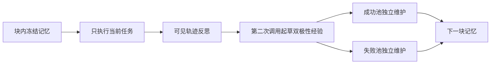
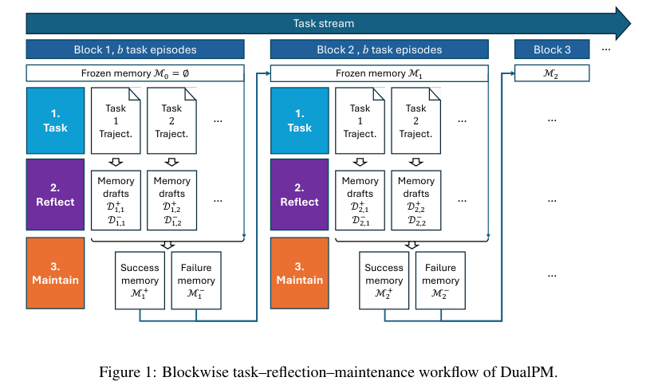

# DualPM：冻结块内记忆，分开维护成功与失败经验

[English](README-en.md)

> `component_only` / **`l0_interface`**，只有CPU回调、状态与来源接口测试；固定fixture不代表LLM反思、记忆质量或Agent能力。完整实验成本过高，不复现（审查 DONE）；无Evolve晋级。

## 论文信息

| 字段 | 内容 |
| --- | --- |
| 论文链接 | [Failure Broadens, Success Sharpens: Continual Adaptation of Tool-Use Agents Across Diverse Tasks with Dual-Polarity Memory](https://arxiv.org/abs/2611.33612v1)，固定v1 |
| 公司/机构/学校 | 一作Tianmai M. Zhang：University of Washington，微软实习期间工作；其余署名Microsoft，按PDF第1页 |
| 首次公开日期 | 2026-11-25 01:38:15 UTC，arXiv v1；2026-11-26公告/发现/审查，公告日由本轮公告池核实 |
| 原作者开源代码 | 固定v1全文、arXiv入口及本轮有界标题检索未找到可核实的专属作者代码仓库；不把TRAJECT-Bench/EvoMemBench引用仓当本方法源码 |
| 本地 Adapter / 方法 | `adapter: null`；key `dualpm`；`auto_research.agent_research.dualpm.diagnostic` |
| 本地复现代码目录 | `src/auto_research/agent_research/dualpm.py`；`tests/test_nov26_agent_components.py` |

## 原始论文总结

### 背景与主要改动

整条轨迹成功不表示每步都好，失败轨迹也可包含值得保留的局部行为。DualPM把任务流分块：块内所有任务只读同一个冻结记忆；完成后每轨迹先由LLM反思，再用第二次调用起草两种极性经验。之后两次独立维护调用分别合并成功/失败池，为下一块生成完整记忆列表；不做任务特定检索，整个记忆作为上下文。



<!-- paper-figure:start -->
### 原论文关键图

[](https://arxiv.org/pdf/2611.33612v1#page=3)

图片来自[原论文](https://arxiv.org/pdf/2611.33612v1#page=3)第3页Figure 1，版权归原作者所有。仅裁无关正文/留白，完整保留图和图注，已目视核对；[来源与裁剪坐标](assets/provenance.json)。不是本地实验。
<!-- paper-figure:end -->

### 核心公式

$$
\tau_i\sim\pi(t_i,M_{k-1})\ (t_i\in B_k),\quad
D_{k,i}^{+},D_{k,i}^{-}=Draft(\tau_i,Reflect(\tau_i)),\quad
M_k^p=Maintain(M_{k-1}^p,D_k^p),\quad |M_k^p|\le m.
$$

$p$为成功或失败，$M_k=M_k^+\cup M_k^-$。论文取每episode每极性$d=2$份draft、每池$m=10$条、每条最多$e=3$项evidence。局部成功/失败都从agent可见行为归纳，反思与维护不接gold轨迹、参考答案、checker结果或未来任务。来源引用只是模型声称的lineage，不是语义grounding、因果或未来有效性的证明。

### 论文离线与线上效果

TRAJECT-Bench四用户200任务流、20任务/块、4记忆条件；每条件评价720个非冷启动episode。作者报告both-on相比无记忆：usage recall66.0%→72.4%、final answer accuracy68.1%→73.2%；成功池更省turn，失败池更扩展覆盖。三种memory-on条件之间final accuracy差异不显著，不能宣称both-on各项均显著领先。EvoMemBench四域、50任务/域、三次独立run总成功率69.8%；不是本地测量。未报告生产线上A/B。

## 本地复现与边界

### 数据协议与代码映射

`VisibleEpisode`只允许任务、可见instructions/steps/final文本与ID，未知gold字段拒绝；嵌套输入用不可变tuple与冻结dataclass。`begin_block`冻结上下文，`finish_block`对已完成episode实际执行reflect→draft回调，再分别维护两种极性。校验$d/m/e$、同极性call-local M/D引用、新记忆非空lineage与重复episode拒绝；两池全部通过后原子提交，失败不留下半池更新。

```bash
PYTHONPATH=src python -c 'from auto_research.agent_research.dualpm import diagnostic; print(diagnostic(42))'
PYTHONPATH=src python -m pytest tests/test_nov26_agent_components.py -q
```

### 结果、负控与边界

实际回调执行验证顺序、冻结快照、两极性隔离、跨call伪造引用拒绝与失败原子性。三seed只改变教学episode ID，不构成三次LLM实验或能力比较。fixture的经验文本是控制输入，**仅L0接口**，不是执行了论文的LLM记忆策略。调用方仍须用当前块的冻结快照执行任务，模块不实现agent runtime。可信Python callback不是恶意代码沙箱；语义支持、隐私脱敏、因果有效性和记忆收益均未验证。

### 同主题比较与边界

已实读[GrepMem](../2611.25123-grepmem/README.md)，属于`memory-and-skills`。GrepMem追加保留原始轨迹，压缩后用词法grep取回细节；DualPM有损归纳可迁移程序经验，固定块内上下文、不做检索。一个保证原日志仍在，一个希望教会未来行为；日志无损不等于经验有效，有限记忆也不等于原始细节可恢复。两篇本地测试都不证明模型是否会正确使用记忆。

### 完整实验与成本决定

主矩阵使用GPT-5.5任务/反思/维护和DeepSeek-V3.2裁判；both-on每episode总162.3K加权token（含DualPM57.2K，附录D Table5；权重不是原始token数）。四用户×200任务×4条件之外还有跨用户及四域三run的外评。完整长rollout/API多臂矩阵对单A100/A30或Mac预算**成本过高，不复现（审查 DONE）**。不调API、不下载模型/数据、不探跑、不自动重试、不接Evolve。没有GPU回执，也不需要为L0接口伪造回执。

### 来源核对

固定v1 PDF SHA256：`581e03a7d449ebe1f32e76d54ec02c6f27be6496e23e3ea0881721f0ada96a68`。方法§2.1、可见性与prompt附录A.1、结果§3/附录D；有限增量审查。
