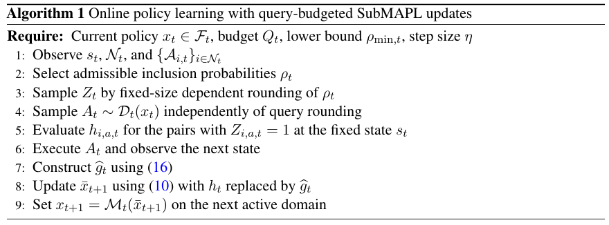

# Budgeted SubMAPL: query fewer marginal gains while preserving unbiased updates

<!-- source-sha256: 2e329077a822dab0f8c9ca86bc21592d9d03404e4b70d8da2897784222487070 -->

[简体中文](README.md)

> `component_only` / L1 CPU coordination mathematics, not LLM-agent/RSI capability. The inexpensive full simulation was not accepted: `not_run_scope_limited`, `full_experiment_review_done=false`, not a fabricated high-cost terminal decision. No Evolve promotion.

## Paper information

| Field | Content |
| --- | --- |
| Paper | [Compute-Aware Submodular Online Learning in Open Multi-Agent Systems](https://arxiv.org/abs/2611.34211v1), fixed v1 |
| Institutions | First author Jing Liu: East China University of Science and Technology; Luca Ballotta/Ruggero Carli: University of Padova; Fangfei Li/Yang Tang: ECUST, PDF page 1 |
| Original publication | 2026-11-25 11:35:43 UTC, arXiv v1; the PMLR 2027 template does not change first release; discovered/reviewed 2026-11-27 |
| Announcement | 2026-11-26, verified official cs.LG new entry; not a November 27 first release |
| Author code | No dedicated author implementation found in fixed full text, arXiv links and bounded exact-title search; paper-list repositories are not author releases |
| Local adapter/key | `adapter: null`; `budgeted-submapl`; `auto_research.agent_research.budgeted_submapl.diagnostic` |
| Local code | `src/auto_research/agent_research/budgeted_submapl.py`; `tests/test_nov27_agent_components.py` |

## Original method

### Motivation and changes

Overlapping cooperative coverage has diminishing returns, but evaluating every agent-action gain can exceed online budgets. Before observing current gains, the method allocates inclusion probabilities from policy/budget and uses dependent rounding to query exactly Q coordinates. Query selection is independent of joint-action sampling. Inverse-probability-weighted counterfactual gains drive KL mirror ascent. An unqueried coordinate has zero estimate, not necessarily zero true marginal.

<!-- paper-figure:start -->
### Original algorithm

[](https://arxiv.org/pdf/2611.34211v1#page=7)

图片来自[原论文](https://arxiv.org/pdf/2611.34211v1#page=7)，版权归原作者所有。Page 7 Algorithm 1 retains its title and all steps; only unrelated text/whitespace cropped, visually reviewed. [Hashes/crop](assets/provenance.json). Its final dynamic-migration step is not locally implemented.
<!-- paper-figure:end -->

### Equations

$$
\rho^*_{i,a}=clip_{[\rho_{min},1]}(\tau\sqrt{x_{i,a}}),\quad\sum_{i,a}\rho^*_{i,a}=Q,\qquad
\widehat g_{i,a}=\frac{Z_{i,a}}{\rho_{i,a}}F((i,a)\mid A^{-i};s).
$$

$$
\bar x_{i,a}^{+}=\frac{x_{i,a}\exp(\eta\widehat g_{i,a})}{\sum_b x_{i,b}\exp(\eta\widehat g_{i,b})}.
$$

Rounding must satisfy exact cardinality and preserve each inclusion marginal; ordinary weighted sampling without replacement does not automatically do so. Allocation minimizes the second-moment bound sum(x/rho), not arbitrary task performance. Assumptions require normalized monotone submodular utility, bounded nonnegative marginals, positive policy support and positive inclusion floors. The one-half approximate dynamic-regret bound also contains KL tracking variation; sublinear regret requires additional conditions.

### Reported results

The authors use a 30×30 coverage grid, at most five agents, 200 rounds, three weight fields/three schedules and 20 held-out seeds. Most metrics at 10% querying stay within 2% of full feedback. Policy-aware and uniform allocations nearly coincide under high entropy; constant-Q=3 dynamic schedules show clearer differences. The paper compares query counts and defers CPU/wall-time evaluation, so fewer queries are not measured speedups. No production online A/B or local capability result is reported.

## Local scope

### Protocol and mapping

The standard-library kernel executes clipped square-root allocation, pairwise dependent rounding, exactly Q oracle queries, IPW and log-space KL updates. Separate random streams drive querying/joint actions. No full current gain table, optimal action or gold plan enters the learner. Public toy coverage sets implement a genuine normalized monotone submodular utility, not an LLM score proxy. Evaluator-only finite enumeration checks the full-gradient expectation separately.

```bash
PYTHONPATH=src python -c 'from auto_research.agent_research.budgeted_submapl import diagnostic; print(diagnostic(42))'
PYTHONPATH=src python -m pytest tests/test_nov27_agent_components.py -q
```

### Controls and limits

Controls check exact distinct query counts, inclusion bounds/sum, positive simplexes, full-Q reduction and actual policy change. Exact small rounding-tree analysis checks marginals/IPW expectation instead of presenting sparse Monte Carlo as an unbiasedness proof. Invalid budgets/floors, NaN oracles, shared random-stream objects and extreme-update underflow reject. Allocation must remain feasible with tiny positive support. Immutable inputs prevent partial policy commits.

Only the fixed-active-domain kernel is implemented: no full state transition, observation classification/tabular memory, 30×30 environment or migration map M. The paper references earlier SubMAPL work for that map; no substitute is invented. Section 6.1 describes stay/cardinal moves but Section 6.2 states up to nine actions; this unresolved environment detail precludes a claimed faithful benchmark. Three seeds do not establish LLM capability or full-paper statistics.

### Same-topic comparison

Reviewed peer [OOAS](../2611.30405-ooas/README.md) belongs to `agent-policy-learning`. OOAS observes aggregate task feedback and uses shared exponential noise and whole-task same-arm event probabilities to correct hint residuals. SubMAPL can query selected counterfactual marginals and corrects coordinates by inclusion probability before KL updates. OOAS's Tsallis/barrier FTRL is not this KL update, and the two importance weights are not interchangeable. Both local entries are mathematical kernels without comparable agent success rates.

### Full-experiment cost decision

The paper's small 30×30 simulation uses at most five agents/45 coordinates, 200 rounds and 20 seeds, without large models, external data or reported expensive hardware. Total time is unreported; there is **no basis for a high-cost designation**. This task accepts only bounded CPU mathematics. The full simulation/migration remains unexecuted: `not_run_scope_limited`, `full_experiment_review_done=false`; `review_done=true` closes only the accepted component/selection scope. No downloads, probes, automatic expansion/retry or Evolve. Unaccepted work is not hardware infeasibility.

### Sources

Fixed PDF SHA256: `c8290d0f706e6649b18b77d6ccec45004d5ff93141292351896af70b24be9636`. Method Sections 3–5/Equations 10,13–16,21–22/Algorithm 1; experiments Section 6. Bounded overlap selection, without advancing the overall review watermark.
