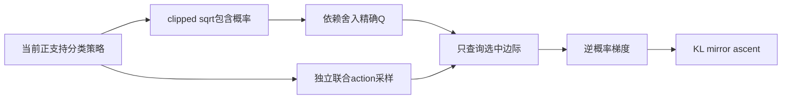
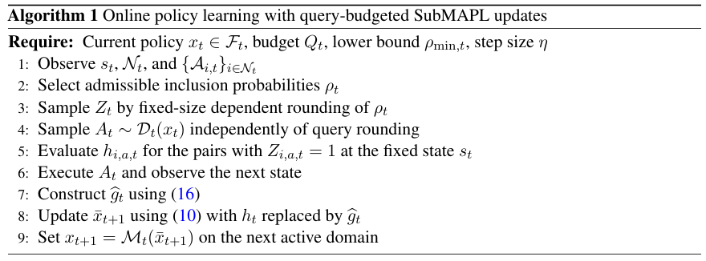

# Budgeted SubMAPL：少查询边际收益，仍保持无偏策略更新

[English](README-en.md)

> `component_only` / L1 CPU多智能体协调数学内核；不是LLM Agent或RSI能力复现。完整便宜模拟未承接，不虚构高成本终态：`not_run_scope_limited` / `full_experiment_review_done=false`；无Evolve晋级。

## 论文信息

| 字段 | 内容 |
| --- | --- |
| 论文链接 | [Compute-Aware Submodular Online Learning in Open Multi-Agent Systems](https://arxiv.org/abs/2611.34211v1)，固定v1 |
| 公司/机构/学校 | 一作Jing Liu：East China University of Science and Technology；Luca Ballotta/Ruggero Carli：University of Padova；Fangfei Li/Yang Tang：ECUST，按PDF第1页 |
| 首次公开日期 | 2026-11-25 11:35:43 UTC，arXiv v1；PDF的PMLR 2027模板不改写首发；发现/审查2026-11-27 |
| 公告日期 | 2026-11-26，当前官方cs.LG new公告已核；不是11月27日新首发 |
| 原作者开源代码 | 固定v1全文、arXiv入口及有界精确标题搜索未找到专属作者实现；不把论文列表仓库当开源代码 |
| 本地 Adapter / 方法 | `adapter: null`；key `budgeted-submapl`；`auto_research.agent_research.budgeted_submapl.diagnostic` |
| 本地复现代码目录 | `src/auto_research/agent_research/budgeted_submapl.py`；`tests/test_nov27_agent_components.py` |

## 原始论文总结

### 背景与主要改动

协作覆盖的重叠贡献具有边际递减性，但更新每个agent每个action的收益可能超在线预算。论文在看当前收益之前，只用当前分类策略与查询预算分配包含概率，再用固定基数依赖舍入精确选$Q$个agent-action。查询选择与联合action采样独立，对所查反事实边际收益做逆概率校正，再KL mirror-ascent。未被查询的估计为0，不等于真实边际为0。



<!-- paper-figure:start -->
### 原论文关键图

[](https://arxiv.org/pdf/2611.34211v1#page=7)

图片来自[原论文](https://arxiv.org/pdf/2611.34211v1#page=7)第7页Algorithm 1，版权归原作者所有。完整保留算法标题与所有步骤，仅裁无关正文/留白，已目视核对；[来源、hash与坐标](assets/provenance.json)。原图最后的动态迁移步骤不是本地已实现。
<!-- paper-figure:end -->

### 核心公式

$$
\rho^*_{i,a}=clip_{[\rho_{min},1]}(\tau\sqrt{x_{i,a}}),\quad\sum_{i,a}\rho^*_{i,a}=Q,\qquad
\widehat g_{i,a}=\frac{Z_{i,a}}{\rho_{i,a}}F((i,a)\mid A^{-i};s).
$$

$$
\bar x_{i,a}^{+}=\frac{x_{i,a}\exp(\eta\widehat g_{i,a})}{\sum_b x_{i,b}\exp(\eta\widehat g_{i,b})}.
$$

固定基数舍入须满足$\sum Z=Q$且$E[Z]=\rho$；普通加权无放回抽样不自动有这些包含概率。分配最小化的是$\sum x/\rho$这一二阶矩上界，不保证任意任务效果最优。理论要求归一化、单调、子模效用、有界非负边际、正策略支持和包含概率下界；1/2近似dynamic regret还含KL tracking variation，额外条件不足时不声称sublinear regret。

### 论文离线与线上效果

作者30×30覆盖网格、至多5agent、200轮，三权重场/三开闭系统schedule、20个held-out seed；10%查询的多数指标与full feedback差异在2%内。高熵设置下policy-aware与uniform几乎相同；固定Q=3的动态schedule上才观察更清楚优势。作者只比较query数量，实际CPU/wall-clock评估留待后续；不能把少查询当实测速率提高。未报告生产线上A/B，非本地测量。

## 本地复现与边界

### 数据协议与代码映射

标准库执行clipped平方根分配、成对依赖舍入、仅Q次oracle查询、IPW与log-space KL更新。两个随机流分别驱动舍入/联合action；当前完整gain表、最优action或gold计划不进入learner。公开小覆盖集合是真实归一化单调子模函数，不是LLM打分替身；完整梯度仅在独立评估测试侧按有限联合action枚举，用于核期望。

```bash
PYTHONPATH=src python -c 'from auto_research.agent_research.budgeted_submapl import diagnostic; print(diagnostic(42))'
PYTHONPATH=src python -m pytest tests/test_nov27_agent_components.py -q
```

### 结果、负控与边界

检查精确预算/无重复、包含概率边界及和、简单形正支持、full-Q退化为full feedback和实际policy变化。精确小舍入树核边缘概率/IPW期望，不用少量Monte Carlo宣称无偏证明。负控含不合法预算/floor、NaN oracle、同一随机流及极端更新下溢；极小正策略支持的分配仍须可行。输入不可变，失败不提交半份策略。

仅固定active domain数学内核；无完整状态转移、观察分类/表格策略记忆、30×30环境或动态迁移$M$。论文把迁移正式定义交给此前SubMAPL文章，本地不补猜。§6.1叙述stay/四向，§6.2却称最多9actions，完整环境动作集细节仍未消歧；不选一个版本冒称benchmark复现。三seed控制不能变成LLM能力或全论文统计结论。

### 同主题比较与边界

已实读[OOAS](../2611.30405-ooas/README.md)，同属`agent-policy-learning`。OOAS只得整任务aggregate反馈，以共享Exp噪声耦合steering选择，按整任务同臂事件概率校正hint残差；SubMAPL允许查询选中的反事实边际，以包含概率校正每个坐标并做KL更新。前者FTRL/Tsallis-barrier与后者KL mirror ascent不是同一softmax替身，两种重要性权重也不能互换。两篇本地都是数学核，无Agent胜率可比较。

### 完整实验与成本决定

原文模拟是30×30小网格、≤5agent/最多45坐标、200轮/20seed；没有大模型、外部数据或已报告的昂贵硬件，总时长未给。**没有依据标为成本过高**。本轮只承接小型CPU数学核，完整模拟/迁移未执行，标`not_run_scope_limited`、`full_experiment_review_done=false`；`review_done=true`仅说明本次选题与组件范围闭环。不下载/探跑、自动扩scope、重试或接Evolve；不把未承接写成硬件不可行。

### 来源核对

固定PDF SHA256：`c8290d0f706e6649b18b77d6ccec45004d5ff93141292351896af70b24be9636`。机制§3–5/Eq10、13–16、21–22/Algorithm1；实验§6。有限重叠池选题，不推进全库审查水位。
