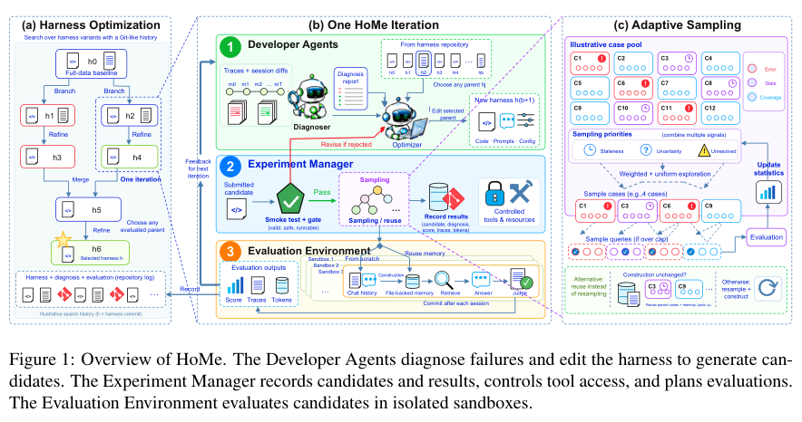

# HoMe: sampling and construction reuse are not automated memory optimization

<!-- source-sha256: 38fa2c1a2ece7aee87ef3a24ff628a555b8678144858a97166ab9ba61a4abbea -->

[简体中文](README.md)

> `component_only` / `l1_mechanism`: CPU sampling/reuse diagnostics only, not an LLM diagnostician, harness optimizer or agent-capability reproduction. The high-cost full campaign is terminally not reproduced; review DONE. No Evolve promotion.

## Paper information

| Field | Content |
| --- | --- |
| Paper | [HoMe: Toward Practical Harness Optimization of Memory Systems for AI Assistants](https://arxiv.org/abs/2611.34624v1), fixed v1 |
| Institutions | First author Yifei Xu: Shanghai Jiao Tong University; coauthor affiliations Alibaba Group and Peking University, PDF page 1 |
| Original publication | 2026-11-25 16:11:53 UTC, arXiv v1; announced/discovered/reviewed 2026-11-26; announcement verified against this batch's captured pool |
| Author code | [ReMe HoMe plugin](https://github.com/agentscope-ai/ReMe/tree/7b2317584f23ba63a21cb154b961eb3dcc788e0e/plugins/home), pinned public tree, Apache-2.0; sampling.py and evaluation/reuse.py verified |
| Local adapter/key | `adapter: null`; `home`; `auto_research.agent_research.home.diagnostic` |
| Local code | `src/auto_research/agent_research/home.py`; `tests/test_nov26_agent_components.py` |

## Original method

### Motivation and changes

HoMe derives a new harness from any previously evaluated candidate. Session-level memory versions and execution traces localize missing evidence, while cross-case diagnosis identifies recurring defects. An early admission gate favors structural changes rather than prompt/parameter-only edits; later refinement relaxes it. Smoke tests precede evaluation. Adaptive sampling reduces cases/queries; construction-equivalent ancestors supply persisted memory with probability 0.6, rerunning only retrieval, answering and scoring. Models stay fixed; code, prompts and configuration change.

<!-- paper-figure:start -->
### Original figure

[](https://arxiv.org/pdf/2611.34624v1#page=4)

图片来自[原论文](https://arxiv.org/pdf/2611.34624v1#page=4)，版权归原作者所有。Figure 1, page 4, visually reviewed with its full caption; only unrelated text/whitespace cropped. [Source, hashes and crop](assets/provenance.json). Not a local result.
<!-- paper-figure:end -->

### Equations

Host validation statistics include EMA loss, valid observation count, last selection/error rounds and perfect observations since the last error. Infrastructure failures without valid scores do not update loss/count.

$$
\bar\ell_v\leftarrow\alpha(1-y_v)+(1-\alpha)\bar\ell_v,\qquad
r_v=\bar\ell_v+0.2\log(1+\Delta_v)+\frac{0.2}{\sqrt{n_v+1}}+0.1u_v,
$$

$$
u_v=\frac{\log(1+\max(b-t_v^{err},0))}{1+k_v},\qquad
p_v=(1-\epsilon)\frac{e^{r_v}}{\sum_w e^{r_w}}+\frac{\epsilon}{|V|}.
$$

The first observation initializes loss directly; no recorded error means zero unresolved-error term. The paper sets alpha 0.3 and epsilon 0.2. Case sampling precedes query-capped sampling; the local implementation retains upstream fair-share allocation. Priorities are failure-finding heuristics, not confidence intervals. Adaptive-subset means are neither unbiased full-set estimates nor directly comparable candidate rankings.

### Reported results

The authors report LongMemEval-S test score 0.888→0.916 and query tokens 43.9K→17.9K; BEAM-1M score 0.650→0.704 and tokens 101.8K→60.4K. BEAM search consumed 10.4 hours/185.2M tokens including full initialization, diagnosis and development; an eight-minute replay evaluation is not total search cost. The paper explicitly tunes SimpleMem/A-MEM parameters on test, so not all cross-method comparisons constitute isolated-test evidence. Local selection/statistics are validation-only. No production online A/B is reported; none of these values is locally measured.

## Local scope

### Protocol and mapping

Standard-library `observe/probabilities/sample/mark_selected` preserve formulas, without-replacement draws, actual uniform mixing and selection timestamps. Inputs are IDs and host validation scalars, not gold answers or full task tables delivered to a policy. `reuse_source` requires dataset/runtime/construction/model fingerprints, completed ancestors, snapshot hashes and affirmative host equivalence reviews. It picks the nearest eligible ancestor before one probability draw. Unknown equivalence, failure or construction changes rebuild. No LLM reviewer runs here; filenames do not establish semantic equivalence.

```bash
PYTHONPATH=src python -c 'from auto_research.agent_research.home import diagnostic; print(diagnostic(42))'
PYTHONPATH=src python -m pytest tests/test_nov26_agent_components.py -q
```

### Controls and limits

CPU controls cover probabilities, budgets, reproducibility and reuse admission. Batch-runner seeds do not turn sampling diagnostics into agent comparisons. Negative controls include invalid scores, duplicate IDs, unknown equivalence, changed model/construction fingerprints, incomplete ancestors, zero reuse probability and error decay. No LLM diagnosis, harness editing, session Git repository, Docker concurrency, real QA or paper-level gains are reproduced.

### Same-topic comparison

The reviewed peer [MORSE](../2611.30011-morse/README.md) belongs to `harness-and-self-improvement`. MORSE researches and acquires host-approved perception services for streaming video; HoMe optimizes file-memory harnesses using session differences, structural exploration and evaluation reuse. Neither is simply score maximization: HoMe sampled scores differ in coverage, and MORSE has staged quality/latency contracts. Local HoMe is a component and MORSE is review-only; there are no comparable agent scores.

### Full-campaign cost decision

LongMemEval-S has 500 cases averaging 115K history tokens; BEAM-1M has 35 cases with 20 queries each and 1.04M average history tokens. Full optimization uses qwen3.6-flash/qwen3.7-max APIs, concurrency 28 and six formal candidates per benchmark; BEAM reports 185.2M tokens/10.4 hours. It exceeds the short one-A100/A30-or-Mac budget: high cost, not reproduced (review DONE). No paid API, model/data download, cost probe, automatic retry or Evolve integration; only bounded CPU components run.

### Sources

Fixed-v1 PDF SHA256: `5e63f56e550184fff754bc78a709e8e5dcaa8c0c7dde3dafe017f8472e224601`. Method Sections 3.2–3.3/Appendix A.7; configuration Section 4.1; cost Section 4.2.2/A.8. Bounded incremental review, not exhaustive coverage.
