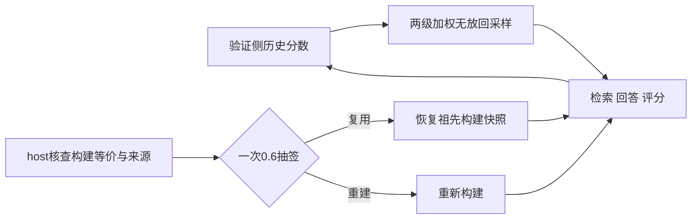
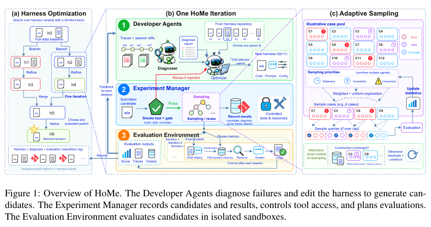

# HoMe：采样与构建复用不等于自动优化记忆

[English](README-en.md)

> `component_only` / `l1_mechanism`，仅CPU采样与复用协议诊断；不是LLM诊断、harness优化或Agent能力复现。完整实验成本过高，不复现（审查 DONE）；不接入Evolve晋级。

## 论文信息

| 字段 | 内容 |
| --- | --- |
| 论文链接 | [HoMe: Toward Practical Harness Optimization of Memory Systems for AI Assistants](https://arxiv.org/abs/2611.34624v1)，固定v1 |
| 公司/机构/学校 | 一作Yifei Xu：Shanghai Jiao Tong University；共同署名Alibaba Group、Peking University，按PDF第1页 |
| 首次公开日期 | 2026-11-25 16:11:53 UTC，arXiv v1；2026-11-26公告/发现/审查，公告日由本轮公告池核实 |
| 原作者开源代码 | [ReMe的HoMe插件](https://github.com/agentscope-ai/ReMe/tree/7b2317584f23ba63a21cb154b961eb3dcc788e0e/plugins/home)，固定公开树commit，Apache-2.0；已核实sampling.py与evaluation/reuse.py |
| 本地 Adapter / 方法 | `adapter: null`；key `home`；本地方法`auto_research.agent_research.home.diagnostic` |
| 本地复现代码目录 | `src/auto_research/agent_research/home.py`；`tests/test_nov26_agent_components.py` |

## 原始论文总结

### 背景与主要改动

HoMe让代码agent从此前任意已评估harness派生新候选，以逐session记忆版本和执行trace追溯信息丢失，再跨case归纳共同失败机制。早期门控拒绝只有prompt/参数变化的候选，后期放开细调；评价前先smoke。自适应采样减少case/query数；若构建未变，则以0.6概率重用最近兼容祖先的已构建记忆，仅重跑检索、回答和评分。模型固定，变化的是代码、prompt和配置，不是模型权重。



<!-- paper-figure:start -->
### 原论文关键图

[](https://arxiv.org/pdf/2611.34624v1#page=4)

图片来自[原论文](https://arxiv.org/pdf/2611.34624v1#page=4)第4页Figure 1，版权归原作者所有。完整保留原图和图注，仅裁无关正文及留白，已目视核对；[来源、SHA256与裁剪坐标](assets/provenance.json)。不是本地运行结果。
<!-- paper-figure:end -->

### 核心公式

对验证侧采样单元$v$保存EMA损失、有效观察数$n_v$、最近选择/错误轮次和错误后的满分观察数$k_v$。无有效评分的基础设施失败不更新损失或观察数。

$$
\bar\ell_v\leftarrow\alpha(1-y_v)+(1-\alpha)\bar\ell_v,\qquad
r_v=\bar\ell_v+0.2\log(1+\Delta_v)+\frac{0.2}{\sqrt{n_v+1}}+0.1u_v,
$$

$$
u_v=\frac{\log(1+\max(b-t_v^{err},0))}{1+k_v},\qquad
p_v=(1-\epsilon)\frac{e^{r_v}}{\sum_w e^{r_w}}+\frac{\epsilon}{|V|}.
$$

首次观察直接初始化$\bar\ell_v=1-y_v$；从未出错时$u_v=0$。论文取$\alpha=0.3,\epsilon=0.2$。case之后再按query上限采样；本地保留作者公开实现的fair-share分配。该优先级是找失败的启发式，不是置信区间；自适应子集均分不是无偏全量性能估计，也不能直接跨候选排名。

### 论文离线与线上效果

作者报告LongMemEval-S测试分数0.888→0.916、query token43.9K→17.9K；BEAM-1M分数0.650→0.704、token101.8K→60.4K。BEAM搜索耗时10.4小时、185.2M token，包含初始全量评价、诊断与开发，不能用单次复用评价8分钟替代总成本。原文还明确SimpleMem/A-MEM参数在test上调过，故不把所有跨方法比较当严格隔离test的证据；本地选择/状态只允许验证数据。未报告生产线上A/B，上述均非本地测量。

## 本地复现与边界

### 数据协议与代码映射

纯标准库实现`observe/probabilities/sample/mark_selected`，保留公式、无放回、真实uniform混合和选择时间戳。输入只有case/query ID与host验证侧标量；没有gold答案或完整任务表进入被测policy。`reuse_source`要求dataset/runtime/construction/model指纹、已完成祖先、快照hash和host肯定等价结论，选择最近祖先后只抽签一次。不确定、失败或构建变化必须重建；本地不执行LLM等价审查，也不以文件名相同推断语义等价。

```bash
PYTHONPATH=src python -c 'from auto_research.agent_research.home import diagnostic; print(diagnostic(42))'
PYTHONPATH=src python -m pytest tests/test_nov26_agent_components.py -q
```

### 结果、负控与边界

CPU受控诊断只检查采样概率、预算、重复性和复用准入。三seed由批次runner统一记录；不把不同seed的抽样控制变成Agent能力对照。负控包括NaN/越界score、重复ID、未知等价、模型/构建指纹变化、未完成祖先、零复用概率及陈旧错误衰减。没有LLM诊断、harness编辑、session Git仓库、Docker并发、真实问答或论文效果复现。

### 同主题比较与边界

已实读[MORSE](../2611.30011-morse/README.md)，属于`harness-and-self-improvement`。MORSE在流式视频任务中让Editor主动研究并经host准入扩展感知服务；HoMe面向文件记忆harness，强调session差分归因、早期结构探索及评价复用。两者都不能缩成“打分后选最高”：HoMe的自适应分数不直接可比，MORSE还有阶段性质量/延迟合同。本地HoMe仅采样/复用，MORSE仅收录，无Agent分数可横比。

### 完整实验与成本决定

LongMemEval-S500例均值115K历史token；BEAM-1M35例、每例20query、均值1.04M历史token。完整搜索用qwen3.6-flash/qwen3.7-max API、28并发、每benchmark六个正式候选，BEAM已报告185.2M token和10.4小时。对单A100/A30或Mac短时预算，**成本过高，不复现（审查 DONE）**。不调用付费API、不下载模型或benchmark，不探跑、不自动重试，不进入Evolve；仅运行秒级CPU组件。

### 来源核对

固定v1 PDF SHA256：`5e63f56e550184fff754bc78a709e8e5dcaa8c0c7dde3dafe017f8472e224601`。机制§3.2–3.3、附录A.7；配置§4.1、成本§4.2.2及A.8。有限增量审查，不代表穷尽整个Agent领域。
