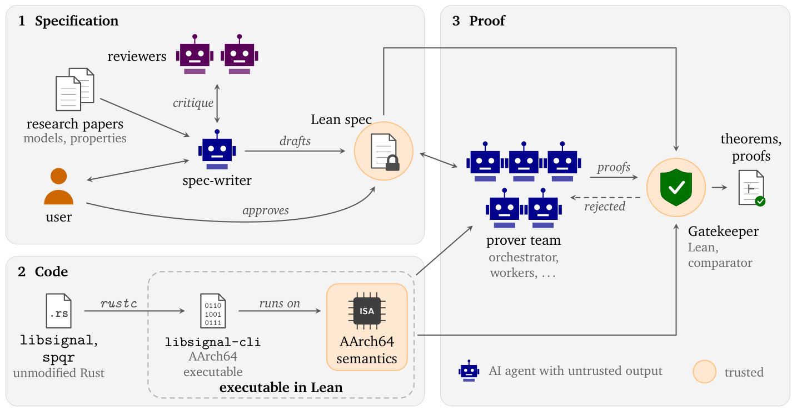
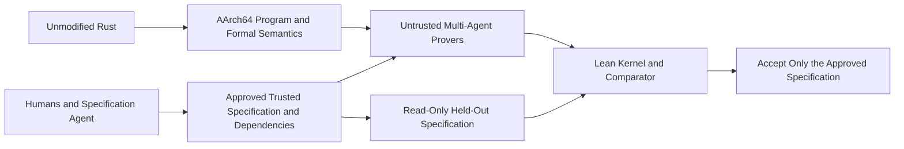

# AlphaProof Code: A Proof Must Match the Approved Specification

<!-- source-sha256: 59b4b3240a997fe7783fb61d85fd46e7a9ffd50ba00486231218ab4f4d50ff4e -->

[简体中文](README.md)

> `deferred_high_cost`, source and cost review only: **not reproduced because of high cost; review DONE**. No local formal prover, agent, executable operator, or invented metrics.

## Paper Information

| Field | Value |
| --- | --- |
| Paper | [AlphaProof Code: Verifying Signal's Security at the Machine-Code Level, official technical report](https://deepmind.google/documents/36/Formal_Verification_of_Signal_4.pdf); [official project](https://google-deepmind.github.io/code-verification/) |
| Company / institution / university | First author Swarat Chaudhuri, Google DeepMind; all nine authors at Google DeepMind or Google, checked against PDF page 1 |
| First public release | Official report and [announcement](https://deepmind.google/blog/introducing-alphaproof-code/) dated 2026-11-10, day precision; no arXiv identity found and no invented ID or UTC time |
| Author source code | [google-deepmind/code-verification](https://github.com/google-deepmind/code-verification), reviewed commit `808b4b7ffef198e6a91f71ed776d641a1c236882`; proofs, specifications, and checks. Main code is Apache-2.0; third-party Signal material retains separate licenses including AGPL-3.0-only |
| Local adapter | None; literature key `alphaproof-code`; no `local_operator` |
| Local reproduction code | None: this page is cost-review documentation only. An upstream link is not a locally executed implementation |

## Original Paper Summary

<!-- paper-figure:start -->
### Key Figure from the Paper

Source: [official technical report, page 2, Figure 1](https://deepmind.google/documents/36/Formal_Verification_of_Signal_4.pdf#page=2), cropped from the original, not redrawn. The orange trusted boundary includes specification approval, Lean's kernel, and the comparator; generated proof text alone does not satisfy these conditions. This repository contains a cost and mechanism review only and does not execute this verification system.

Image from the [original paper](https://deepmind.google/documents/36/Formal_Verification_of_Signal_4.pdf#page=2); copyright belongs to its authors. Full-system or experimental results shown are not local component results.

<!-- paper-figure:end -->

### Background and Main Changes

Humans and specification-writing/reviewer agents approve security properties before a prover team handles AArch64 code produced by compiling unmodified Rust. Lean checks proofs; gatekeeping also prevents weakened specifications and dependencies. Symbolic and computational guarantees concern PQXDH and Triple Ratchet, not every possible Signal scenario. [Report Sections 2 and 4–5](https://deepmind.google/documents/36/Formal_Verification_of_Signal_4.pdf)

### Core Verification Conditions

Section 2.4 requires more than matching source text or finding no `sorry` token:

$$
\mathrm{Accept}=\mathrm{KernelChecks}(p)\land
\mathrm{SameTransitiveSpecification}(p,S_{approved})\land
\mathrm{StandardAxiomsOnly}(p).
$$

Approved specifications are held outside agents' write access. Amendments require approval. Comparator checks theorem dependencies and replays exported proofs in a fresh Lean kernel rather than trusting compiled `.olean` files. Humans still trust and review specifications, machine semantics, and cryptographic assumptions. A checked proof need not capture every real user intention.

### Reported Offline and Online Outcomes

The authors report about 6.5 million lines of checked proofs, around 26,000 trusted specification/semantics lines, and violations proved after reintroducing two historical bugs. This verifies a deployed implementation; it is not a randomized production A/B experiment or a business uplift. These are upstream findings, not local reruns.

## Local Review and Boundaries

### Source Checks

This pass checked affiliations, Sections 2.4 and 7, the official project, and its pinned README for primary provenance and costs. It did not clone the large proof repository, install Lean/Rust, or run `lake build` or comparator. No schema, hash, or regex substitutes for formal proof. There are no local experimental metrics, GPU receipt requirements, or Evolve integration.

### High-Cost Full Experiments

Section 7 describes a five-person team working continuously for four weeks and nearly seven million Lean lines. The [pinned README](https://github.com/google-deepmind/code-verification/blob/808b4b7ffef198e6a91f71ed776d641a1c236882/README.md) says full proof building takes several hours and roughly 15–34 GiB peak RAM, with pinned Lean, Rust, LLVM, Zig, Mathlib, and AArch64 tooling. Comparator depends on Linux Landlock, so a Mac cannot run an equivalent check directly. An A100/A30 does not eliminate CPU build or expert specification costs.

From the published configuration, not local timing: **not reproduced because of high cost; review DONE**. No expensive trial build was started; small toy theorems are not presented as verification of Signal's security. No automatic retry or implementation queue is enabled.
