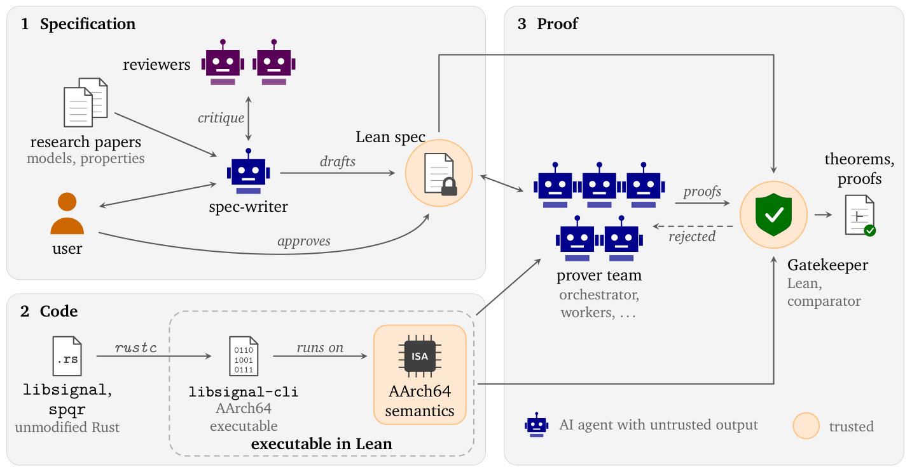
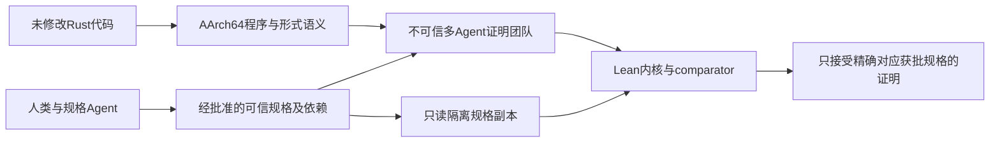

# AlphaProof Code：证明必须对应获批规格，而不只是能够通过检查

> `deferred_high_cost`，仅论文/代码来源与成本审查，**成本过高，不复现（审查 DONE）**。没有本地形式证明器、Agent 或可执行算子，不生成伪指标。

## 论文信息

| 字段 | 内容 |
| --- | --- |
| 论文链接 | [AlphaProof Code: Verifying Signal's Security at the Machine-Code Level，官方技术报告](https://deepmind.google/documents/36/Formal_Verification_of_Signal_4.pdf)，[官方项目](https://google-deepmind.github.io/code-verification/) |
| 公司/机构/学校 | 一作 Swarat Chaudhuri，Google DeepMind；九位作者均为 Google DeepMind 或 Google，按 PDF 第一页核对 |
| 首次公开日期 | 官方技术报告及 [发布说明](https://deepmind.google/blog/introducing-alphaproof-code/)标注 2026-11-10（日精度）；未找到 arXiv 标识，不捏造 ID 或 UTC 时刻 |
| 原文开源代码 | [google-deepmind/code-verification](https://github.com/google-deepmind/code-verification)，核对 commit `808b4b7ffef198e6a91f71ed776d641a1c236882`；证明、规格和检查代码，主代码 Apache-2.0，第三方 Signal 材料另有 AGPL-3.0-only 等许可 |
| 本地 Adapter | 无；文献 key：`alphaproof-code`；没有 `local_operator` |
| 本地复现代码 | 无本地复现；仅本页成本审查文档，不把上游源码链接当成本库已运行实现 |

## 原始论文总结

<!-- paper-figure:start -->
### 原论文关键图

来源：[官方技术报告第 2 页 Figure 1](https://deepmind.google/documents/36/Formal_Verification_of_Signal_4.pdf#page=2)，截取原图，未重绘。橙色可信边界包括规范批准、Lean 内核和 comparator；生成证明文本本身并不等于通过这些条件。本地仅收录成本与机制审查，没有运行该验证系统。

图片来自[原论文](https://deepmind.google/documents/36/Formal_Verification_of_Signal_4.pdf#page=2)，版权归原作者所有；图中完整系统或实验结果不等于本地组件结果。

<!-- paper-figure:end -->

### 背景与主要改动

人类与规格编写/审阅 Agent 先定义并批准要证明的安全性质，证明团队再处理实际 Rust 代码经标准编译器生成的 AArch64 程序。Lean 内核检查证明，gatekeeper 还要防止团队偷偷弱化规格或其依赖。原文涉及 PQXDH 握手和 Triple Ratchet 的符号/计算安全保证，而不是“所有 Signal 场景都无漏洞”。[PDF §2、§4–5](https://deepmind.google/documents/36/Formal_Verification_of_Signal_4.pdf)

### 核心验证条件

§2.4 的验收不是源码文本相同或正则找不到 `sorry`，而是同时满足：

$$
\mathrm{Accept}=\mathrm{KernelChecks}(p)\land
\mathrm{SameTransitiveSpecification}(p,S_{approved})\land
\mathrm{StandardAxiomsOnly}(p).
$$

开始证明前，把获批规格固定在 Agent 不可写目录；变更需经审查批准。comparator 检查定理及所有传递依赖，且从导出证明在新 Lean 内核重放，不直接信任已编译 `.olean`。人类仍须信任并审阅规格、机器语义及密码学假设；证明通过不等于规格代表了用户全部真实意图。

### 论文离线与线上效果

作者报告约 650 万行内核检查的证明，约 2.6 万行需信任的规格/机器语义，并重引入两项历史 bug 后证明其违反安全性质。对象是实际部署的协议实现，但这是形式验证成果，**不是生产随机流量 A/B 或业务指标提升**。这些是上游结果，本库未重跑。

## 本地审查与边界

### 来源核验

本轮只读了报告署名、§2.4、§7 与官方项目/固定 README，核对一手出处和成本。没有克隆整个大型证明仓库，没有安装 Lean/Rust 工具链，没有跑 `lake build` 或 comparator。也没有用 schema、哈希或 regex 模拟形式证明。无本地实验指标，不要求 GPU 回执，不接入 Evolve。

### 高成本完整实验

报告 §7 是五人团队持续四周、近 700 万行 Lean 的工作。上游 [固定 README](https://github.com/google-deepmind/code-verification/blob/808b4b7ffef198e6a91f71ed776d641a1c236882/README.md)明确全证明构建需数小时、约 15–34 GiB 峰值内存；还需要固定 Lean、Rust、LLVM、Zig、Mathlib 与 AArch64 编译链。comparator 依赖 Linux Landlock，Mac 不能直接等价执行。单卡 A100/A30 也不能省掉这些 CPU 构建和专业规格成本。

据原配置而非本地计时，**成本过高，不复现（审查 DONE）**。不启动“试试看”的大构建，不用几行玩具定理冒充 Signal 的关键安全证明，不进入自动重试或实现队列。
