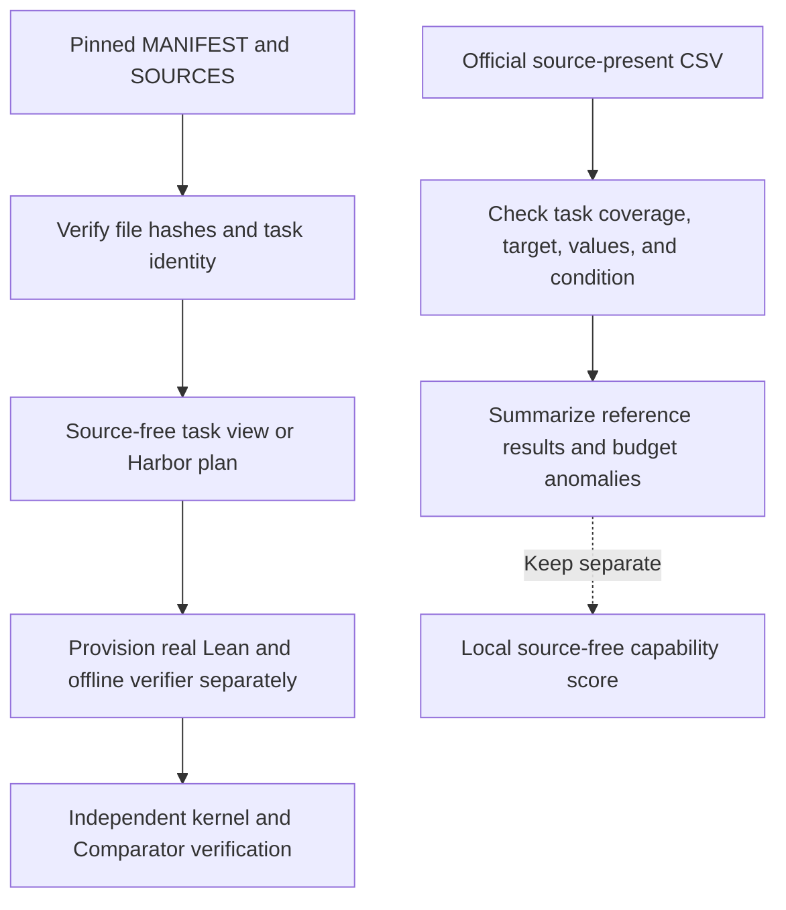
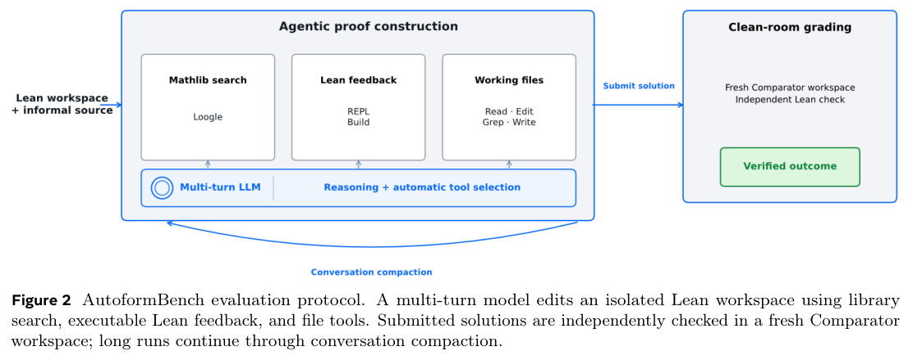

# Meta AutoformBench: Formal Mathematics Tasks and Results Interface

<!-- source-sha256: d2def41af1f87f010b9cdb0af70cfbc37250c2bd29b3478882c086f0bbc531ec -->

[简体中文](README.md)

> **CPU evaluation protocol interface only**, not a reproduction of model or agent capability. This work reads the real official task catalog and existing results. It does not run Lean, Harbor, inference, or paid APIs, report a local source-free success rate, or promote candidates in Evolve.

## Paper information

| Field | Details |
|---|---|
| Paper | [AutoformBench: A Lean Formalization Benchmark for Advanced Mathematics, official PDF](https://github.com/facebookresearch/autoformbench/blob/af1aa38fd44e019e566bce0b5a168609a886d8e6/paper.pdf); no verified arXiv ID for this work. It is not the document-understanding paper with the same name at arXiv 2603.29832. |
| Organization | Joint first authors Charles Arnal and Ahmad Rammal (random order): FAIR at Meta. Rammal also lists CERMICS / ENPC / Institut Polytechnique de Paris. |
| First public release | Not established. Official release page: 2026-10-13; manuscript cover: 2026-10-05; software CITATION: 2026-09-30. These are distinct and do not establish first public availability. |
| Authors' code | [Released: facebookresearch/autoformbench](https://github.com/facebookresearch/autoformbench), pinned to `af1aa38fd44e019e566bce0b5a168609a886d8e6`. |
| Adapter / method | None (`adapter: null`); standalone `evaluation_protocol_interface`, not an agent policy. |
| Local reproduction code | `src/auto_research/agent_research/autoformbench.py`; CLI: `scripts/run_autoformbench.py`. |
| License and intended use | Upstream CC BY-NC 4.0; research and evaluation only, not training data. Cited books have separate licenses and are not downloaded by this interface. |

## Original paper

### Motivation and method

AutoformBench asks agents to construct the definitions, auxiliary lemmas, and proofs that support advanced mathematics statements under pinned Lean and Mathlib versions. It is not a benchmark for filling in an isolated proof. Its 341 tasks draw from 24 mathematical sources and contain 1,155 proof obligations. A task succeeds only if every obligation passes trusted verification.

There are two distinct settings. The paper leaderboard provides agents with the informal source text (**source-present**). The public repository publishes **source-free** workspaces without textbook excerpts or reference proofs. Identical task IDs do not make scores under these settings comparable. See the [pinned official README](https://github.com/facebookresearch/autoformbench/blob/af1aa38fd44e019e566bce0b5a168609a886d8e6/README.md).

### Evaluation workflow



Trusted scoring keeps challenge declarations immutable and transfers only submitted Lean files. A clean workspace checks target equivalence, allowed axioms, Lean's kernel, and independent kernel replay with nanoda. Infrastructure errors have no numeric reward; they must not be counted as ordinary wrong answers scored at zero. See the [official Harbor/verifier protocol](https://github.com/facebookresearch/autoformbench/blob/af1aa38fd44e019e566bce0b5a168609a886d8e6/harbor/README.md).

<!-- paper-figure:start -->
### Key figure from the paper

[](https://raw.githubusercontent.com/facebookresearch/autoformbench/af1aa38fd44e019e566bce0b5a168609a886d8e6/paper.pdf#page=4)

> **Figure 2:** Overview of the benchmark method and components. From the [original paper](https://github.com/facebookresearch/autoformbench/blob/af1aa38fd44e019e566bce0b5a168609a886d8e6/paper.pdf); copyright remains with the authors.
<!-- paper-figure:end -->

### Scoring

For a fixed, complete task set $T$, the success rate is $\sum_{t\in T}\mathbf{1}[\text{all obligations accepted}]/|T|$. Cost-conditioned comparisons require identical tasks, source access, tools, scaffolds, and stopping policies; failed tasks, over-budget records, and infrastructure errors cannot be silently dropped.

The paper's nominal cap is USD 200 per task, not a uniform realized cost. This interface preserves reported CSV costs without recalculating them with current model prices.

### Results reported by the authors

On 341 source-present tasks, the official leaderboard records the following pass counts: GPT-6 Astra 281, Opus 5 211, GPT-5.6 Sol 201, Fable 5 181, DeepSeek V4.1 Flash 180, Gemini 3.7 Flash 179, Kimi K3 165, Sonnet 5 152, and Opus 4.8 150. These are existing reference results from the authors, **not new local runs**. No production A/B test is reported.

## Local interface

### 1. Fetch public manifests and existing results

Run from the repository root in a Python environment with the project installed:

```bash
PYTHONPATH=src python scripts/run_autoformbench.py fetch \
  --release-dir .cache/autoformbench-af1aa38 --all-models
```

Downloads only `MANIFEST.csv`, `SOURCES.csv`, and nine task-level CSVs, totaling less than 1 MB. The revision and per-file SHA-256 values are pinned. A moving `main`, identically named files with different content, or unverified existing cache entries are rejected. No textbook, model, Mathlib checkout, container, or trace is downloaded.

### 2. Export the source-free manifest or select tasks

```bash
PYTHONPATH=src python scripts/run_autoformbench.py tasks \
  --release-dir .cache/autoformbench-af1aa38 \
  --output runs/autoformbench/tasks.json

PYTHONPATH=src python scripts/run_autoformbench.py tasks \
  --release-dir .cache/autoformbench-af1aa38 \
  --book algebraic_topology_i --limit 2 \
  --output runs/autoformbench/topology-two.json
```

`--task` and `--book` can be supplied more than once. Duplicate or unknown IDs, empty intersections, and invalid limits are errors. Output preserves task declarations, source references, canonical workspace links, and a hash of the selection. It is a metadata view, **not a complete task package with Lean installed**.

### 3. Plan a real Harbor execution without running it

```bash
PYTHONPATH=src python scripts/run_autoformbench.py plan \
  --release-dir .cache/autoformbench-af1aa38 \
  --repository-dir /absolute/path/to/autoformbench \
  --task alg_top_theorem107 --agent nop \
  --output runs/autoformbench/nop-plan.json
```

The output contains the actual argument vectors for the official `harbor/export.py --problem`, its read-only `--check`, and Harbor 0.22.0. The interface neither executes the commands nor installs dependencies. Running requires the complete pinned checkout, Lean v4.32.2, Mathlib `905b95818eb32af7874a58b427f50c1711a5e96c`, Harbor 0.22.0, and both prebuilt images. A formal evaluation must also pin the image digests.

The default `nop` calls no model. Its original `sorry` must be rejected for an expected reward of 0. An actual agent requires explicit `--agent` and `--model provider/model`. The plan preserves upstream per-task timeouts (86,400 seconds for the agent and 6,000 for the verifier), **does not enforce a dollar cap, and does not authorize a low-cost run**. This path was not executed. See the [official execution and isolation configuration](https://github.com/facebookresearch/autoformbench/blob/af1aa38fd44e019e566bce0b5a168609a886d8e6/harbor/templates/task.toml).

### 4. Import official source-present results

```bash
PYTHONPATH=src python scripts/run_autoformbench.py import-results \
  --release-dir .cache/autoformbench-af1aa38 --all-models \
  --source-condition source-present --budget-usd 200 \
  --output runs/autoformbench/official-reference.json
```

An import requires pinned file hashes; exactly 341 known, unique task IDs in each file; matching source and target declarations; valid booleans and finite nonnegative counts and costs; and consistent success and stop reasons. Changed files, source-present CSVs relabeled `source-free`, changes to the nominal budget, and mixing task sets, scaffolds, tools, or stopping policies are rejected. The input is summarized as-is, not presented as a local capability score.

`--strict-budget` further requires every reported cost to stay within the selected budget. Without it the interface still reports a complete `budget_audit`, **not a certification of hard-budget compliance**. The pinned Fable 5 CSV contains one task at USD 358.8273 against the nominal USD 200 cap. The public files do not establish why. The interface retains the anomaly and refuses a strict USD 200 comparison of all nine models instead of capping the value or removing the task.

### 5. Import an existing verifier verdict

```bash
PYTHONPATH=src python scripts/run_autoformbench.py verdict \
  --path /absolute/path/to/real/verdict.json --task alg_top_theorem107 \
  --output runs/autoformbench/verdict-import.json
```

This checks the official verdict structure and task ID only. `accepted/rejected/error` preserve the meanings `1/0/null`; errors are not imputed as 0. A JSON file cannot prove image identity, independent kernel execution, or submission provenance. Output always carries `verifier_provenance_attested: false` and `local_capability_score: null`. The interface never manufactures a successful subprocess to fill that gap.

## Local validation

On 2026-10-15, the pinned small public files were read on Mac CPU: 341 tasks, 24 sources, 1,155 proof obligations, and 3,069 task rows across the nine complete CSVs. Every pass count matched upstream. Lean was not run, and there is no local source-free score.

The [CPU interface receipt](validation/interface-cpu.json) reports parsing and validation counts, not model scores. It lives under `validation/` and does not enter the public experiment dashboard as a seedless model experiment.

| Pinned input | SHA-256 |
| --- | --- |
| MANIFEST.csv | `8fcde3381403e456b42639ab040a2cc47cb02369bddfedc345fa7d42cd8af674` |
| SOURCES.csv | `854135c5c49acc2506a38a08dfbd5f205f71a5e26f40f0d38b865aedf60e73c8` |
| gpt-6-astra.csv | `64a2174e047eac29468a7925768f1671f9c9ab8fd59d4547f78b1d80ff340bd5` |

`FILE_HASHES` contains hashes for all nine CSVs. Tests cover corruption, duplicated or missing IDs, target substitution, non-finite costs, condition or budget mismatches, unknown dates, read-only import, and infrastructure errors. Artificial CSV/JSON inputs in unit tests are parser counterexamples, not paper experiments.

## Implementation mapping and limits

| Local implementation | Preserved protocol | Not implemented or claimed |
| --- | --- | --- |
| `load_release`, `select_tasks`, `task_view` | Pinned versions and hashes, task-to-source correspondence, deterministic selection | Lean source audit, complete workspaces, dependency installation |
| `harbor_plan` | Source-free setting, official exporter and runner arguments, no-network/nop plan | Harbor execution, paid models, image or verifier attestation |
| `import_official_results`, `validate_comparison` | Complete task IDs, declarations, reported costs, condition and budget differences | Trace replay, rescoring, new source-free results |
| `read_verifier_verdict` | Parses real output schema; errors have no numeric reward | Running or replacing Comparator/nanoda, proof-file authenticity |

The original nine frontier model runs, 341 long task trajectories, textbooks, and toolchain exceed the low-cost budget of a single A100/A30 or local Mac. **Full experiment not reproduced due to cost; review complete.** Only the interface is delivered. It is CPU-only and does not require a GPU receipt, upgrade historical review status to algorithm acceptance, supply training data, or automatically enter Evolve.
