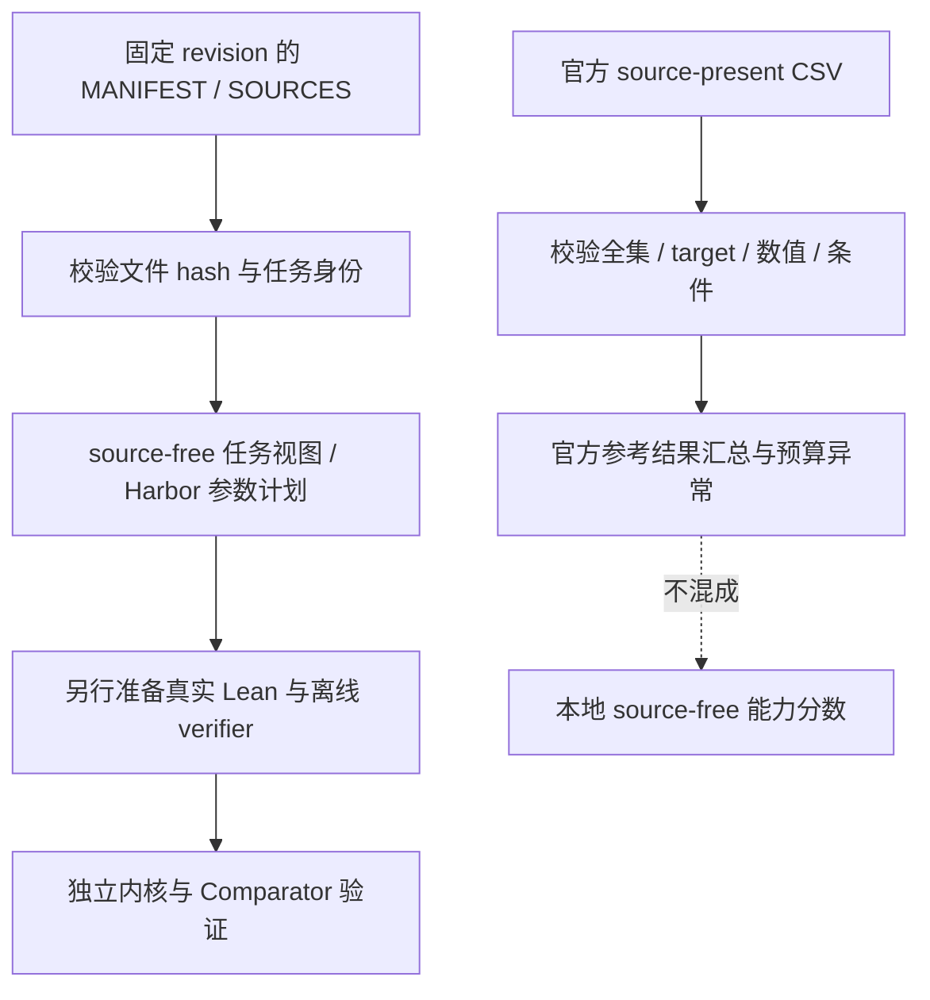
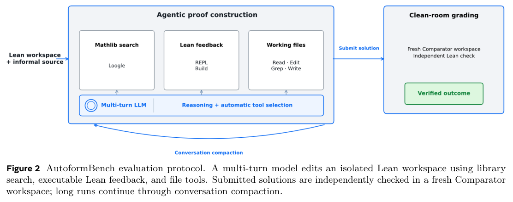

# Meta AutoformBench：形式化数学任务与结果接口

> 本页是 **CPU 评测协议接口**，不是模型/Agent 能力复现。本轮真实读取官方任务清单和已有结果，未运行 Lean、Harbor、模型推理或付费 API；不提供本地 source-free 成功率，不接入 Evolve 晋级。

## 论文信息

| 字段 | 内容 |
| --- | --- |
| 论文链接 | [AutoformBench: A Lean Formalization Benchmark for Advanced Mathematics，官方 PDF](https://github.com/facebookresearch/autoformbench/blob/af1aa38fd44e019e566bce0b5a168609a886d8e6/paper.pdf)；未核实该作 arXiv ID，不是 arXiv 2603.29832 的同名文档理解论文 |
| 公司/机构 | 共同一作 Charles Arnal / Ahmad Rammal（随机排序）：FAIR at Meta；Rammal 另列 CERMICS / ENPC / Institut Polytechnique de Paris |
| 首次公开日期 | 未确定。官方发布页为 2026-10-13，论文首页文稿日期为 2026-10-05，软件 CITATION 日期为 2026-09-30；三者不能拼成已证实的首次公开日 |
| 原文开源代码 | [已开源：facebookresearch/autoformbench](https://github.com/facebookresearch/autoformbench)，固定 revision `af1aa38fd44e019e566bce0b5a168609a886d8e6` |
| 本地 Adapter | 无（`adapter: null`）；独立 `evaluation_protocol_interface`，不注册为 Agent 策略 |
| 本地复现代码 | `src/auto_research/agent_research/autoformbench.py`；CLI：`scripts/run_autoformbench.py` |
| 许可与用途 | 上游 CC BY-NC 4.0；仅用于评测和研究，不作训练数据。引用来源的书籍另有各自许可，不由本接口下载 |

## 原始论文总结

### 背景与主要改动

AutoformBench 不只要求补一个孤立证明，而是让 Agent 在固定 Lean/Mathlib 上构造支撑高级数学命题的定义、辅助引理和证明。341 个任务来自 24 个数学来源，共有 1,155 个需要完成的证明义务；一个任务只有全部义务均通过可信验证才算成功。

最容易混淆的是两个不同实验条件：论文排行榜向 Agent 提供非形式化原文（**source-present**）；公开仓库则发布不含教材摘录/参考证明的 **source-free** 工作区。相同 task ID 并不代表两种条件的成绩可以直接比较。[官方固定版本说明](https://github.com/facebookresearch/autoformbench/blob/af1aa38fd44e019e566bce0b5a168609a886d8e6/README.md)

### 评测流程



可信评分必须保持挑战声明不可修改、仅转移提交的 Lean 文件，在干净工作区验证目标等价、允许公理、Lean 内核以及 nanoda 独立内核重放。基础设施错误没有数值奖励，不能当作普通错误答案记 0。[官方 Harbor/verifier 协议](https://github.com/facebookresearch/autoformbench/blob/af1aa38fd44e019e566bce0b5a168609a886d8e6/harbor/README.md)

<!-- paper-figure:start -->
### 原论文关键图

[](https://raw.githubusercontent.com/facebookresearch/autoformbench/af1aa38fd44e019e566bce0b5a168609a886d8e6/paper.pdf#page=4)

> **原论文 Figure 2（关键图）**：展示原论文方法的总体设计和关键组成。图片来自[原论文](https://github.com/facebookresearch/autoformbench/blob/af1aa38fd44e019e566bce0b5a168609a886d8e6/paper.pdf)，版权归原作者所有；点击图片可查看来源。
<!-- paper-figure:end -->

### 核心公式

对固定、完整任务集合 $T$，成功率为 $\sum_{t\in T}\mathbf{1}[\text{all obligations accepted}]/|T|$。预算条件曲线只允许使用相同任务集合、来源访问、工具、scaffold 和停止策略；不能把失败任务、超预算行或基础设施错误静默删除。

论文名义美元上限是每题 200 美元，不是每题实际统一花费。本接口保留 CSV 实报成本而不重新按当前模型价格换算。

### 论文离线与线上效果

官方 source-present 排行榜在 341 题上的通过数依次为：GPT-6 Astra 281、Opus 5 211、GPT-5.6 Sol 201、Fable 5 181、DeepSeek V4.1 Flash 180、Gemini 3.7 Flash 179、Kimi K3 165、Sonnet 5 152、Opus 4.8 150。它们是原作者已有参考成绩，**不是本轮新跑的成绩**。未报告生产线上 A/B。

## 本地接口与操作

### 1. 获取小型公开清单与已有结果

在项目根目录、已安装项目的 Python 环境中运行：

```bash
PYTHONPATH=src python scripts/run_autoformbench.py fetch \
  --release-dir .cache/autoformbench-af1aa38 --all-models
```

只下载 `MANIFEST.csv`、`SOURCES.csv` 和九份任务级 CSV，总量不足 1 MB；固定 revision 和每文件 SHA256，不接受浮动 `main` 或同名不同内容。已有缓存必须先通过 hash 校验。不会下载教材、模型、Mathlib、容器或轨迹。

### 2. 导出 source-free 清单或筛选任务

```bash
PYTHONPATH=src python scripts/run_autoformbench.py tasks \
  --release-dir .cache/autoformbench-af1aa38 \
  --output runs/autoformbench/tasks.json

PYTHONPATH=src python scripts/run_autoformbench.py tasks \
  --release-dir .cache/autoformbench-af1aa38 \
  --book algebraic_topology_i --limit 2 \
  --output runs/autoformbench/topology-two.json
```

支持重复 `--task` / `--book`，但重复或未知 ID、空交集、非法上限会报错。输出保留任务声明、来源引用、规范工作区链接和选择内容 hash；这是元数据视图，**不是包含 Lean 环境的完整任务包**。

### 3. 准备真实 Harbor 执行计划（本轮不执行）

```bash
PYTHONPATH=src python scripts/run_autoformbench.py plan \
  --release-dir .cache/autoformbench-af1aa38 \
  --repository-dir /absolute/path/to/autoformbench \
  --task alg_top_theorem107 --agent nop \
  --output runs/autoformbench/nop-plan.json
```

计划给出官方 `harbor/export.py --problem`、只读 `--check` 和 Harbor 0.22.0 的实际参数向量；不执行命令，不自动下载依赖。真正运行前，必须有该固定提交的完整 checkout、Lean v4.32.2、Mathlib `905b95818eb32af7874a58b427f50c1711a5e96c`、Harbor 0.22.0 及预先构建的两种镜像；正式评测还需固定镜像 digest。

默认 `nop` 不调用模型，原始 `sorry` 必须被拒绝，预期奖励为 0。换成真实 Agent 必须显式提供 `--agent` 和 `--model provider/model`。计划保留上游单任务超时（Agent 86,400 秒、verifier 6,000 秒），**并不执行美元预算限制，也不代表低成本运行许可**；本轮没有启用该完整运行路径。[官方执行和隔离配置](https://github.com/facebookresearch/autoformbench/blob/af1aa38fd44e019e566bce0b5a168609a886d8e6/harbor/templates/task.toml)

### 4. 导入官方 source-present 结果

```bash
PYTHONPATH=src python scripts/run_autoformbench.py import-results \
  --release-dir .cache/autoformbench-af1aa38 --all-models \
  --source-condition source-present --budget-usd 200 \
  --output runs/autoformbench/official-reference.json
```

导入前必须满足：固定文件 hash、每份 341 个任务且无遗漏/重复/未知 ID、来源和目标声明匹配、布尔值及非负有限计数/成本合法、成功与停止原因一致。修改文件、把官方 CSV 声明成 `source-free`、更改名义预算、混用任务集合/scaffold/工具/停止策略均拒绝。文件原样汇总，不能把官方参考成绩移植成自己的能力分数。

`--strict-budget` 进一步要求所有行实报成本不超过所选预算；不指定时仍输出完整 `budget_audit`，**不等于验证了硬预算合规**。这一区分很重要：固定版本 Fable 5 CSV 存在一行实报 358.8273 美元，高于名义 200 美元。公开文件不足以确定原因，接口保留该异常；九模型的严格 200 美元预算比较会拒绝，而不是削成 200 或删掉该题。

### 5. 读取已经真实产生的 verifier verdict

```bash
PYTHONPATH=src python scripts/run_autoformbench.py verdict \
  --path /absolute/path/to/real/verdict.json --task alg_top_theorem107 \
  --output runs/autoformbench/verdict-import.json
```

此操作只校验官方 verdict 结构和任务 ID；`accepted/rejected/error` 分别保留 `1/0/null` 的含义，错误不填成 0。一个 JSON 文件不能证明镜像、独立内核与提交来源，所以输出始终标明 `verifier_provenance_attested: false`、`local_capability_score: null`；本接口不会伪造子进程成功来补上这些证据。

## 本轮实际验证与结果

2026-10-15 在 Mac CPU 上实际读取上述固定提交的小型公开文件：341 任务、24 来源、1,155 证明义务；对九份完整 CSV 导入，共 3,069 个任务结果行。通过数与原仓库全部一致，未运行 Lean，也没有本地 source-free 能力分数。

小型结构化回执见 [CPU 接口验证](validation/interface-cpu.json)；其字段是解析/校验数量，不是本地模型成绩。它独立存放在 `validation/`，不会作为无 seed 的模型实验导入公开实验看板。

固定输入摘要：

| 输入 | SHA256 |
| --- | --- |
| MANIFEST.csv | `8fcde3381403e456b42639ab040a2cc47cb02369bddfedc345fa7d42cd8af674` |
| SOURCES.csv | `854135c5c49acc2506a38a08dfbd5f205f71a5e26f40f0d38b865aedf60e73c8` |
| gpt-6-astra.csv | `64a2174e047eac29468a7925768f1671f9c9ab8fd59d4547f78b1d80ff340bd5` |

所有九份 CSV 的固定 hash 均写在接口 `FILE_HASHES`。本轮测试覆盖数据损坏、重复/缺失 ID、目标替换、非有限成本、条件/预算混用、未知日期、只读结果导入及基础设施错误；单测使用的人工 CSV/JSON 只是解析器反例，不计入论文实验。

## 代码映射、成本与边界

| 本地实现 | 保留的协议 | 没有实现或宣称的部分 |
| --- | --- | --- |
| `load_release` / `select_tasks` / `task_view` | 固定版本与 hash、任务和来源对应、确定性筛选 | Lean 文件内容审计、完整工作区和依赖安装 |
| `harbor_plan` | source-free、官方 exporter/runner 参数、无网络/nop 计划 | 运行 Harbor、付费模型、镜像和 verifier 能力证明 |
| `import_official_results` / `validate_comparison` | 完整 task ID、声明、实报成本、条件与预算差异 | 原始轨迹重放、重新评分、source-free 新成绩 |
| `read_verifier_verdict` | 读取真实输出格式，错误无数值奖励 | 执行或代替 Comparator/nanoda、证明文件不可伪造 |

原研究的九类 frontier 模型、341 题长轨迹及教材/工具链准备超出单张 A100/A30 或本地 Mac 的低成本预算，**成本过高，不复现（审查 DONE）**。本轮仅完成接口，不以组件完成冒充完整论文复现。接口纯 CPU，不要求 GPU 回执，不把历史审查状态改成算法验收，不将数据用于训练或自动进入 Evolve。
