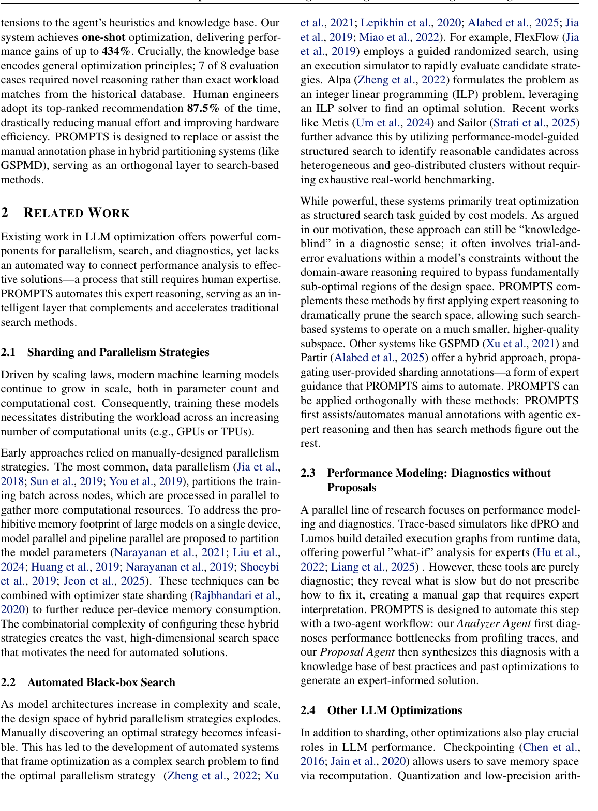

# PROMPTS: Performance Optimization via Multi-Agent Planning for LLM Training and Serving

<!-- source-sha256: c03f9ab92abdf99a4ebd83412215fa2b25548d714d64593240d38119342bb057 -->

[简体中文](README.md)

> L1 profiler evidence ordering and constrained proposals; no Google TPU profiler or GSPMD.

## Paper information

| Field | Details |
|---|---|
| Paper | [Paper or original source](https://research.google/pubs/prompts-performance-optimization-via-multi-agent-planning-for-llm-training-and-serving/) |
| Institution | University of Maryland / Google (first author). |
| First public release | 2026-05-18 |
| Author code | No public author repository found as of 2026-09-14. |
| Local adapter or method key | `prompts` |
| Local reproduction code | [`src/auto_research/agent_research/latest_20260914.py`](https://github.com/daiwk/auto-research/blob/main/src/auto_research/agent_research/latest_20260914.py) |

## Paper method and evidence

Coordinator, Analyzer and Proposal Agent jointly consult profiler and knowledge-base evidence, diagnose bottlenecks and propose explainable sharding changes.

<!-- paper-figure:start -->
### Original paper figure

Figure 2 illustrates the multi-agent optimization flow. From the [original paper](https://research.google/pubs/prompts-performance-optimization-via-multi-agent-planning-for-llm-training-and-serving/); copyright remains with the authors.
<!-- paper-figure:end -->

### Reported results

Paper reports up to 434% improvement on eight production workloads. Engineer selections always in top 3; top 1 hit 87.5%. Not a local run or inferred online A/B.

## Local reproduction

MLSys 2026 Industry Track; repository identifier `mlsys2026-prompts`. [Three-seed metrics](metrics/mechanism-seeds42-44.json) use matched public fixtures and budget; only state transitions are validated.
