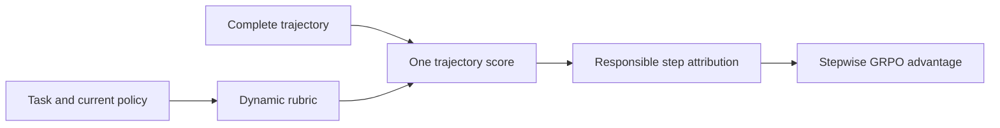
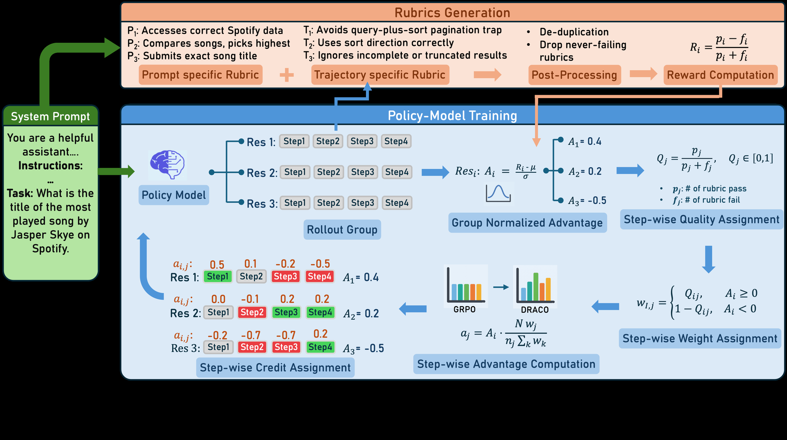

# DRACO: Dynamic-rubric step credit for long-horizon agents

<!-- source-sha256: 97a36ea3c73bee89fd2b6cb616c0dd41b6495aaec1818460ac04670582e62074 -->

[简体中文](../../../agent-research/2609.04094-draco/README.md)

> **Fidelity:** Core mechanism mini-suite for dynamic rubrics, responsible steps, and score redistribution.

## Paper information

| Field | Value |
|---|---|
| Paper | [arXiv 2609.04094](https://arxiv.org/abs/2609.04094) |
| Organization | Carnegie Mellon University (first author's first affiliation), with IBM Research |
| First published | 2026-09-03 (arXiv v1) |
| Original author code | Yes: [IBM/draco](https://github.com/IBM/draco). |
| Local adapter or method | `draco` |
| Local reproduction code | [`src/auto_research/agent_research/latest_20260905.py`](https://github.com/daiwk/auto-research/blob/main/src/auto_research/agent_research/latest_20260905.py) |

## Original paper summary

Long-horizon agents often have no programmatic verifier, and one trajectory score cannot identify useful steps. DRACO adapts multidimensional rubrics to the policy, scores each finished trajectory once, and allocates advantages from rubric step annotations without training an attribution model.

<!-- paper-figure:start -->
### Key figure from the paper

**Original Figure 1** shows the authors' design and key components. Image from the [original paper](https://arxiv.org/abs/2609.04094); copyright belongs to the authors. Click for its source.
<!-- paper-figure:end -->

### Core mechanism

For rubric score $r_j$ and responsible steps $S_j$, preserve $A_t=\sum_{j:t\in S_j}w_{jt}r_j$ with normalization for length and reward scale.

### Paper results

AppWorld improves 15.9 points over base and 5.3 over sparse-true-reward GRPO. Out-of-domain Tau-Bench improves 5.3 points.

## Local reproduction and limits

The shared agent mini-suite uses seeds 42/43/44 and records rubrics, attributed steps, redistribution, success, and cost. A deterministic fixture does not reproduce AppWorld/Tau-Bench model training or a frontier judge. No advertised CUDA path. [Stable metrics](../../../agent-research/2609.04094-draco/metrics/mini-suite-seeds42-44.json).
