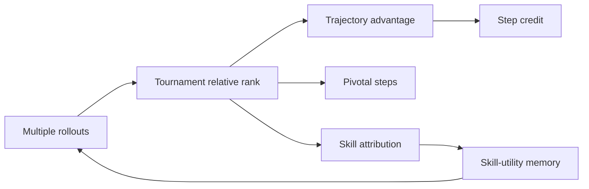
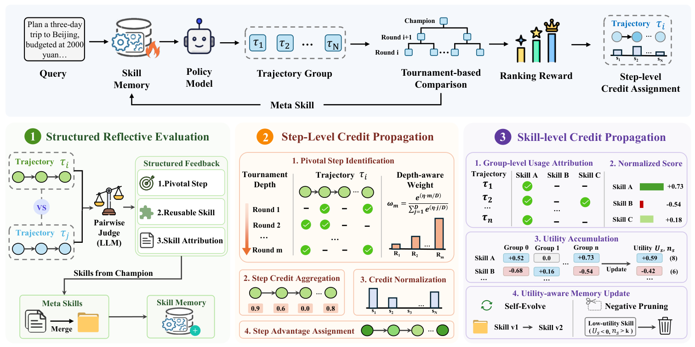

# ArenaFlow: From trajectory ranking to hierarchical credit

<!-- source-sha256: 66d2b7b8388d74ec7d5d9c72b192d3d8a98d74c40fe1a28eb171053631c50a36 -->

[简体中文](../../../agent-research/2609.21378-arenaflow/README.md)

> **Fidelity:** L1 diagnostic for tournament, pivotal-step, and skill-utility ledgers, without real online RL.

## Paper information

| Field | Value |
|---|---|
| Paper | [ArenaFlow](https://arxiv.org/abs/2609.21378) |
| Organization | Alibaba Group (first author affiliation) |
| First published | 2026-09-18 (arXiv v1) |
| Original author code | Yes: [Alibaba-NLP/qqr](https://github.com/Alibaba-NLP/qqr), linked by the paper; repository contents still need version verification. |
| Local adapter or method | `arenaflow` |
| Local reproduction code | [`src/auto_research/agent_research/latest_20260921.py`](https://github.com/daiwk/auto-research/blob/main/src/auto_research/agent_research/latest_20260921.py) |

## Original paper summary

Tournament relative ranks replace saturated point rewards. Structured comparisons identify pivotal successes, reusable skills, and skill-use attribution. Trajectory advantages propagate along survival depth to key steps. Skill utility updates the global skill memory to guide exploration.

<!-- paper-figure:start -->
### Key figure from the paper

**Original Figure 2** shows the authors' design and key components. Image from the [original paper](https://arxiv.org/abs/2609.21378); copyright belongs to the authors. Click for its source.
<!-- paper-figure:end -->

### Core mechanism

The trajectory advantage is `A_i = (rank_mean - rank_i) / max(n-1,1)`. Local code distributes it to pivotal steps along survival depth and adds success contributions to corresponding skills.

## Local reproduction and limits

Three-layer credit and gold-plan isolation only. No gradient updates. [Stable metrics](../../../agent-research/2609.21378-arenaflow/metrics/mechanism-seeds42-44.json).
