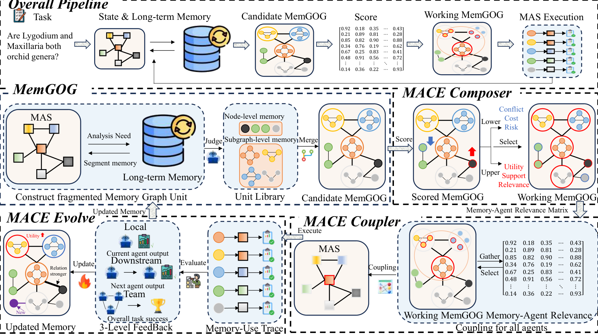

# MACE: Memory–agent co-evolution over adaptive memory graphs

<!-- source-sha256: ecf7ba96d4d27c367d565b0e6e5567c4326078c6b8dccc69c8ae3d15d87c25f9 -->

[简体中文](../../../agent-research/2609.21533-mace/README.md)

> **Fidelity:** L1 diagnostic for functional units, typed relations, and outcome-conditioned updates. No full eight-benchmark or multi-agent LLM run.

## Paper information

| Field | Value |
|---|---|
| Paper | [MACE](https://arxiv.org/abs/2609.21533) |
| Organization | First author's institution unclear in arXiv HTML; no inference made. |
| First published | 2026-09-18 (arXiv v1) |
| Original author code | No public author code found (checked 2026-09-21). |
| Local adapter or method | `mace` |
| Local reproduction code | [`src/auto_research/agent_research/latest_20260921.py`](https://github.com/daiwk/auto-research/blob/main/src/auto_research/agent_research/latest_20260921.py) |

## Original paper summary

MemGoG groups conditions, actions, and outputs into units with local dependencies and links experiences via support, conflict, and repair. MACE Loop chooses a working graph within budget, presents it as instructions or checklists, and jointly updates composition, presentation, and results.

<!-- paper-figure:start -->
### Key figure from the paper

**Original Figure 2** shows the authors' design and key components. Image from the [original paper](https://arxiv.org/abs/2609.21533); copyright belongs to the authors. Click for its source.
<!-- paper-figure:end -->

### Core mechanism

Local update `w'_(i,j) = w_(i,j) + η · outcome · relation(i,j)` retains separate support, conflict, and repair edges and the outcome-conditioned direction, not the full paper optimizer.

## Local reproduction and limits

The deterministic public-observation mini-suite records units, relations, and presentation feedback, not multi-agent capability gains. [Stable metrics](../../../agent-research/2609.21533-mace/metrics/mechanism-seeds42-44.json).
