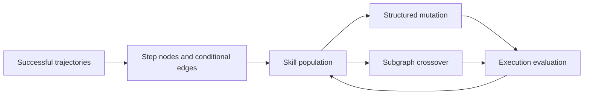
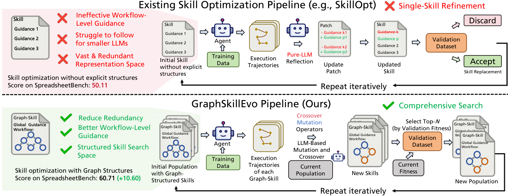

# GraphSkillEvo: Evolving graph-structured agent skills

<!-- source-sha256: f4f9b5a8eeecf4c028a9946873237cb7420e2bac2015e0ab6fdeea1e17ae094d -->

[简体中文](../../../agent-research/2609.21749-graphskillevo/README.md)

> **Fidelity:** L1 diagnostic with explicit skill graphs, deduplication, structured mutation, and crossover. No GPT-5.4 calls or full five-benchmark run.

## Paper information

| Field | Value |
|---|---|
| Paper | [GraphSkillEvo](https://arxiv.org/abs/2609.21749) |
| Organization | City University of Hong Kong (first author affiliation) |
| First published | 2026-09-18 (arXiv v1) |
| Original author code | Yes: [ruisun7/GraphSkillEvo](https://github.com/ruisun7/GraphSkillEvo). |
| Local adapter or method | `graphskillevo` |
| Local reproduction code | [`src/auto_research/agent_research/latest_20260921.py`](https://github.com/daiwk/auto-research/blob/main/src/auto_research/agent_research/latest_20260921.py) |

## Original paper summary

Skills become action-step nodes with context-conditional edges, reducing free-text redundancy and clarifying workflows. Population evolution uses structural mutation and crossover to expand search.

<!-- paper-figure:start -->
### Key figure from the paper

**Original Figure 1** shows the authors' design and key components. Image from the [original paper](https://arxiv.org/abs/2609.21749); copyright belongs to the authors. Click for its source.
<!-- paper-figure:end -->

### Core mechanism

Local fitness is `fitness(G) = success(G) - λ · duplicate_nodes(G)`. Subgraph crossover requires valid parent topology and no duplicate edges. These are structure checks, not paper-scale capability.

## Local reproduction and limits

Public observations form skill graphs; deduplication and crossover are deterministic. The mini-suite tests state invariants, not the paper's ability claims. [Stable metrics](../../../agent-research/2609.21749-graphskillevo/metrics/mechanism-seeds42-44.json).
