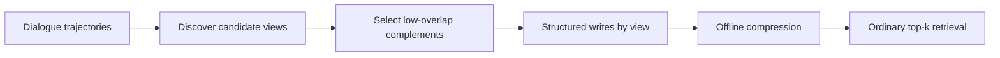
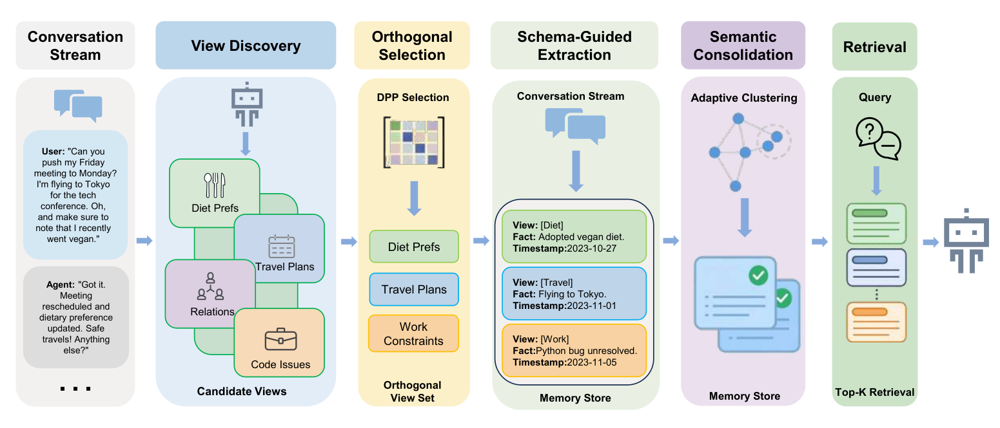

# AutoViewMem: Self-configuring orthogonal views for long-term dialogue memory

<!-- source-sha256: c10b2baab365ce1a111d7021a62391eb48c2363011ceeb13ef2a9701e46e11f3 -->

[简体中文](../../../agent-research/2609.21940-autoviewmem/README.md)

> **Fidelity:** L1 diagnostic for pre-write view discovery, low-overlap storage, and offline compression. No Qwen3-8B/14B, LoCoMo, or PersonaMem runs.

## Paper information

| Field | Value |
|---|---|
| Paper | [AutoViewMem](https://arxiv.org/abs/2609.21940) |
| Organization | National University of Defense Technology (first author affiliation) |
| First published | 2026-09-18 (arXiv v1) |
| Original author code | No public author code found (checked 2026-09-21). |
| Local adapter or method | `autoviewmem` |
| Local reproduction code | [`src/auto_research/agent_research/latest_20260921.py`](https://github.com/daiwk/auto-research/blob/main/src/auto_research/agent_research/latest_20260921.py) |

## Original paper summary

Discover semantic views from trajectories, select low-overlap complements, and extract memories with provenance by view. Separation precedes indexing, so ordinary top-k suffices without complex routing. Offline graph compression merges duplicate or conflicting memories.

<!-- paper-figure:start -->
### Key figure from the paper

**Original Figure 1** shows the authors' design and key components. Image from the [original paper](https://arxiv.org/abs/2609.21940); copyright belongs to the authors. Click for its source.
<!-- paper-figure:end -->

### Core mechanism

Local overlap is `overlap(v_i,v_j) = |T_i ∩ T_j| / |T_i ∪ T_j|`. Write only complementary views below the threshold. This mini-suite proxy does not replace the LLM view discoverer.

## Local reproduction and limits

The kernel makes bounded view buckets from public observations and records discovery, orthogonal writes, and consolidation. Gold answers stay out of policy input. [Stable metrics](../../../agent-research/2609.21940-autoviewmem/metrics/mechanism-seeds42-44.json).
