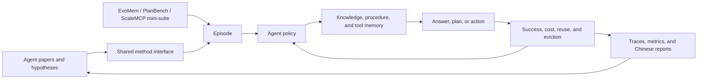

# Agent paper research

<!-- source-sha256: ed6fadf3cbda58413328fb73c9953f65d3e453572ac0a1102195fa4980c08138 -->

[简体中文](../../agent-research/README.md)

Recent scaled mechanism experiment: [GRAFT trajectory-graph credit assignment](../experiments/sep28-three-mechanisms.md). LLM-policy and formal-environment evaluation are not complete.

The [paper implementation and evaluation library](../research-library.md) covers agent memory, planning, tools, collaboration, and self-evolution here. Deterministic mini-suites check state and reuse across episodes. `swebench-local` creates temporary repositories, edits code, and executes regression tests. These methods and evaluators also underpin [Agent Evolve](../evolution-domains.md).

!!! info "Reproduction fidelity"
    Mini-suites reproduce mechanisms. Code sandboxes execute real actions in a microbenchmark, not official SWE-bench Lite. Paper pages separate author results, local mapping, and limits.

## Quick entry points

- [AgentX-Model](../../agent-research/2609.30001-agentx-model/README-en.md): Dual proposer/investigator roles, four research actions, and outcome-blind dependency-graph replay. Public MovieLens-1M mechanism check, not the private production system.
- [AtomRec](../../agent-research/2609.04882-atomrec/README-en.md): Atomic preference memory, semantic–collaborative links, and multi-hop recommendation evidence.
- [CoSkill](../../agent-research/2609.04865-coskill/README-en.md): Joint training of reasoning policy, meta-skill policy, and a hierarchical skill library.
- [SiLR](../../agent-research/2609.04629-silr/README-en.md): Shadow execution, per-branch product-order admission, and same-source process rewards.
- [Multi-Harness RL](../../agent-research/2609.04518-multi-harness-rl/README-en.md): Freezes experience to distinguish grouping credit from transfer across execution harnesses.
- [DRACO](2609.04094-draco/README.md): Dynamic rubrics and closed-form redistribution of step credit.
- [Agents in Evolve](../evolution-domains.md): Supported status, combination axes, and execution limits.
- [Methods index](catalog.md): Browse memory, planning, tool management, and other areas.
- [Lineage and gaps](lineage.md): Audits the classic lineage, recent coverage, and real-environment prerequisites.
- [Shared evaluation protocol](benchmark.md): Mini-suites, cost definitions, fair comparisons, and inclusion criteria.
- [L2.1 isolated capability evaluation and Evolve](capability-benchmark.md): Removes guide/oracle, isolates train/validation/test, and integrates nine Agent genome axes into the multi-round controller.
- [Trainable policies and real executors](training-executor.md): Agent Lightning checkpoint updates and a matched-budget execution matrix.
- [SPO++](../../agent-research/2608.24870-spo-plus-plus/README-en.md): Freezes prompt values at generation and corrects asynchronous advantages under an action-token measure.
- [SkillForge](../../agent-research/2608.24747-skillforge/README-en.md): Explicit creation, invocation, verification, and revision of reusable skills.
- [AHEAD](../../agent-research/2608.24114-ahead/README-en.md): Adds environmental feedback to ordinary steps and corrective hints to erroneous steps.
- [SMITH](../../agent-research/2608.24571-smith/README-en.md): Jointly optimizes tool creation and use, separating schema, code, and result verification.
- [JIT-Agent](../../agent-research/2608.25593-jit-agent/README-en.md): Builds task-specific memory, planning, action protocol, and tools/skills; repairs the harness from failures.
- [TraceML](../../agent-research/2608.26086-traceml/README-en.md): Converts execution traces into trainable state, action, and credit records for cross-task diagnosis and reuse.
- [AdaVDR](../../agent-research/2608.25559-adavdr/README-en.md): Allocates retrieval depth by verification uncertainty and constrains answers with evidence consistency.
- [TOPAS](../../agent-research/2608.25523-topas/README-en.md): Typed observation, planning, and action schemas for long-horizon tools.
- [CaSKG](../../agent-research/2608.25500-caskg/README-en.md): Causal skill graphs for retrieving, composing, and validating task-specific paths.
- [ProgRouter](../../agent-research/2608.25992-progrouter/README-en.md): Progressively routes planner, tools, and recovery policy from the task and live feedback.
- [Agent-G²](../../agent-research/2608.23318-agent-g2/README-en.md): Estimates Gaussian guidance bands online from existing rollouts, without extra probes.
- [AutoSaddler](../../agent-research/2608.23041-autosaddler/README-en.md): Diagnoses failed traces and generates and verifies durable harness patches.
- [Toolformer](../../agent-research/2302.04761-toolformer/README-en.md): Self-supervised tool-call filtering by token-loss improvement.
- [Self-Refine](../../agent-research/2303.17651-self-refine/README-en.md): One model generates, critiques, and revises iteratively.
- [ReWOO](../../agent-research/2305.18323-rewoo/README-en.md): Separates Planner, Worker, and Solver to reduce repeated observations.
- [AutoGen](../../agent-research/2308.08155-autogen/README-en.md): Role-based multi-agent messages with explicit termination.
- [PEARL](../../agent-research/2601.20439-pearl/README-en.md): Offline tool exploration and planning-centric GRPO.
- [Tree of Thoughts](../../agent-research/2305.10601-tree-of-thoughts/README-en.md): Thought trees, value estimates, and BFS backtracking.
- [LATS](../../agent-research/2310.04406-lats/README-en.md): MCTS, environmental feedback, and reflective search.
- [ReAct](../../agent-research/2210.03629-react/README-en.md): Alternating Thought, Action, and Observation traces.
- [Reflexion](../../agent-research/2303.11366-reflexion/README-en.md): Converts failure feedback into verbal reflection for reuse across trials.
- [Voyager](../../agent-research/2305.16291-voyager/README-en.md): Automatic curriculum, execution checks, and a growing skill library.
- [U-Mem](../../agent-research/2602.22406-u-mem/README-en.md): Cost-aware active knowledge acquisition and memory verification.
- [LEGOMem](../../agent-research/2510.04851-legomem/README-en.md): Composable orchestrator and executor procedure memory.
- [MemTool](../../agent-research/2507.21428-memtool/README-en.md): Dynamic tool memory under limited context.
- [MetaGPT](../../agent-research/2308.00352-metagpt/README-en.md): Product, architecture, engineering, and testing SOP.
- [CRITIC](../../agent-research/2305.11738-critic/README-en.md): Iterative revision from real tool feedback.
- [Agent Lightning](../../agent-research/2508.03680-agent-lightning/README-en.md): Decoupled execution and training with credit assignment.
- [GiGPO](../../agent-research/2505.10978-gigpo/README-en.md): Separately attributes credit to trajectory groups and shared step groups.
- [StepPO](../../agent-research/2604.18401-steppo/README-en.md): Uses environment steps as MDP units for GAE and ratio clipping.
- [SWE-agent](../../agent-research/2405.15793-swe-agent/README-en.md): Agent–computer interface for software engineering.
- [OpenHands](../../agent-research/2407.16741-openhands/README-en.md): Editor, terminal, and sandbox event stream.
- [MRKL](../../agent-research/2205.00445-mrkl/README-en.md): Routes across neural and discrete symbolic experts.
- [HuggingGPT](../../agent-research/2303.17580-hugginggpt/README-en.md): Plans, matches specialist models, executes dependencies, and aggregates outputs.
- [Generative Agents](../../agent-research/2304.03442-generative-agents/README-en.md): Memory-stream scoring, reflection, and planning.
- [MemGPT](../../agent-research/2310.08560-memgpt/README-en.md): Core, working, and archival virtual context with interrupts.
- [WebGPT](../../agent-research/2112.09332-webgpt/README-en.md): Browser trajectories, citation constraints, and reward-model rejection sampling.
- [SayCan](../../agent-research/2204.01691-saycan/README-en.md): Language relevance multiplied by skill affordance.
- [PAL](../../agent-research/2211.10435-pal/README-en.md): Generates a program and runs it with a deterministic interpreter.
- [ART](../../agent-research/2303.09014-art/README-en.md): Retrieves demonstrations and pauses and resumes at tool calls.
- [SEED](../../agent-research/2607.14777-seed/README-en.md): Extracts hindsight skills from completed traces and assigns dense credit.
- [CAST](../../agent-research/2607.25308-cast/README-en.md): Uses solver-value differences for turn supervision.
- [TurnOPD](../../agent-research/2607.05804-turn-opd/README-en.md): Adaptive rollout depth and turn-normalized OPD.
- [Search-R1](../../agent-research/2503.09516-search-r1/README-en.md): Interleaved reasoning/search, retrieval token masks, and outcome reward.
- [RAGEN](../../agent-research/2504.20073-ragen/README-en.md): StarPO-S trajectory RL with Echo Trap detection and stabilization.
- [LOOP](../../agent-research/2502.01600-loop/README-en.md): Leave-one-out PPO without a value model; reuses old rollouts with token-level clipping for long interactions.
- [WebAgent-R1](../../agent-research/2505.16421-webagent-r1/README-en.md): Compresses page context dynamically and trains on parallel complete traces with M-GRPO outcome reward.
- [MUA-RL](../../agent-research/2508.18669-mua-rl/README-en.md): Rollouts include a simulated user for multi-turn intent clarification, real tools, and terminal task reward.
- [HiSkill](../../agent-research/2607.25853-hiskill/README-en.md): Hierarchical graph of skills, AtomicOps, and typed edges.
- [UniMem](../../agent-research/2607.26017-unimem/README-en.md): Self-routing episodic/parametric memory with consolidation.
- [CAM-DF](../../agent-research/2607.27083-cam-df/README-en.md): Turns a frozen tool ranking into cost-aware prefix stopping.
- [SkillRise](../../agent-research/2607.26784-skillrise/README-en.md): Alternates solving related tasks and maintaining skill documentation.
- [TAPO](../../agent-research/2607.27973-tapo/README-en.md): Alternates policy and action-conditioned transition prediction on the same rollout.
- [GRSD](../../agent-research/2607.28076-grsd/README-en.md): Contrasts successful and failed reflections in a group to obtain privileged turn-level guidance.
- [EnvACE](../../agent-research/2608.06197-envace/README-en.md): Alternates acting and rehearsal in one policy with role-specific group advantages.
- [AgentOPSD](../../agent-research/2608.05987-agent-opsd/README-en.md): Recursively aggregates privileged token gaps into Bayesian credit for key turns.
- [OCSD](../../agent-research/2608.04788-ocsd/README-en.md): Compares full versus observation-ablated replay to remove scaffold confounding.
- [VerMem](../../agent-research/2608.03137-vermem/README-en.md): Manages long-term memory, active context, and episode history with a two-level verifier.
- [CoEvo-Mem](../../agent-research/2608.01739-coevo-mem/README-en.md): Alternates updates to retrieval router and memory store.
- [OSReward / OS-Shepherd](../../agent-research/2607.28609-osreward/README-en.md): Audits two-class recall, balanced accuracy, and leniency for cross-platform computer-use rewards.
- [DeepResearcher](../../agent-research/2504.03160-deepresearcher/README-en.md), [ReTool](../../agent-research/2504.11536-retool/README-en.md), [ToolRL](../../agent-research/2504.13958-toolrl/README-en.md): Deep research trajectory rewards and RL for tool selection and execution.
- [SAGE](../../agent-research/2512.17102-sage/README-en.md), [MemSkill](../../agent-research/2602.02474-memskill/README-en.md), [Memento-Skills](../../agent-research/2603.18743-memento-skills/README-en.md): Abstract, revise, and retrieve reusable skills from trajectory memory.
- [SEARL](../../agent-research/2604.07791-searl/README-en.md), [Agent0](../../agent-research/2511.16043-agent0/README-en.md): Joint policy/tool-graph optimization and zero-data multi-agent curricula.
- [Agent-R1](../../agent-research/2511.14460-agent-r1/README-en.md), [CAMEL](../../agent-research/2303.17760-camel/README-en.md), [ToolBench](../../agent-research/2305.16504-toolbench/README-en.md), [GAIA](../../agent-research/2311.12983-gaia/README-en.md): Step-level Agent RL, role-playing, tool instruction learning, and general public evaluation.

Browse [by institution](catalog/by-organization.md), [by topic](catalog/by-topic.md), or [by year](catalog/by-year.md).

## 2026-08-09 P0/P1 additions

- [EvoHarness-RL](../../agent-research/2608.05446-evoharness-rl/README-en.md), [VaG](../../agent-research/2608.05810-vag/README-en.md), [GSE](../../agent-research/2608.06153-gse/README-en.md): Harness policies, validation before skill writes, and global skill-graph evolution.

## 2026-08-13 MR7 additions

- [SinkFlex-RL](../../agent-research/2608.10357-sinkflex-rl/README-en.md): Combines attention sinks, sliding windows, and critic-free group-relative RL for long-horizon tool agents.
- [CIPO](../../agent-research/2608.06128-cipo/README-en.md), [State2State](../../agent-research/2608.04934-state2state/README-en.md), [HindSearch](../../agent-research/2608.01597-hindsearch/README-en.md): Evidence credit, environment-derived tasks, and hindsight from failed trajectories.
- [HarnessOpt-Bench](../../agent-research/2608.06301-harnessopt-bench/README-en.md), [CodeGrep](../../agent-research/2608.05886-codegrep/README-en.md), [MemoryCPT](../../agent-research/2608.04843-memorycpt/README-en.md): Harness optimization evaluation, code retrieval policies, and cost-aware memory.

All nine methods entered the shared runner and compositional Agent Evolve genome, with fixed-seed PlanBench mini-suite results.

## 2026-08-24 additions

- [AgentX](../../agent-research/2606.26859-agentx/README-en.md): Industrial recommendation self-iteration with bounded proposals, repository-constrained implementation, guarded A/B, retained positive and negative outcomes, and SGPO harness updates.
- [AUSO](../../agent-research/2608.21292-auso/README-en.md): Combines skill internalization, exploration, and bounded utilization through a progressive skill lifecycle and action-level JSD.

<!-- historical-agent-research:start -->
## 2026 historical scan B10–B11

- [SAPO: Single-Rollout Autoregressive Policy Optimization for Agentic Reinforcement Learning](../../agent-research/2608.19842-sapo/README-en.md): One autoregressive backbone outputs policy and value under different causal boundaries, combining PPO, on-policy SARSA, and trajectory GAE.
- [SPADE: Self-Play in Adaptive Synthetic Executable Environments](../../agent-research/2608.19197-spade/README-en.md): One LLM plays environment designer and reasoner. Regret with and without privileged hints learns executable environments near the capability boundary.
- [RTPO: Reverse-Turn Policy Optimization for Stabilizing Agentic RL Training](../../agent-research/2608.18682-rtpo/README-en.md): Organizes multi-turn rollouts into a sparse reverse tree and updates turns backwards so decisions stay on-policy with downstream continuations.
- [PlanPO: Group Planning-Aware Policy Optimization for Multi-Turn Agentic LLMs](../../agent-research/2608.17289-planpo/README-en.md): Compares turn count and per-turn response length within successful trajectories for coarse-to-fine planning advantages.
- [TRCA: Transition-wise Rubric Credit Assignment for Long-horizon LLM Agents](../../agent-research/2608.16156-trca/README-en.md): Constructs base and breakthrough rewards from Evidence, Execution, and Invalidity rubrics at each transition, without successful anchors.
- [LoongReflect: Boosting Long-Horizon Reflection in Search Agents via Global Perspective Distillation](../../agent-research/2608.11967-loongreflect/README-en.md): Treats reflection and backtracking as memory-control actions on a reversible trajectory tree, combining fast privileged-teacher feedback and slow outcome GRPO.
- [HyMem: Hierarchical Context Management for Long-Horizon Agents via Information Isolation](../../agent-research/2608.15703-hymem/README-en.md): Separates planning, execution, and isolated reasoning. Structured summaries carry progress across context refresh.
- [OpenLoopEvolve: A Verifiable Self-Evolution Framework for Loop Policies in Long-Horizon Complex Tasks](../../agent-research/2608.09380-openloopevolve/README-en.md): Versions observation, planning, memory, action, verification, and recovery assets, using champion–challenger, release monitoring, and rollback.
- [Coupling Planning with Episodic Memory in LLM Agents for Software Issue Resolution](../../agent-research/2608.06811-pmcoder/README-en.md): Conditions episodic retrieval on a hierarchical phase planner. Detects stuck states from trace statistics, replans, and validates actual execution verdicts.
- [ToolLIFT: Lifting Tool-Specific Trajectories into Function-Level Graphs for Generalizable Tool Planning](../../agent-research/2608.03468-toollift/README-en.md): Lifts tool-specific trajectories into transferable function workflow graphs and separates workflow planning from tool selection.
- [HyperAgent: Planning and Acting over Tool-Schema Hypergraphs for Tool-Use LLM Agents](../../agent-research/2608.02650-hyperagent/README-en.md): Represents tools as input-to-output schema hyperedges. Builds a Task DAG and expands support graphs for missing state.
- [MANTA: Multi-Agent Network Topology Adaptation for Self-Evolving Multi-Agent Systems](../../agent-research/2607.28527-manta/README-en.md): Initializes topology from task priors, monitors collaboration traces, and adjusts roles, edges, order, visibility, and verification under bounds.
<!-- historical-agent-research:end -->

## Research loop



## Current implementations

| Direction | Method | Mechanism | Local evaluation | Status |
|---|---|---|---|---|
| Environment rehearsal / Agent RL | [EnvACE](../../agent-research/2608.06197-envace/README-en.md) | Act/rehearse roles, private observations, rolewise GRPO | PlanBench mini | Mechanism |
| Fair baseline | Long-context | Full history without memory compression | EvoMem mini | Implemented |
| Tool learning | [Toolformer](../../agent-research/2302.04761-toolformer/README-en.md) | Candidate API calls filtered by self-supervised loss | ScaleMCP mini | Mechanism |
| Self-refinement | [Self-Refine](../../agent-research/2303.17651-self-refine/README-en.md) | Generate, receive feedback, and refine | PlanBench mini | Mechanism |
| Decoupled planning | [ReWOO](../../agent-research/2305.18323-rewoo/README-en.md) | Planner/Worker/Solver and evidence variables | PlanBench mini | Mechanism |
| Multi-agent | [AutoGen](../../agent-research/2308.08155-autogen/README-en.md) | Role messages, handoff, critic, and termination | PlanBench mini | Mechanism |
| Planning RL | [PEARL](../../agent-research/2601.20439-pearl/README-en.md) | Tool exploration, plan reward, and group update | PlanBench mini | Mechanism |
| Reasoning search | [Tree of Thoughts](../../agent-research/2305.10601-tree-of-thoughts/README-en.md) | Thought expansion, value, and BFS/backtracking | PlanBench mini | Mechanism |
| Agent search | [LATS](../../agent-research/2310.04406-lats/README-en.md) | UCT, rollouts, environmental feedback, and reflection | PlanBench mini | Mechanism |
| Reasoning and action | [ReAct](../../agent-research/2210.03629-react/README-en.md) | Thought → Action → Observation | ScaleMCP mini | Mechanism |
| Self-improvement | [Reflexion](../../agent-research/2303.11366-reflexion/README-en.md) | Verbal feedback and episodic reflection | PlanBench mini | Mechanism |
| Lifelong learning | [Voyager](../../agent-research/2305.16291-voyager/README-en.md) | Curriculum, skill library, and self-verification | PlanBench mini | Mechanism |
| Active memory | [U-Mem](../../agent-research/2602.22406-u-mem/README-en.md) | Tiered acquisition, semantic retrieval, and Thompson sampling | EvoMem mini | Mechanism |
| Procedural memory | [LEGOMem](../../agent-research/2510.04851-legomem/README-en.md) | Cross-episode reuse of orchestration and execution units | PlanBench mini | Mechanism |
| Tool memory | [MemTool](../../agent-research/2507.21428-memtool/README-en.md) | Protect workflow tools; evict by recency and success | ScaleMCP mini | Mechanism |
| Multi-agent software engineering | [MetaGPT](../../agent-research/2308.00352-metagpt/README-en.md) | Four-role SOP and structured artifacts | SWE-style local code | Actual execution |
| Tool feedback | [CRITIC](../../agent-research/2305.11738-critic/README-en.md) | Failed patch, test feedback, and revision | SWE-style local code | Actual execution |
| Agent RL | [Agent Lightning](../../agent-research/2508.03680-agent-lightning/README-en.md) | Transitions, credit updates, and policy reuse | SWE-style local code | Actual execution |
| Agent group credit | [GiGPO](../../agent-research/2505.10978-gigpo/README-en.md) | Macro trajectory and micro step advantages | PlanBench mini | Mechanism |
| Step-aligned Agent RL | [StepPO](../../agent-research/2604.18401-steppo/README-en.md) | Step critic, GAE, and within-step ratio aggregation | PlanBench mini | Mechanism |
| Agent transition RL | [TAPO](../../agent-research/2607.27973-tapo/README-en.md) | Policy objective and next-observation supervision | PlanBench mini | Mechanism |
| Group-reflective RL | [GRSD](../../agent-research/2607.28076-grsd/README-en.md) | Contrast success/failure reflections, stop-gradient guidance, and turn credit | PlanBench mini | Mechanism |
| CUA reward evaluation | [OSReward / OS-Shepherd](../../agent-research/2607.28609-osreward/README-en.md) | Success/failure recall, balanced accuracy, and leniency | OSReward mini | Evaluation protocol |
| Software engineering ACI | [SWE-agent](../../agent-research/2405.15793-swe-agent/README-en.md) | Locate, edit, and run regression tests | SWE-style local code | Actual execution |
| General software agent | [OpenHands](../../agent-research/2407.16741-openhands/README-en.md) | Editor and terminal event stream | SWE-style local code | Actual execution |
| Neurosymbolic routing | [MRKL](../../agent-research/2205.00445-mrkl/README-en.md) | Router, neural and symbolic experts, and aggregation | ScaleMCP mini | Mechanism |
| Specialist model orchestration | [HuggingGPT](../../agent-research/2303.17580-hugginggpt/README-en.md) | Planning, model selection, and DAG execution | PlanBench mini | Mechanism |
| Memory and reflection | [Generative Agents](../../agent-research/2304.03442-generative-agents/README-en.md) | Recency, importance, relevance, reflection, and plan | EvoMem mini | Mechanism |
| Virtual context | [MemGPT](../../agent-research/2310.08560-memgpt/README-en.md) | Tiered memory, paging, and interrupts | EvoMem mini | Mechanism |
| Browser QA | [WebGPT](../../agent-research/2112.09332-webgpt/README-en.md) | Browser trajectories, citations, and rejection sampling | ScaleMCP mini | Mechanism |
| Embodied planning | [SayCan](../../agent-research/2204.01691-saycan/README-en.md) | Language relevance multiplied by affordance | PlanBench mini | Mechanism |
| Program reasoning | [PAL](../../agent-research/2211.10435-pal/README-en.md) | Program generation and symbolic runtime | ScaleMCP mini | Mechanism |
| Automatic tool reasoning | [ART](../../agent-research/2303.09014-art/README-en.md) | Demo retrieval, pause/tool/resume, and library update | PlanBench mini | Mechanism |
| Agentic RL | [SEED](../../agent-research/2607.14777-seed/README-en.md) | Hindsight skills and dense on-policy credit | PlanBench mini | Mechanism |
| Agentic RL | [CAST](../../agent-research/2607.25308-cast/README-en.md) | Solver-value differences and turn credit | PlanBench mini | Mechanism |
| Agentic OPD | [TurnOPD](../../agent-research/2607.05804-turn-opd/README-en.md) | Depth probes, dynamic rollouts, and turn normalization | ScaleMCP mini | Mechanism |
| Search-agent RL | [Search-R1](../../agent-research/2503.09516-search-r1/README-en.md) | Multiturn search/reasoning, retrieval loss mask, and outcome reward | ScaleMCP mini | Mechanism |
| Multi-turn Agent RL | [RAGEN](../../agent-research/2504.20073-ragen/README-en.md) | Trajectory filtering, critic baseline, and decoupled clipping | PlanBench mini | Mechanism |
| Long-horizon Agent RL | [LOOP](../../agent-research/2502.01600-loop/README-en.md) | Leave-one-out advantage, off-policy reuse, and per-token clipping | PlanBench mini | Mechanism |
| Web-agent RL | [WebAgent-R1](../../agent-research/2505.16421-webagent-r1/README-en.md) | Context compression, parallel trajectories, and M-GRPO | ScaleMCP mini | Mechanism |
| Multi-turn user Agent RL | [MUA-RL](../../agent-research/2508.18669-mua-rl/README-en.md) | Simulated users, intent refinement, real tool responses, and final reward | ScaleMCP mini | Mechanism |
| Hierarchical skills | [HiSkill](../../agent-research/2607.25853-hiskill/README-en.md) | Skill and AtomicOp nodes with typed-edge subgraphs | PlanBench mini | Mechanism |
| Continual memory | [UniMem](../../agent-research/2607.26017-unimem/README-en.md) | Episodic/parametric routing and consolidation | EvoMem mini | Mechanism |
| Tool-acquisition control | [CAM-DF](../../agent-research/2607.27083-cam-df/README-en.md) | Payoff gap, regret weighting, and cost-sensitive stopping | ScaleMCP mini | Mechanism |
| Cross-task skills | [SkillRise](../../agent-research/2607.26784-skillrise/README-en.md) | Solve/curate phases with discounted downstream credit | PlanBench mini | Mechanism |

## Local experiment snapshot

These fixed mini-suite and code-sandbox results describe their mechanisms and execution protocol, not general agent ability. A value of 1 is not proof that a real agent would solve the benchmark.

| Method and benchmark | Joint success | Mean cost | Additional diagnostic |
|---|---:|---:|---|
| Long-context · EvoMem mini | 1.0000 | 64.5000 | Context cost grows linearly with history |
| U-Mem · EvoMem mini | 1.0000 | 3.0500 | Escalates to tool research after retrieval misses |
| LEGOMem · PlanBench mini | 1.0000 | 1.1200 | 108 procedure-unit reuses |
| MemTool · ScaleMCP mini | 1.0000 | 1.9812 | 200 controlled tool evictions |
| ReAct · ScaleMCP mini | 1.0000 | 3.0000 | 360 reasoning/action steps |
| Reflexion · PlanBench mini | 0.9000 | 1.1000 | 12 reflections, 108 reuses |
| Voyager · PlanBench mini | 1.0000 | 1.1200 | 12 skills, 108 reuses |
| Tree of Thoughts · PlanBench mini | 1.0000 | 2.5000 | 1200 nodes, 480 backtracks |
| LATS · PlanBench mini | 1.0000 | 4.0000 | 480 rollouts, 360 reflections |
| Toolformer · ScaleMCP mini | 1.0000 | 3.0000 | 540 candidates, 360 accepted calls |
| Self-Refine · PlanBench mini | 1.0000 | 2.0000 | 120 feedback and refinement operations |
| ReWOO · PlanBench mini | 1.0000 | 3.5000 | 120 plans, 360 worker calls |
| AutoGen · PlanBench mini | 1.0000 | 3.0000 | 360 cross-role messages |
| PEARL · PlanBench mini | 1.0000 | 1.1200 | 24 exploration operations, 12 policy updates |
| MetaGPT · SWE local | 1.0000 | 3.5000 | 48 role artifacts |
| CRITIC · SWE local | 1.0000 | 4.0000 | 24 rounds of tool feedback and revision |
| Agent Lightning · SWE local | 1.0000 | 3.6250 | Patch reuse 0.7500 |
| SWE-agent · SWE local | 1.0000 | 2.5000 | 12 actual file edits |
| OpenHands · SWE local | 1.0000 | 2.5000 | Editor/terminal event stream |
| MRKL · ScaleMCP mini | 1.0000 | 1.2500 | 360 router calls; 170 symbolic calls |
| HuggingGPT · PlanBench mini | 1.0000 | 2.3500 | 360 model matches; 240 dependency edges |
| Generative Agents · EvoMem mini | 1.0000 | 1.7900 | 354 memories; 30 reflections |
| MemGPT · EvoMem mini | 1.0000 | **0.9200** | 108 writes; 96 page-ins; 108 interrupts |
| WebGPT · ScaleMCP mini | 1.0000 | 3.0000 | 600 references; 240 candidates |
| SayCan · PlanBench mini | 1.0000 | 3.3750 | 1350 affordance checks |
| PAL · ScaleMCP mini | 1.0000 | 1.4000 | 120 programs/interpreter calls |
| ART · PlanBench mini | 1.0000 | 1.5500 | 108 retrievals; 360 pauses |
| SEED · PlanBench mini | 1.0000 | 0.9800 | 12 hindsight skills; 360 dense credit updates |
| CAST · PlanBench mini | 1.0000 | 1.5000 | 2040 solver queries; 360 turn credits |
| TurnOPD · ScaleMCP mini | 1.0000 | 1.3333 | 40 rollout turns saved |
| Search-R1 · ScaleMCP mini | 1.0000 | 2.7500 | 240 queries; 1800 masked tokens |
| RAGEN · PlanBench mini | 1.0000 | 1.6000 | 480 rollouts; 120 filtered; 19 Echo Trap probes |
| LOOP · PlanBench mini | 1.0000 | 2.2000 | 476 old-trajectory reuses; 480 LOO updates; 120 clips |
| WebAgent-R1 · ScaleMCP mini | 1.0000 | 2.6000 | 360 compressed tokens; 120 parallel groups and M-GRPO updates |
| MUA-RL · ScaleMCP mini | 1.0000 | 2.2500 | 360 user turns; 240 intent corrections; 120 terminal rewards |
| HiSkill · PlanBench mini | 1.0000 | 0.6900 | 48 nodes; 60 edges; 324 AtomicOp reuses |
| UniMem · EvoMem mini | 1.0000 | **0.5200** | 24 episodic; 96 parametric; 12 consolidations |
| CAM-DF · ScaleMCP mini | 1.0000 | 4.7333 | Tool exposure -51.02%; 120 early stops |
| SkillRise · PlanBench mini | 1.0000 | **0.6550** | 119 cross-task skill reuses; 360 downstream credits |
| GiGPO · PlanBench mini | 1.0000 | 1.6500 | 36 within-group and 36 between-group advantages |
| StepPO · PlanBench mini | 1.0000 | 0.9000 | 36 step GAE and sequence-ratio aggregations |
| TAPO · PlanBench mini | 1.0000 | 1.0500 | 360 transition targets, accuracy 1.0000 |
| GRSD · PlanBench mini | 1.0000 | 1.3500 | 120 reflection groups, 360 guidance updates |

For metric definitions, see the [shared evaluation protocol](benchmark.md). Stable artifacts, in order: base mini-suite, classic mini-suite, code sandbox, TAPO/GRSD, classic gaps, P1 candidates, July 29 Agentic RL and memory, classic Agentic RL/OPD, omitted methods, and step-credit algorithms:

- [agent-mini-suites-seed42.json](../../experiments/agent-mini-suites-seed42.json)
- [classic-agent-mini-suites-seed42.json](../../experiments/classic-agent-mini-suites-seed42.json)
- [agent-code-sandbox-seed42.json](../../experiments/agent-code-sandbox-seed42.json)
- [tapo-grsd-planbench-seed42.json](../../experiments/tapo-grsd-planbench-seed42.json)
- [p0-missing-agent-mini-suites-seed42.json](../../experiments/p0-missing-agent-mini-suites-seed42.json)
- [p1-agent-candidates-mini-suites-seed42.json](../../experiments/p1-agent-candidates-mini-suites-seed42.json)
- [agent-20260729-seed42.json](../../experiments/agent-20260729-seed42.json)
- [classic-agentic-rl-opd-seed42.json](../../experiments/classic-agentic-rl-opd-seed42.json)
- [omitted-agentic-rl-opd-seed42.json](../../experiments/omitted-agentic-rl-opd-seed42.json)
- [rl-papers-summary-seed42.json](../../experiments/rl-papers-summary-seed42.json)

## 2026-08-29 additions

- [SWE-Prime](../../agent-research/2608.27449-swe-prime/README-en.md): Trajectory-level and semantic-span filtering.
- [HarnessLens](../../agent-research/2608.27311-harnesslens/README-en.md): Behavior-relevant task selection and attributable verification.
- [CoVeMem](../../agent-research/2608.26895-covemem/README-en.md): Trainable collaborative vector memory.
- [SPT](../../agent-research/2608.26563-spt/README-en.md): Reference Insert and mid-training of multi-file skill packages.

Batch index: [latest-20260829-seed42.json](../../experiments/latest-20260829-seed42.json).

## Run

```bash
auto-research agent-eval --method u-mem --benchmark evomem-mini
auto-research agent-eval --method legomem --benchmark planbench-mini
auto-research agent-eval --method memtool --benchmark scalemcp-mini \
  --episodes 200 --memory-size 8
auto-research agent-eval --method reflexion --benchmark planbench-mini \
  --episodes 120 --memory-size 24
auto-research agent-eval --method pearl --benchmark planbench-mini \
  --episodes 120 --memory-size 24

auto-research agent-eval --method critic --benchmark swebench-local \
  --episodes 12 --seed 42
```

Outputs in `runs/agent-research/<method>-<benchmark>-seed<seed>/` include step traces, `metrics.json`, and the Chinese `report.md`.

## Extension requirements

New work includes a method implementation, independent write-up, method index, shared-protocol experiments, and stable metrics. Write-ups include metadata, background and changes, architecture, core equations or algorithm, author results, local mapping, experiment, and fidelity limits. The overview maintains global status and comparable snapshots.
