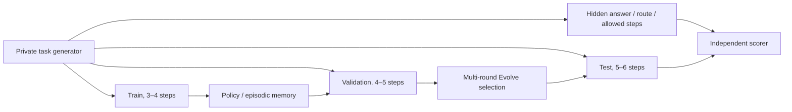

# Agent L2.1: Isolated capability evaluation and evolution

<!-- source-sha256: d47d06c2f4e88a7848f3260b35299a33c98893f0f4ad5d563ad7675ee8b1bb4d -->

[简体中文](../../agent-research/capability-benchmark.md)

`toolroute-l2.1-v1` replaces the earlier L2 tool-routing task that saturated easily. It asks:

1. Can an agent solve unseen tasks from public tool feedback without knowing the answer or reference plan?
2. How should memory, planner, tool policy, critic, policy, recovery, reflection, verifier, and context compression be combined for a better success–cost Pareto trade-off?

!!! success "No oracle or guide at the interface"
    A policy receives only `CapabilityObservation` and `call_tool(name)`. Public objects have no answer, route, allowed steps, reference plan, or perturbation labels. There are no `guide`, `reveal`, or `verify_answer` endpoints. Asking for unknown `guide` returns `unknown_tool`.

## Split isolation

| Split | Task families | Route depth | Use | Role in final result |
|---|---|---:|---|---|
| Train | travel / finance / retail / support | 3–4 | Learn reusable skills or memory | None |
| Validation | logistics / education / media / health | 4–5 | Evolve promotion and winner selection | Selection only |
| Test | science / legal / security / operations | 5–6 | Once after all generations | Final report |

Task families, IDs, and depths are isolated. Evolve never selects on test. Test compares the frozen initial baseline with the validation winner only.



## Difficulty axes

- `clean`: Normal long tool chain.
- `transient`: First call fails temporarily; retry spends budget.
- `ambiguous`: Feedback includes a correct tag and similar distractor.
- `fallback`: Primary tool fails permanently. Read feedback and switch to a read-only fallback.
- `irreversible`: A candidate is publicly marked risky and irreversible.
- `combined`: Ambiguity, transient failure, and fallback occur together.

The budget covers the correct path and permitted retries/fallbacks. Blindly trying distractors consumes later budget; enumeration cannot guarantee a perfect score. Public tool metadata determines costs rather than assigning equal cost to each call.

## Six distinct implementations

| Method | Local mechanism |
|---|---|
| Long-context | Takes the first candidate without explicit exploration, retry, verification, or memory |
| ReAct | Observation loop explores candidates and handles transient failures and fallback |
| Reflexion | Adds failure reflections before trying later candidates |
| Agent-G² | Generator proposes candidates; public-evidence verifier orders by reliability, reversibility, and cost |
| AHEAD | Prefers read-only candidates and compresses multicandidate context |
| AUSO | Writes successful tag decisions into episodic skill memory and reuses them across episodes |

Five ablations share splits, seeds, and tool budgets: `react-no-retry`, `reflexion-no-reflection`, `agent-g2-no-verifier`, `ahead-no-compression`, and `auso-no-memory`.

## Metrics

- Answer accuracy, plan exact match and step F1, joint success.
- Recovery success.
- Invalid-tool rate and irreversible-error rate.
- Mean tool calls and mean accumulated cost from metadata.
- Three-seed means, standard deviations, and 95% intervals.
- Reflection, verification, compression, and memory-write/reuse telemetry.

Fixed train/validation/test counts are 36/60/60 episodes per seed, seeds 42/43/44. Isolated test means:

| Method | Joint success | Plan F1 | Recovery | Invalid-tool rate | Average cost |
|---|---:|---:|---:|---:|---:|
| Long-context | 0.3500 | 0.5212 | 0.0000 | 0.0532 | 2.8571 |
| ReAct | 0.6833 | 0.7683 | 0.6667 | 0.0455 | 4.7984 |
| Reflexion | 0.7278 | 0.7786 | 0.6667 | 0.0376 | 4.7920 |
| Agent-G² | **0.7778** | **0.8276** | 0.6667 | 0.0394 | 5.0662 |
| AHEAD | 0.7556 | 0.7887 | 0.6667 | **0.0334** | 4.5571 |
| AUSO | 0.7556 | 0.7887 | 0.6667 | **0.0334** | **4.5192** |

Long-context is cheapest but not best at the task. Agent-G² has the highest success and extra verification cost. Removing ReAct retries yields joint success 0.5167. Removing Reflexion reflections drops 0.7278 to 0.6833; removing Agent-G² verification drops 0.7778 to 0.6833. AHEAD compression and AUSO memory mainly affect cost and telemetry in this version. No success-rate gain is invented.

See [fixed results](../../experiments/agent-toolroute-l2-seeds42-44.json). They apply to `toolroute-l2.1-v1` only, not general agent ability.

## Static fair comparison

```bash
python -m pip install -e ".[dev]"

auto-research agent-capability \
  --methods long-context,react,reflexion,agent-g2,ahead,auso \
  --train-episodes 36 \
  --episodes 60 \
  --seeds 42,43,44 \
  --output-dir runs/agent-capability
```

## Multi-round evolution

```bash
auto-research evolve \
  --model agent \
  --dataset toolroute-l2.1 \
  --direction "Combine memory, planner, tools, critic, policy, recovery, reflection, verifier, and context compression" \
  --generations 3 \
  --population 9 \
  --workers 3 \
  --agent-episodes 60 \
  --seeds 42,43,44
```

Generation 1 uses single-component matched ablations. Later generations compose operators around the validation winner. Reports record candidate sources, parents, mutations, validation observations, negative results, and final isolated test. Candidates are existing paper operators and allowlisted combinations. Discovered but unimplemented papers remain nonexecutable.

The fixed three-generation, population-9, three-seed example executes the baseline and every candidate. Validation winner `g2-t2` improves isolated test joint success from **0.3500** to **0.8000** and plan F1 from **0.5212** to **0.8327**, at average cost **2.8571** to **4.9662**. See [genomes, lineage, evidence, and negative results](../../agent-research/metrics/toolroute-l21-evolve-seeds42-44.json).

## Regenerate public evidence

```bash
PYTHONPATH=src python scripts/generate_agent_l2_evidence.py
PYTHONPATH=src python scripts/generate_public_experiment_dashboard.py
```

## Limits and L3

- L2.1 is still synthetic and local but contains no answer, plan, or guide leakage.
- Episodic memory may update within a split using public feedback. It does not read labels.
- Cost comes from fixed tool metadata, not real API tokens, network latency, or dollars.
- Official SWE-bench Lite, ToolHop, and real browsers remain deferred L3 items at the user's request.
- Real LLM policy, post-training, or multimodal work can use GPUs later. This benchmark itself does not need A100.
