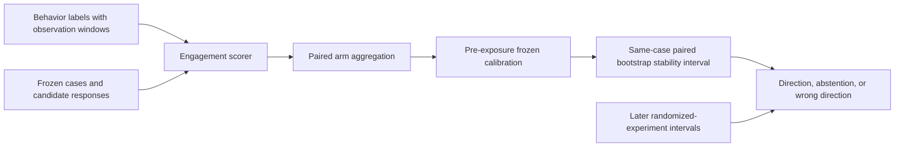

# Meta layered engagement evaluation: a reusable audit protocol

<!-- source-sha256: 60bcd06e6944af192849c75f9f0a4f4fc8c507c53276df3ec25dc994e8a0e822 -->

[简体中文](../../agent-research/layered-engagement-protocol.md)

> **Status: Protocol implementation, not experimental reproduction.** The paper uses private Meta assistant conversations, classifiers, frozen coefficients, and real A/B controls. Those data and weights are not public. This repository provides paired bootstrap, pre-exposure freeze checks, and interval decision auditing; it does not reproduce the paper's 81.1% F1.

## Paper information

| Field | Value |
|---|---|
| Paper | [arXiv v1](https://arxiv.org/abs/2609.25408) |
| Organization | Meta Platforms, affiliation of first author Xuanyi Li |
| First published | 2026-09-21 (arXiv v1) |
| Original author code | No author evaluation code or paired data found as of 2026-09-26 |
| Adapter | None; protocol, not a reproduction registry entry |
| Local code | [`src/auto_research/evaluation/layered_engagement.py`](https://github.com/daiwk/auto-research/blob/main/src/auto_research/evaluation/layered_engagement.py) |

The paper asks whether offline metrics predict online experiments at three levels: aligning behavior labels with product goals, classifiers with candidate behavior, and fixed test sets, aggregation, and calibration with experiment effects. Correlation alone is not sufficient: use confidence intervals from later randomized experiments to check the frozen proxy's decision direction. Abstain if the offline stability interval crosses zero. The paper's eight post-freeze experiments and 113 contrasts reach 81.1% contrast-micro F1; proprietary features and coefficients were not released.

Local `Contrast` requires timezone-aware `frozen_at ≤ offline_scored_at < exposure_started_at`. `paired_scoring_interval` resamples control/treatment cases with shared indices and applies the caller's **frozen** linear scale. It is not a prediction interval for future live effects. `audit` reports the paper's contrast-micro F1, equal-experiment macro F1, wrong direction, abstentions, and power-aware precision. Without real paired A/B, tests verify formulas and data gates only.

To use this in a live project, pin cases, models, and calibration before exposure and record versions and timestamps. After launch, add per-experiment intervals and contrast IDs. Do not tune calibration on online results and still claim prospective validation. See Figure 1 and §§3.2 and 3.5 in the [official full text](https://arxiv.org/html/2609.25408v1).
