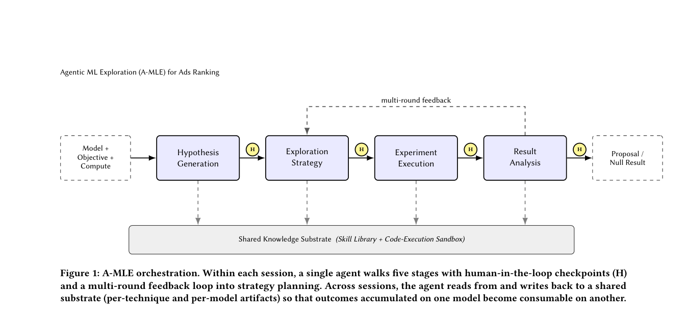

# A-MLE: Agentic ML exploration for ad ranking

<!-- source-sha256: f8ebe1691a999d580be6a7ed7067a1c4e988ed2ac3712c5021ad37f1d790ab48 -->

[简体中文](../../../evolution/2609.08248-amle/README.md)

> **Fidelity:** Public controller mechanism: stage state, independent ideas, audit events, and execution lessons, without Meta's private sandbox, training platform, or models.

## Paper information

| Field | Value |
|---|---|
| Paper | [arXiv 2609.08248](https://arxiv.org/abs/2609.08248) |
| Organization | Meta Platforms, Inc. |
| First published | 2026-09-08 (arXiv v1) |
| Original author code | Not found or not released. |
| Local adapter or method | `research-portfolio-amle` |
| Local reproduction code | [`src/auto_research/research_loop/portfolio.py`](https://github.com/daiwk/auto-research/blob/main/src/auto_research/research_loop/portfolio.py) |

## Original paper summary

A-MLE divides industrial iteration into hypothesis generation, exploration strategy, experiment execution, result analysis, and shared knowledge. Agents invoke domain skills and retain human checkpoints at stage boundaries. The objective also includes research throughput and reliable transfer across models.

<!-- paper-figure:start -->
### Key figure from the paper

**Original Figure 1** shows the authors' design and key components. Image from the [original paper](https://arxiv.org/abs/2609.08248); copyright belongs to the authors. Click for its source.
<!-- paper-figure:end -->

## Local reproduction and limits

ResearchPortfolio records auditable transitions, durable per-idea state, exclusive worker claims, append-only events, and a fixed baseline. Domain adapters, trainers, and evaluators produce and measure candidates; the controller does not execute titles or unimplemented suggestions. `tests/test_research_portfolio.py` verifies state isolation, conflicting claims, illegal transitions, failure/restart recovery, and separate execution and result memory. No comparable public industrial platform or data were released, so no numerical reproduction is claimed.
