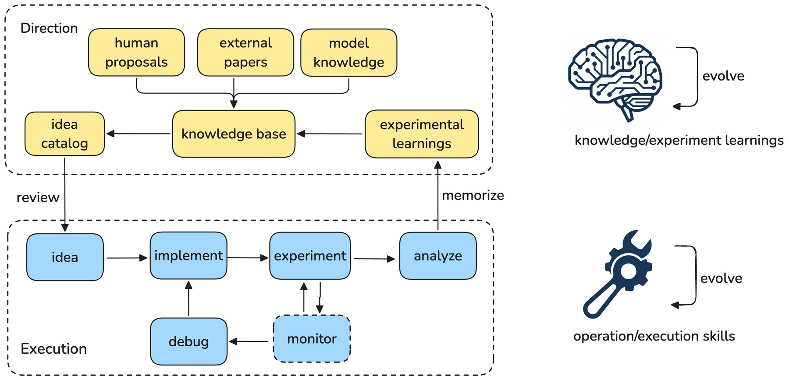

# Auto-RecSys: Autonomous research for industrial recommenders

<!-- source-sha256: 6fb675de1549e147a6d6714904b9edfd1c999836c23952266a8390ab4af6f68b -->

[简体中文](../../../evolution/2609.10922-auto-recsys/README.md)

> **Fidelity:** Public controller mechanism: per-idea isolation, durable recovery, and two memory layers, not Meta's cross-server storage, scheduler, or multi-day jobs.

## Paper information

| Field | Value |
|---|---|
| Paper | [arXiv 2609.10922](https://arxiv.org/abs/2609.10922) |
| Organization | Meta |
| First published | 2026-09-10 (arXiv v1) |
| Original author code | Not found or not released. |
| Local adapter or method | `research-portfolio-auto-recsys` |
| Local reproduction code | [`src/auto_research/research_loop/portfolio.py`](https://github.com/daiwk/auto-research/blob/main/src/auto_research/research_loop/portfolio.py) |

## Original paper summary

Industrial recommender training is slow and configurations fragile. Auto-RecSys moves ideas asynchronously across stages, using distributed execution, centralized persistent memory, and separation of cognition from process. The execution loop records successes and failures as playbooks. The idea loop uses historical outcomes for new hypotheses.

<!-- paper-figure:start -->
### Key figure from the paper

**Original Figure 1** shows the authors' design and key components. Image from the [original paper](https://arxiv.org/abs/2609.10922); copyright belongs to the authors. Click for its source.
<!-- paper-figure:end -->

## Local reproduction and limits

`ResearchPortfolio` stores ideas separately in JSON, using atomic replacement and exclusive claims. Failure enters `debugging`; after repair, execution resumes the original stage. `playbooks.json` stores execution lessons; append-only `outcomes.jsonl` stores terminal results retrievable by hypothesis relevance. The local/shared filesystem is not the authors' central service; remote work uses the repository's SSH/Slurm executor. No official code was released.
