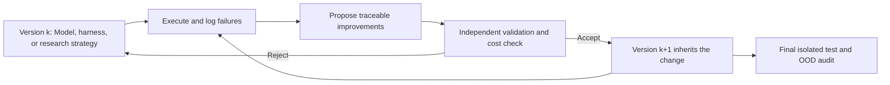

# Recursive self-improvement (RSI)

<!-- source-sha256: 7f59106940dbacdd9fe1559853f4ec6c655650cdf5a38eefa817ccf397def2e2 -->

[简体中文](../../evolution/recursive-self-improvement.md)

RSI is a **cross-domain research topic**, not a seventh directory of implementations. It asks whether a system can use failures and validation results from one round to improve the next model, agent harness, training data, or research strategy. Papers and adapters stay in [foundation models](../foundation-models/README.md), [LLM post-training](../post-training/README.md), or [agents](../agent-research/README.md). This page explains how they can form auditable multi-round loops.

## What counts as RSI?

A model writing a reflection is not enough. **Persist the change**, **inherit it** in the next round, and **validate it** under fixed-budget external feedback. Keep rejected proposals and failure traces. Within-question correction is useful but is not by itself research-level RSI. Running code generated from an unimplemented paper is also not the RSI path here.

| Object of improvement | Local entry point | Not established |
|---|---|---|
| Model architecture, parameters, and training recipes | [Directed evolve](../model-evolution.md), [executable operator constraints](../evolution-operators.md) | Automatically implementing arbitrary newly retrieved papers |
| LLM weights and post-training data | [Post-training evolve](../auto-research.md), [Recursive OPSD diagnostic](../../reproductions/2609.30652-recursive-opsd/README-en.md) | Paper-scale recursive learning gains or models independently rewriting training algorithms |
| Agent harnesses, memory, and tool policies | [Agent evolve](../agent-research/capability-benchmark.md), [long-running research controller](research-portfolio.md) | Reliable self-improvement on unknown real-world tasks |
| Research process | [Proposals and negative-result memory](../research-platform-p1.md) | Unsupervised modification of executors, evaluators, or safety boundaries |

## Papers and evaluation leads

The entries below distinguish local mechanisms from candidates still to review. An external paper is not a local reproduction.

- [DiscernMem](../../agent-research/2610.36652-discernmem/README-en.md): Paired replay distinguishes scope from content problems. Repairs must preserve parent-memory and no-memory baselines; a new version resets old effect evidence. Local work covers CPU measurements and versioning, not LLM repair or a real memory environment.
- [RuHarness](../../agent-research/2610.36826-ruharness/README-en.md): Co-evolves rubrics and harnesses, choosing rules with a conservative utility quantile over a six-cell joint posterior and updating only after independent validation. Local work covers the statistical frontier and gates, not a full self-evolving agent.
- [Google Sleep](../../foundation-models/2606.03979-sleep-lti/README-en.md): Offline consolidation transfers fast memory to expandable slow modules. Local work implements only the LTI reward, not dream generation, LoRA training, or recursive learning.
- [ImageRSI](../../agent-research/2610.32120-image-rsi/README-en.md): Grows experience with real image generation, independent verification and repair, and paired acceptance, then trains a judge. Documentation only; the full generation/API/training loop is too costly and not reproduced (review DONE). Score arithmetic is not a judge.
- [RSI-Opt](../../agent-research/2610.32026-rsi-opt/README-en.md): A coding agent changes an optimizer and inherits improvements through actual multi-task training. Documentation only; high-cost search is not reproduced. The paper's held-out lineage and archive-propagation concerns are preserved.
- [HarnessMM](../../agent-research/2610.32813-harnessmm/README-en.md): Reduces duplicate calls with auditable event dependencies and callback-boundary certificates. Documentation only; no full native harness matrix and no fabricated physical-call receipt.
- [OPST](../../post-training/2610.32770-opst/README-en.md): Self-generation, verification, and an EMA teacher create multi-round self-training. Local work covers unambiguous gates, externally supplied divergence reduction, and EMA. The PDF's inconsistent divergence weights were not silently corrected. No full self-improvement or evolve integration claim.
- [Harness²](../../agent-research/2610.14224-harness2/README-en.md): With a fixed model and shared initial harness reset for each task, runs Propose–Probe–Compose and retains improvements backed by execution controls. The local parallel/sequential controller, anonymous artifact selection, and same-domain memory ran 96 real Python probes. Deterministic editor and selector stand-ins do not establish model-backed open-world RSI, and there is no evolve integration. The complete model/API benchmark is too costly and not reproduced (review DONE).
- [Harmony Harness](../../agent-research/2610.15150-harmony-harness/README-en.md): Multi-objective decomposition preserves function–safety trade-offs while evolving tools, skills, and logic at general and environment-specific scopes. Documentation only. Multi-configuration model runs, repeated container builds, and exploit execution are too costly and not reproduced. Not a local evolve operator.
- [SEER](../../agent-research/2610.04109-seer-forecasting/README-en.md): Retrieves, filters, and stores causal experience for forecasting, waiting for feedback maturity before updating in training backtests and freezing memory on test. Documentation only. Closed models, web retrieval, and full backtesting are not reproduced; temporal isolation is not evidence of forecast capability.
- [RSIFlow](../../agent-research/2610.21791-rsiflow/README-en.md): Executes a frozen parent, M/H/A callback interventions, paired acceptance, and failure retention. The numeric fixture fixes the meta-program; it is not autonomous large-model training or unified evolve integration.
- [Terminal-RSI](../../agent-research/2610.22192-terminal-rsi/README-en.md): Implements observation-skipping TB-GAE, chunked continuation, and FDR/SPR rewards. Full 27B training is not reproduced. Main-table gains are not attributed to TB-GAE without confirmation it entered that checkpoint.
- [Athanor](../../agent-research/2610.21055-athanor/README-en.md): Documentation of autonomous post-training research. Its 32-GPU, 104-hour campaign is **too costly and not reproduced (review DONE)**. Not a local research executor.
- [Self-Refine](../../agent-research/2303.17651-self-refine/README-en.md) and [Reflexion](../../agent-research/2303.11366-reflexion/README-en.md): Within-task correction and cross-episode language memory are loop components. Improvement of later versions needs isolated evaluation.
- [Recursive Self-Improvement via On-Policy Distillation](../../reproductions/2609.30652-recursive-opsd/README-en.md): A dynamic teacher and student share updated weights. A small-budget Qwen diagnostic exists; the three-seed control did not show gains, and the paper's training/evaluation protocol is incomplete locally.
- [Video-RSI](../../agent-research/2609.37950-video-rsi/README-en.md): Diagnoses failures through active video investigation, then admits inheritable harness changes through accuracy–visual-cost Pareto gates. The local admission protocol runs; the full video environment is not reproduced.
- [FrugalEvo](../../agent-research/2610.03675-frugalevo/README-en.md): A stronger model proposes strategies and a weaker model codes. Fixed costs and external geometry checks decide which programs to retain. A standalone real-checkpoint path exists, without unified evolve or cross-request prefix KV caching.
- [Sentry](../../agent-research/2610.02994-sentry/README-en.md): Retrieves prior experience on failure and writes memory only after outcome-blind recovery validation. The local run uses real Qwen and read-only document tools, with a frozen test playbook. Recovery is not final answer accuracy; browser and software engineering results are not reproduced.
- [RRSI](https://arxiv.org/abs/2609.24972): Regularizes harness proposals and selection, emphasizing OOD capability and token costs. **Awaiting review; no local adapter.**
- [RSIBench-Data](https://arxiv.org/abs/2607.25886): Fixes the post-training stack and measures whether feedback helps an agent improve data strategies. **Evaluation candidate under review; not integrated locally.**
- [RSIPO](../../reproductions/2610.15772-rsipo/README-en.md): Co-evolves skills and policy, using isolated replay controls to estimate skill gains and reliability-weighted OPD/RL. **Paper interpretation and cost review complete; high-cost reproduction and acceptance deferred.** Not an executable evolve operator.
- [LoOPSD](../../reproductions/2610.18162-loopsd/README-en.md): Searches recurrent layer paths for a self-teacher, then alternates online distillation with search. **Cataloged; full multi-round training deferred.** No verified recursive capability gains.
- [MemCon](../../agent-research/2607.13591-memcon/README-en.md): A low-cost memory controller and persisted learned state are implemented. This is an inheritable RSI component; a local UCB feedback loop is not general self-evolution.

## Acceptance protocol

Log the initial version, each round's change and provenance, training and inference budgets, validation decisions, failed candidates, final isolated test, OOD and regression sets, and cost. Preserve **best-so-far** and final-round curves. An intermediate peak must not hide final degradation, and vice versa. Fix data revisions, model starts, seeds, and tool budgets across methods. Evaluated agents must not read gold answers or test feedback beyond what the protocol permits.

Apply the [discovery audit](../paper-discovery-audit.md) and domain paper contract before classifying a new item as evidence only, standalone adapter, or executable composition of implemented operators. This page explains and groups entries without duplicating detail pages, metric files, or bypassing CUDA evidence.
