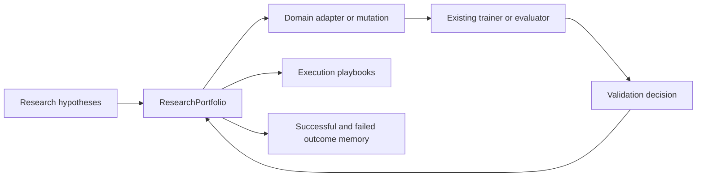

# Long-running research portfolio controller

<!-- source-sha256: 3cd4e3cb3371c4b45e38b21eeebd13d46589b58fd473c6ee8cafd3e15a4acbe8 -->

[简体中文](../../evolution/research-portfolio.md)

`ResearchPortfolio` persists orchestration above model, post-training, and agent evolve. It does not pick a neural network. It preserves state, isolates failures, and reuses experience when parallel hypotheses take hours or days.

## Relationship to evolve



- `ResearchPortfolio` owns idea lifecycle, worker claims, recovery, and memory.
- Domain adapters still produce **implemented, executable** architectures, objectives, or policies.
- Trainers and evaluators run and measure actual experiments. Paper titles and natural-language proposals are not operators.
- Each idea has its own state file. Events and terminal outcomes are append-only JSONL. Key JSON files use temporary writes, `fsync`, and atomic replacement.

## State and recovery

```text
ideating -> implementing -> validating -> training -> analyzing -> complete
                    |             |           |
                    +-------------+-----------+-> debugging -> previous stage
```

Nonterminal ideas may also enter `rejected`. Invalid transitions fail immediately. Exclusive lock files prevent two workers from claiming one idea. Portfolio layout:

```text
portfolio/
├── portfolio.json    # schema and fixed baseline
├── ideas/*.json      # independent persistent state per idea
├── claims/*.lock     # exclusive worker claims
├── events.jsonl      # append-only event history
├── playbooks.json    # execution experience
└── outcomes.jsonl    # successful and rejected outcomes
```

## Minimal example

```python
from pathlib import Path

from auto_research.research_loop import IdeaStage, ResearchPortfolio

portfolio = ResearchPortfolio(Path("runs/portfolio/demo"), baseline_id="main@abc123")
portfolio.create_idea("longer", "Add long-history compression to the model", payload={"budget": 300})
portfolio.transition("longer", IdeaStage.IMPLEMENTING)
portfolio.claim("longer", "worker-0")

try:
    # Invoke the existing adapter, trainer, and evaluator here.
    portfolio.transition("longer", IdeaStage.VALIDATING)
finally:
    portfolio.release("longer", "worker-0")
```

Call `fail(idea_id, error)` after failure and `recover(idea_id)` after fixing it to return to the prior stage. `remember_playbook` saves execution experience. `related_outcomes` retrieves past results by hypothesis keyword overlap and measured score for later ideation.

## Paper grounding and local limits

### A-MLE

[Standalone implementation write-up](2609.08248-amle/README.md)

> **Paper information**
>
> - Paper: [Agentic ML Exploration (A-MLE) for Ads Ranking (arXiv v1)](https://arxiv.org/abs/2609.08248)
> - Organization: Meta Platforms, Inc.
> - First public release: 2026-09-08
> - Upstream code: Not found / not released
> - Local adapter: `research-portfolio-amle`
> - Local code: `src/auto_research/research_loop/portfolio.py`

A-MLE separates hypotheses, strategies, experiment execution, result analysis, and shared knowledge, with human checkpoints. This implementation uses staged auditing but does not reproduce Meta's internal tools, sandbox, or ads infrastructure.

### Auto-RecSys

[Standalone implementation write-up](2609.10922-auto-recsys/README.md)

> **Paper information**
>
> - Paper: [Auto-RecSys: Harnessing Autonomous Research Agents for Industry-Scale Recommender Systems (arXiv v1)](https://arxiv.org/abs/2609.10922)
> - Organization: Meta
> - First public release: 2026-09-10
> - Upstream code: Not found / not released
> - Local adapter: `research-portfolio-auto-recsys`
> - Local code: `src/auto_research/research_loop/portfolio.py`

Auto-RecSys separates idea state, asynchronous execution, cross-session recovery, and two loops for execution experience and experimental outcomes. These public controller semantics are reproduced. The shared-file persistence layer is not the paper's multi-server storage and job infrastructure.

## Current limits

- This is not a new remote scheduler. SSH and Slurm use existing executors.
- `baseline_id` cannot change within a portfolio lifecycle; do not mix different baseline conclusions.
- Playbook updates persist, but adoption still requires validation. They do not automatically rewrite model code.
- No public official implementation was found for either paper. This is a public mechanism reproduction, not numeric replication.
