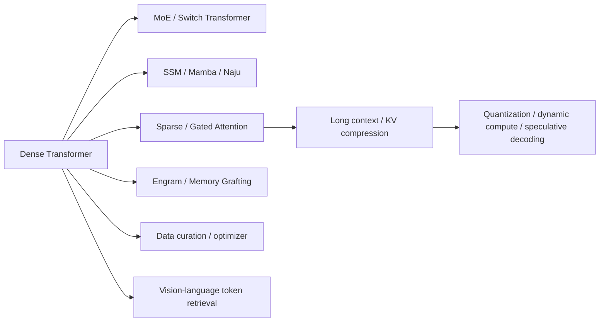

# Foundation model lineage and open gaps

<!-- source-sha256: d0b7c54d8e5ebef8c2041d8015ef666a96991e953b642d096f4d17774ff717c0 -->

[简体中文](../../foundation-models/lineage.md)

## Covered research lines

Current coverage includes MoE, state-space models, sparse and gated attention, conditional memory, long-context positions, pretraining data orchestration, optimizers, quantization, dynamic width, speculative decoding, and visual token retrieval. Operators that actually train locally have progressively entered LLM Evolve. Methods that require custom kernels or large clusters retain explicit systems-reproduction limits.

## Completed planned capabilities

| Capability | Status | Evidence |
|---|---|---|
| Test-time compute, verifiers, and dynamic reasoning budgets | Complete | [PR #113](https://github.com/daiwk/auto-research/pull/113): pinned SmolLM2 revision; reports correctness, tokens, latency, and call cost |
| Scaling-law budget curves | Complete | [PR #114](https://github.com/daiwk/auto-research/pull/114): model-size, data-volume, and training-budget grid with fit residuals |
| Video and audio multimodality | Complete | [PR #115](https://github.com/daiwk/auto-research/pull/115): public Video-MME-v2 and ESC-50/CLAP paths |
| Embodied and multimodal post-training | Complete | [PR #116](https://github.com/daiwk/auto-research/pull/116): SmolVLA/LeRobot training and hardware/simulator limits |

Pretraining mixtures and curriculum, multimodal image–text understanding, and RoPE/ALiBi have standalone implementations and Evolve integration, so they are no longer on the static backlog. No static P0/P1 remains open in this scope. The dynamic queue accepts new work only when real operators, public data, and fair evaluation are available. Large clusters, proprietary kernels, and real robot capability still require explicit limits; a small-model smoke test is not a production result.
