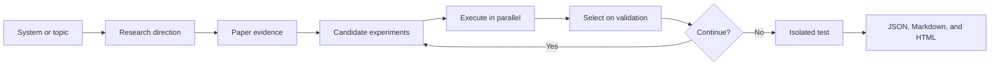

---
hide:
  - toc
---

# Auto Research

<!-- source-sha256: b2cfefdecfaeb5acefc4538983f8b04ac9535c27d3f7496bcc367717ab0df3ca -->

[简体中文](../index.md) · English

Auto Research is a local-first platform for inspecting paper implementations and running reproducible, iterative experiments. Start by checking what a paper establishes and which parts are implemented locally. Then use compatible components in a controlled research loop.

[Browse the paper catalog](papers/index.md){ .md-button .md-button--primary }
[Install and run a demo](setup.md){ .md-button }

## Two workflows

### Paper implementation and evaluation

Start with the [paper catalog](papers/index.md). Entries link to original sources and identify the available write-up language. A write-up records the method, authors' results, local commands or evaluation artifacts, and where the implementation differs from the paper.

| Domain | What to look for |
| --- | --- |
| Search, advertising, recommendation, and LLM applications | Retrieval, ranking, generative recommendation, and production A/B evidence; local public-data experiments are reported separately. |
| Foundation models | Model architecture, pretraining, long context, and inference efficiency, with the local model size and compute budget made explicit. |
| Structured decisions / System One | Typed questions, dynamic candidate sets, calibration, selective prediction, and structured scoring. |
| Multimodal models | Image, video, audio, and language experiments with traceable checkpoints and evaluation subsets. |
| LLM post-training | Preference learning, reinforcement learning, on-policy distillation, and training stability; candidate scoring is not the same as free generation. |
| Agents | Memory, planning, tools, and self-improvement. A local mechanism or simulator is not evidence of general agent capability. |

### Automated research and evolution

Start from a research topic, or supply a supported system, dataset, and research direction. The controller retrieves paper evidence, proposes testable hypotheses, runs registered candidates under a shared budget, and uses validation performance to guide the next round. Test data stays isolated from selection.

Supported examples include RankMixer and HyFormer, a local micro-LLM, post-training objectives, and combinations of agent memory, planner, tool policy, and critic. Newly discovered methods with no executable implementation remain evidence only. The [evolution overview](auto-research.md) covers adapter and workflow details.

## Read the evidence

The [public experiment dashboard](public-experiment-dashboard.md) indexes committed, traceable results. Compare like with like: an original paper's offline benchmark, its online A/B test, and a local public-data run answer different questions. A synthetic mechanism check or a small smoke test does not establish the full paper's capability or production gains. High-cost experiments that were not run are explicitly labeled **not reproduced**.

For the source repository, see the [English README](https://github.com/daiwk/auto-research/blob/main/README.en.md). Use the [learning cards](learning/index.md) and [topic deep dives](learning/deep-dives/index.md) to study mechanisms and compare papers. The [translation coverage report](coverage.md) covers the whole site.
