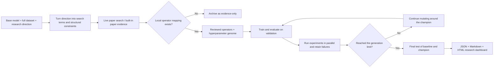

# Automated model evolution

<!-- source-sha256: 590007db84e01fbe1ee05f257e4a54e2e4f8a93b4e773b66ae1b05baffe52902 -->

[简体中文](../model-evolution.md) · English

Use this workflow when you already have a trainable system and want to keep running experiments around a direction expressed in natural language. It supports recommendation models, micro-LLMs, post-training recipes, and agent policies. It also supports evolving test-time compute while keeping a real checkpoint fixed.

In the post-training genome, the algorithm, data recipe, teacher, rollout, learning rate, group size, and steps all change the behavior of the current NumPy candidate-policy evaluator. The `gradient_accumulation` and `mixed_precision` fields form a promotion contract for the real checkpoint runner. The lightweight evaluator combines, records, and exports these fields without claiming they have a numerical effect. They affect actual training, memory usage, and throughput comparisons only after a candidate advances to the checkpoint runner.

!!! summary "Candidates have traceable sources; unreviewed code does not execute"
    **Every architecture or algorithm that actually participates in training has already been implemented and tested in this repository.** The runtime can search online for recent papers, but newly found papers without implementations are retained as `evidence-only`, not turned into executable code. Evolution runs controlled ablations, combinations, and hyperparameter mutations across registered providers and reviewed operators. Validation results guide the next round. A generated plugin must pass isolated testing and receive human approval before it can become an executable operator.

## Where candidates come from {#candidate-sources}

An evolution run can contain four kinds of entries:

| Entry in the page or report | Source | Used in training? | New idea from the system? |
| --- | --- | :---: | --- |
| `installed-paper` | The project implements the paper and maps its paper ID to a local operator. | Yes | No; it is a local implementation of the paper's mechanism. |
| `retrieved-paper` | Live search guided by `--direction`, or built-in evidence in offline mode. | No | No; it is research evidence and a candidate for future implementation. |
| `generated-combination` | The controller combines implemented architectures, data recipes, post-training or agent components, or parameters. | Yes | Yes; it is a new engineering hypothesis to test. |
| `novel-proposal` | A hypothesis derived from a paper specification or failure trace that has not passed plugin promotion. | No | It may be novel, but it cannot execute before review. |

Executable capabilities are registered through `EvolutionProvider`. A provider declares its available datasets, paper retrieval domain, initial genome, and evaluator. Adding a model does not require changing the shared generational controller or adding another large branch to the CLI.

The natural-language `--direction` has two roles:

1. Generate paper-search queries and record newly retrieved evidence related to the direction.
2. Prioritize relevant candidates among implemented operators and constrain the space of combinations.

It does not translate paper PDFs into Python or let a model generate arbitrary code and immediately train it. To use a promising paper from a live search, first implement it locally, add unit and minimal training tests, and map its paper ID. A subsequent evolution run can then execute it.

## A concrete example

Suppose the input is:

```text
Base model: RankMixer
Direction: Add LONGER, UniMixer, and related efficient Transformer structures to RankMixer
```

Here is what the system does:

1. Searches online for papers related to LONGER, UniMixer, and efficient Transformers, or reads the built-in list in offline mode.
2. Recognizes that LONGER and UniMixer are implemented locally, so it enables `rankmixer_longer`, `rankmixer_unimixer`, and their implemented and tested combination, `rankmixer_longer_unimixer`.
3. Labels papers found online with no local operator mapping as `evidence-only`.
4. Compares only the architectures in the first round, holding budget and hyperparameters fixed. Later rounds search layer count, dimensions, learning rate, optimizer, and batch size around the validation champion.
5. Waits until all rounds end to compare the initial baseline and final champion on the isolated test set.

The combined architecture is an engineering hypothesis implemented explicitly in the repository, not two paper names pasted into a configuration.

## Quick start

The examples retain the original `--direction` strings because search queries and candidate priorities depend on them. You can supply your own direction in natural language.

```bash
# 1. Install the CLI from the repository root
python3 -m venv .venv
source .venv/bin/activate
python -m pip install -e '.[neural-recs]'

# 2. Check the available arguments
auto-research evolve --help

# 3. Run a recommendation experiment locally: compare LONGER, UniMixer, and their combination
auto-research evolve \
  --model rankmixer \
  --dataset movielens-100k \
  --direction "比较 LONGER、UniMixer 及其组合" \
  --generations 3 --population 4 --workers 2 \
  --steps 100 --papers 8 --seeds 42
```

After the run finishes, open:

```text
runs/evolution/rankmixer-<timestamp>/index.html
```

The paper-evidence section identifies local operators and marks entries that are `evidence-only`. The experiment table distinguishes paper operators, allowlisted combinations and tuning, and the initial baseline. Use `report.md` for code review and `result.json` for complete configuration and parent-child lineage.

To prevent network retrieval at runtime, add `--offline`. This leaves implemented operators enabled but stops online paper searches and data downloads. The required data must already be cached locally.

## Full workflow

### Resuming runs, GPU resources, and robust promotion

After each trial finishes, the system updates `result.json` atomically. Resume an interrupted run from its original output directory:

```bash
auto-research evolve \
  --model rankmixer --dataset movielens-1m \
  --direction "继续上一轮高效结构研究" \
  --generations 5 --resume runs/evolution/rankmixer-20260809-120000
```

`--retries` controls retries for failed trials. With CUDA, `--gpu-slots` is the number of independent GPU slots that can genuinely run in parallel. `--gpu-memory-per-trial-mb` can further reduce concurrency based on available memory at startup. Each trial under the production evaluator runs in a separate process. When `--trial-timeout-seconds` expires, the process is terminated, not merely marked failed while it continues in the background. Champions are ranked by `fitness - z × standard_error`. If the evaluator provides `fitness_std`, `--confidence-z` penalizes high-variance candidates. For a formal result, the recommended options are:

```text
--seeds 42,43,44 --promotion-min-seeds 3 --confidence-z 1.0
```

A single seed is still useful for smoke testing, but cannot support a claim of stable improvement.

### Inference budget evolution with a real checkpoint

`reasoning-checkpoint` uses a fixed revision of a public causal LM and searches only the inference genome: sample count, maximum generated tokens, and the consensus threshold for early stopping. It does not use the gold answer to select a candidate response. Self-consistency majority voting determines the response, and the gold answer is used only afterward to compute accuracy. Each trial records accuracy, generated tokens, latency, model calls, and estimated call cost. Selection applies a small penalty to token use.

```bash
auto-research evolve \
  --model reasoning-checkpoint \
  --dataset gsm8k-generate \
  --direction "搜索 1/2/4/8 次采样、verifier 和动态停止预算" \
  --generations 2 --population 4 \
  --maximum-examples 64 --seeds 42,43,44 \
  --device cuda
```

The default checkpoint is `HuggingFaceTB/SmolLM2-135M-Instruct`, pinned to a 40-character commit revision. On an offline development machine, use `--reasoning-checkpoint-path` to point to a downloaded snapshot. Budget comparisons use validation data; the isolated test set is used only after the champion is selected.

### Safe promotion of new paper operators

A live search initially classifies each newly retrieved paper as `retrieved-paper`. If an external research agent generates a candidate implementation, provide a JSON specification with the source paper, provider, allowlisted files, and verification commands. Then follow these three steps:

```bash
auto-research candidate stage --spec candidate.json
auto-research candidate verify --id paper-op --timeout 300
auto-research candidate promote --id paper-op \
  --destination src/auto_research/evolution/plugins/paper_op --approve
```

Candidates are first written to `.auto-research/candidates/`, with restrictions on paths, file types, and individual file sizes. Verification results are archived separately. The final step requires an explicit `--approve` and can write only to a directory that does not yet exist within the repository. This establishes a route from paper to structured candidate, isolated verification, human approval, and official registration. It never injects unreviewed code into the main training process automatically.

An evolution run can also call an external candidate generator:

```bash
auto-research evolve ... \
  --candidate-generator-command "python tools/design_candidate.py" \
  --candidate-timeout-seconds 300
```

The controller first writes `paper-candidates.json` with paper sources, implementation status, interface constraints, and claims the candidate must not make. It passes the path as the generator's final argument. The generator outputs `CandidatePluginSpec` JSON. This automated path rejects execution commands supplied by the generator and performs only a syntax check. The output is not automatically promoted or trained in the current round. Reports can therefore distinguish newly retrieved papers from executable paper operators.



Architecture and ordinary parameters are searched together in the same genome:

```text
architecture, dimensions, layers, learning_rate, optimizer,
batch_size, experts, interval_residual, auxiliary_weight
```

Each trial saves its `generation`, `parent_id`, paper sources, reason for mutation, validation metrics, training loss, parameter count, and elapsed time. This lets you trace how the model evolved.

## Executable paper operators: RankMixer examples

| Paper | Built-in architecture | Mechanism actually added to the network |
| --- | --- | --- |
| [RankMixer](https://arxiv.org/abs/2507.15551) | `rankmixer_smoe` | Parameter-free token mixing, per-token FFNs, and ReLU-routed MoE |
| [TokenMixer-Large](https://arxiv.org/abs/2602.06563) | `tokenmixer_large` | Mixing-reverting, per-token SwiGLU, interval residual, and middle auxiliary head |
| [Zenith](https://arxiv.org/abs/2601.21285) | `zenith` | Prime Token RSA Fusion and tokenwise SwiGLU Token Boost |
| [MOI-Mixer](https://arxiv.org/abs/2108.07505) | `moi_mixer` | Channel mixing with first-order linear terms and explicit second-order interactions |
| [WHALE](https://arxiv.org/abs/2607.17017) | `rankmixer_whale` | Wukong multiplicative interactions, causal attention, and gated HSTU updates |
| [TMallGS](https://arxiv.org/abs/2607.13398) | `rankmixer_tmallgs` | Field-wise QKV, noise gating, token-specific SwiGLU, and progressive auxiliary loss |
| [Long-History User Transformers](https://arxiv.org/abs/2607.14331) | `rankmixer_long_history` | Cached state from an asynchronous full-history encoder, fused with a lightweight recent sequence |
| [RAMP](https://arxiv.org/abs/2607.17473) | `rankmixer_ramp` | Personalized and public feature paths, feature availability mask, restricted-path supervision, and prediction alignment |
| [TokenMinds](https://arxiv.org/abs/2606.25147) | `rankmixer_tokenminds` | Aggregate user tokens from hierarchical semantic IDs of historical items; inject them into the RankMixer user representation through a learnable safety gate |
| [HA-MoE](https://arxiv.org/abs/2607.27577) | `rankmixer_ha_moe` | Dynamically route to specialist experts according to example heterogeneity |
| [Dual-purpose SID](https://arxiv.org/abs/2607.24865) | `rankmixer_dual_sid` | Hierarchical SIDs supply both collaborative identity and content-semantic tokens |
| [MFLI](https://arxiv.org/abs/2602.16124) | `rankmixer_mfli` | Represent the retrieval space with learnable codes across multiple facets |
| [Kunlun](https://arxiv.org/abs/2602.10016) | `rankmixer_kunlun` | GDPA gating, interaction blocks, and CompSkip |
| [ULTRA-HSTU](https://arxiv.org/abs/2602.16986) | `rankmixer_ultra_hstu` | Semi-local attention, landmark summaries, and Mixture of Transducers |

AgenticRecTune is not presented as a single network architecture. Its Actor–Critic–SkillHub loop maps to the project's unified multi-round controller. Its standalone `agentic-rec-tune` adapter emits a complete generation trace that can serve as a regression example for evolution control strategies.

The architectures in the table already exist in the repository. Online arXiv search may return other related papers, but only mapped architectures that pass shape and training tests can enter the population. The rest remain `evidence-only`.

Gzip-guided Sparse Attention has a standalone executable byte-level adapter, but the current `micro-llm` evolution path uses BPE tokens. Truncating token IDs to bytes would not reproduce the method, so it is recorded as `evidence-only` until a byte-level evolution backend supports it as a mutable architecture.

## Install the command

`auto-research` is installed by this project; it is not separate software you need to download. For the first setup, run the following from the repository root. See the [installation and demos guide](setup.md) for other runtime extras and device choices.

```bash
cd /path/to/auto-research
python3 -m venv .venv
source .venv/bin/activate
python -m pip install -U pip
python -m pip install -e '.[neural-recs]'
```

Confirm the command is installed:

```bash
auto-research --help
auto-research evolve --help
```

`-e` is editable installation. Updating project source normally does not require reinstalling it. In a new terminal, reactivate the virtual environment:

```bash
cd /path/to/auto-research
source .venv/bin/activate
```

To skip activation, invoke the full path directly:

```bash
.venv/bin/auto-research evolve --help
```

Run the install command again when the dependencies in `pyproject.toml` change.

## Direction-driven usage

This example asks to add LONGER, UniMixer, and related efficient Transformer structures to RankMixer and compare long-sequence compression, learnable token mixing, and their combination.

```bash
auto-research evolve \
  --model rankmixer \
  --dataset movielens-1m \
  --direction "把 LONGER、UniMixer 及相关高效 Transformer 结构加入 RankMixer，比较长序列压缩、可学习 token mixing 及其组合" \
  --generations 3 \
  --population 6 \
  --workers 3 \
  --steps 300 \
  --papers 8 \
  --seeds 42,43,44
```

`--benchmark-suite public` is enabled by default, but promotion still uses the overall primary metric (`--fitness-metric primary`) unless changed. This preserves comparability with earlier experiments. If your research objective emphasizes stability across slices, opt in explicitly. The example compares WHALE, TMallGS, long-history caching, and RAMP:

```bash
auto-research evolve \
  --model rankmixer \
  --dataset movielens-1m \
  --direction "比较 WHALE、TMallGS、长历史缓存和 RAMP 的稳健性" \
  --benchmark-suite public \
  --fitness-metric public_composite \
  --generations 3 --population 6 --workers 3 --steps 300
```

## Public evaluation suites

`evolve` separates evaluation from training operators. `core` runs only the original main task. `public` adds auditable public slices on the same fixed validation cohort and records every component in `result.json`, Markdown, and HTML. Promotion still uses only validation; the final test compares only the initial baseline and champion.

### Recommendation models

The MovieLens public suite includes:

| Slice | What it measures |
| --- | --- |
| `overall` | Hit@10, NDCG@10, head share, and mean popularity over the full fixed cohort |
| `long_history` | Users in the top quartile of history length, to check whether long-sequence mechanisms actually help |
| `tail_target` | Validation/test targets at or below median item popularity, to check long-tail degradation |
| `recent_only` | Only the four most recent actions, to check robustness to short context |
| `restricted_features` | The RankMixer public feature path, to measure degradation when personalized features are unavailable |

`public_composite` is the equally weighted mean of slice NDCG@10 values. It is not an online business metric and does not combine original A/B figures from different papers. Its purpose is to keep evolution from improving overall NDCG while neglecting long-tail targets, long histories, or restricted inputs.

For research that combines sequence modeling and feature interaction, enable the [UniRank-compatible suite (Chinese)](../unirank.md):

```bash
auto-research evolve \
  --model rankmixer \
  --dataset movielens-1m \
  --direction "统一序列建模与特征交互" \
  --benchmark-suite unirank \
  --fitness-metric unirank_composite
```

It adds chronological pointwise AUC and log loss to the above slices and selects on validation using `0.5 × NDCG@10 + 0.5 × AUC`. Recheck large-scale conclusions on UniRank's official five-dataset implementation.

### Language models

The micro-LLM public suite retains WikiText-2 perplexity (PPL) and Alpaca instruction loss, and adds:

| Capability slice | Data and metrics |
| --- | --- |
| Response preference | Held-out Stanford Alpaca instructions; accuracy and pairwise loss for correct responses versus deterministically truncated or shuffled negatives |
| Reasoning candidate ranking | Official GSM8K held-out examples; candidate Pass@1 and NLL for the gold answer versus seven deterministic numeric distractors |

The `public_composite` selection score is `-(LM loss + 0.15 × instruction loss + 0.10 × preference loss + 0.05 × reasoning NLL)`. The `primary` score remains `-(LM loss + 0.15 × instruction loss)`. These public slices are fixed, reproducible evaluations suitable for multi-round local experiments with small models. They are not full open-ended AlpacaEval or GSM8K exact-match evaluations.

The [public-suite smoke metrics](../evolution/public-suite-smoke-seed42.json) record a minimal real training run on both tracks. They verify that four recommendation architectures, two LLM post-training methods, and all public slices run end to end. The file explicitly records its tiny data and training budget; do not interpret it as a paper reproduction or model-capability ranking.

HyFormer can also be the base model. This example introduces LONGER's long-sequence compression and UniMixer's parameterized mixing:

```bash
auto-research evolve \
  --model hyformer \
  --dataset movielens-1m \
  --direction "引入 LONGER 的长序列压缩和 UniMixer 的参数化 mixing，升级高效 Transformer" \
  --generations 3 --population 6 --workers 3 --steps 300
```

## LLM evolution

`micro-llm` is a decoder-only Transformer that can train on a Mac, Linux GPU, or Linux CPU. The default configuration has about 12–16 million parameters depending on architecture, with a 4K local BPE vocabulary, hidden size 384, six layers, and context length 128. All are configurable through the CLI. This is not a production-size LLM. It makes it practical to train, compare, and iterate on architectures, data mixtures, and post-training methods.

```bash
python -m pip install -e '.[llm-evolution]'

auto-research evolve \
  --model micro-llm \
  --dataset wikitext-2 \
  --direction "调研高效 LLM 结构、训练数据配比和 SFT/NEFTune 后训练方法" \
  --generations 3 \
  --population 6 \
  --workers 1 \
  --steps 300 \
  --papers 8 \
  --seeds 42
```

All evolution models share `--device auto|cpu|mps|cuda|cuda:<index>`. On Linux CPU, you can also use `--cpu-threads`. See the [runtime guide](runtime.md) for installation, CUDA selection, and multi-GPU isolation.

The first three rounds have distinct roles by default:

1. **Architecture.** Compare the GPT baseline, GQA, LLaMA-style RMSNorm/RoPE/SwiGLU, parallel attention/FFN, Möbius RoPE, Naju, Native Sparse Attention, Gated Attention, and AdaDSF (dense calibration → Top-K token routing → feature alignment), holding data and training budget fixed. NSA and Gated Attention can also combine as `nsa_gated_attention`. Windowed-MTP is a post-training serving optimization evaluated through a standalone reproduction adapter; PPL is not used to disguise it as an architecture gain.
2. **Data.** Compare WikiText-only, a WikiText + Tiny Shakespeare narrative mixture, and a curriculum that anneals from narrative data toward WikiText. Freeze the champion architecture.
3. **Post-training.** Compare ordinary SFT, low-learning-rate SFT, NEFTune, `dynamic_rubric` (co-updating a dynamic rubric evaluator and policy), and `off_context_grpo` (privileged-information sampling, group-relative advantage, and importance-ratio correction). Use public Stanford Alpaca/GSM8K training slices and freeze the pretraining recipe.

With `--generations` above three, later rounds keep searching hidden size, layer count, learning rate, optimizer (including Muon), batch size, and context length. Architecture and optimizer are independent genome axes, so NSA or Gated Attention can be combined with Muon. Every candidate still descends from the preceding champion, keeping the multi-round lineage traceable.

In the 2025 P0 matched-budget WikiText-2 comparison, NSA and Gated Attention changed PPL by `-3.17% / -0.72%`, respectively, versus the LLaMA baseline. Muon was `+5.61%` (worse) at the untuned default learning rate in a 30-step run. In the architecture round of a four-round compositional evolution run, NSA ranked best of the three architecture candidates but did not beat the current GPT baseline. Subsequent SFT and hidden-size search produced the final champion. The [stable P0 WikiText-2 summary](../evolution/llm-p0-2025-wikitext2-seed42.json) retains these negative results.

The selection objective is `WikiText validation loss + 0.15 × instruction validation loss`. The final champion's WikiText test evaluation runs only after the three rounds finish. The default uses the full WikiText-2 training split; `--maximum-train-tokens` is for smoke tests only.

### Local diagnostic experiment

To verify the complete workflow, a Mac MPS run used a 0.54M-parameter model, 40 pretraining steps, 24 post-training steps, and seed 42. It ran three rounds with four candidates each:

| Stage | Observation in that round |
| --- | --- |
| Architecture | `parallel_gelu` won. Its matched-budget validation PPL of 447.469 was slightly below the GPT baseline's 449.032. |
| Data | WikiText-only won. Mixing in 10%, 20%, or 35% narrative data slightly improved instruction loss but worsened WikiText PPL. |
| Post-training | Ordinary SFT won, ahead of low-learning-rate SFT and the tested NEFTune alpha values of 5 and 10. |

Final isolated-test PPL decreased from `416.134` to `405.328` (`-2.60%`), and instruction validation loss decreased from `6.3804` to `6.2309`. This is a single-seed system diagnostic under a tiny budget, not evidence about the default 12M+ model or standard large-model capabilities. See the [micro-LLM diagnostic record](../evolution/micro-llm-wikitext2-diagnostic-seed42.json) for stable facts.

Candidates in each generation run in parallel. On macOS, multiple workers use separate processes so trials do not share random-number state or models. Experiments still use the same split, seed, and training budget. The run writes:

- `result.json`: machine-readable papers, configuration, parent-child lineage, metrics, failure reasons, and round decisions.
- `report.md`: a Chinese-language research report for code review and long-term archiving.
- `index.html`: a responsive dashboard that opens without a server and shows results, hypotheses, observations, and decisions for the next round.

The first round is a controlled architecture ablation. All candidates inherit the base model's hyperparameters and change only the architecture. From the second round onward, trials vary layer count, dimensions, learning rate, optimizer, and batch size around the previous champion. This separates architectural gains from tuning gains.

## Compositional genomes for post-training and agents

Use standalone `post-train` or `agent-eval` to reproduce an individual algorithm. For multi-round comparisons and combinations, use the shared `evolve` controller. Both tracks share parent-child lineage, validation-based promotion, isolated testing, parallel workers, research memory, and JSON/Markdown/HTML reports with recommendation and micro-LLM evolution.

The post-training genome searches data recipe, objective, teacher mode, rollout source, learning rate, group size, training steps, gradient accumulation, and precision. A child inherits its parent's other axes. This produces combinations of `public data × objective × teacher × rollout × system parameters` across rounds, not just a switch between algorithm names. This example compares GRPO, DPO, and OPD while searching those additional axes:

```bash
auto-research evolve \
  --model post-training \
  --dataset arithmetic-smoke \
  --direction "比较 GRPO、DPO、OPD，并联合搜索数据、teacher、rollout 与系统参数" \
  --generations 3 --population 6 --workers 3 \
  --steps 100 --maximum-examples 512 --seeds 42,43,44
```

The agent genome makes memory, planner, tool policy, critic, trainable policy, failure recovery, and memory capacity independently composable. The first round ablates one component at a time; later rounds build combinations around the champion. The report records cross-episode policy/memory reuse, recovery attempts, recovery success rate, and transition credit separately. This example evolves U-Mem, ReAct, Toolformer, an Agent Lightning policy, and Reflexion recovery together:

```bash
auto-research evolve \
  --model agent \
  --dataset evomem-mini \
  --direction "联合进化 U-Mem、ReAct、Toolformer、Agent Lightning policy 和 Reflexion recovery" \
  --generations 3 --population 8 --workers 4 \
  --agent-episodes 240 --seeds 42,43,44
```

Generative recommendation uses a separate `genrec` provider. It trains a catalog-aware head on the actual retained MovieLens-1M catalog and ranks the entire retained catalog for every validation and test evaluation. It does not present sampled candidates as full-catalog results. Composable axes include recent/full/compressed-long-history context, ID/semantic/hybrid catalog heads, uniform/novelty/content-discovery rewards, and popularity/semantic teacher distillation. This example combines context, rewards, and distillation inspired by Netflix GenRec, JD GenRec, and OxygenREC-v2:

```bash
auto-research evolve \
  --model genrec \
  --dataset movielens-1m \
  --direction "组合 Netflix GenRec、JD GenRec 与 OxygenREC-v2 的 context、reward 和蒸馏" \
  --generations 3 --population 8 --workers 3 \
  --steps 100 --seeds 42,43,44
```

The baseline is fixed to `recent context + ID catalog + uniform CE`. Promotion uses full-catalog `NDCG@10 - 0.02 × head-share@10`. This is reduced-scale model research on public MovieLens data. It does not reproduce private company LLMs, reward models, long-term satisfaction labels, or online serving, and does not automatically put Netflix first.

These mini-suites and reduced-scale models verify the automated research process and help attribute the effects of combinations. They do not represent production-grade open-ended LLM, agent, or recommendation capability. Results retain the full genome, negative outcomes, round hypotheses, and selection rationale. Checkpoints are not committed.

<a id="three-seed-evidence-promotion"></a>

## Three-seed evidence promotion

A shared resumable runner promotes representative methods from mechanism validation to three-seed evidence. Its defaults cover RankMixer, Switch Transformer, GRPO, and Agent Lightning. You can explicitly change the targets:

```bash
auto-research promote-evidence \
  --dataset-dir data \
  --seeds 42,43,44 \
  --adapters rankmixer,switch-transformer \
  --post-training grpo \
  --agent-methods agent-lightning
```

`state.json` is updated atomically after each target/seed. After interruption, re-running the command fills only missing entries. Failed seeds are terminal entries in `metrics.json` and the report; they do not hide other targets. After resolving an environmental issue, pass `--retry-failed` explicitly to retry the failed entries. The original attempts remain in the history. Only runs with at least three successful seeds set `formal_comparison=true` and report a mean, sample standard deviation, and 95% confidence interval. Otherwise the report explicitly disallows a claim of stable improvement.

Real checkpoint artifacts can also serve as **proposal priors** for the next round, but their existing metrics cannot serve as the new fitness score. The first example continues evaluating an Agent Lightning policy; the second compares DPO and ORPO:

```bash
auto-research evolve --model agent --dataset toolroute-l2.1 \
  --direction "继续验证 Agent Lightning policy" \
  --checkpoint-evidence docs/experiments/a100-promotion/agent-lightning-seeds42-44.json \
  --generations 3 --population 8 --seeds 42,43,44

auto-research evolve --model post-training --dataset arithmetic-smoke \
  --direction "比较 DPO 与 ORPO" \
  --checkpoint-evidence docs/experiments/a100-promotion/dpo-ultrafeedback-seeds42-44.json \
  --checkpoint-evidence docs/experiments/a100-promotion/orpo-ultrafeedback-seeds42-44.json \
  --generations 3 --population 6 --seeds 42,43,44
```

The loader accepts only unified metric artifacts with at least three distinct seeds. Promoted methods alter proposal order only. The current data, budget, and evaluator assess each genome from scratch. Accuracy, CKA, and margin from a checkpoint artifact are never copied into fitness. The dashboard can audit the source, seeds, and policy in `research_memory`.

The [2026-08-24 local three-seed closeout](../experiments/remaining-p1-20260824.json) records two generations of mechanism validation for both GenRec and Agent Evolve, plus three-seed promotion for four representative targets: RankMixer, Switch Transformer, GRPO, and Agent Lightning. It retains the reduced step count, retained catalog, and deterministic mini-suite boundaries rather than presenting an engineering smoke test as paper-level evidence.

The [2026-08-28 A100 checkpoint evidence promotion (Chinese)](../evidence-promotion.md) records three-seed runs with real checkpoints. In those runs, neither agent joint success nor DPO/ORPO preference accuracy improved. Multimodal CKA and neighborhood overlap did not improve either. These negative results can nominate candidates worth rechecking with a common evaluator, but do not count as evidence that those candidates should win.

## Dataset scale

Training data is not truncated by default. MovieLens-100K uses all 932 eligible users and 1,682 items; MovieLens-1M uses its full leave-two-out sequence data. To control full-catalog ranking costs per candidate, validation/test defaults to a fixed, uniformly covering 1,000-user cohort. Pass `--evaluation-users 0` to evaluate all users. Set `--maximum-users` and `--maximum-items` explicitly only when quickly validating the workflow. Reports record data scale and evaluation cohort to distinguish smoke tests from formal experiments.

| Recommendation direction | RankMixer candidate | HyFormer candidate | Actual mechanism |
| --- | --- | --- | --- |
| LONGER | `rankmixer_longer` | `hyformer_longer` | Blockwise token merging, global interest, and retention of recent tokens |
| UniMixer | `rankmixer_unimixer` | `hyformer_unimixer` | Learnable token mixing and per-token channel mixing |
| Combined | `rankmixer_longer_unimixer` | `hyformer_longer_unimixer` | Test whether long-sequence compression and parameterized mixing complement each other |

## Early small-scale diagnostic

The MovieLens-100K compact run used 220 users, 360 items, 40 training steps, two generations with three children per generation, and seed 42.

| Model | Validation NDCG@10 | Test Hit@10 | Test NDCG@10 |
| --- | ---: | ---: | ---: |
| Initial dense RankMixer | 0.00956 | 0.05000 | 0.02402 |
| Evolution champion: MOI-Mixer, one layer, batch size 24 | **0.01335** | **0.07727** | **0.03864** |

Compared with the initial model, the champion's validation NDCG increased by `+39.65%` and final isolated-test NDCG by `+60.87%`. Head share also rose from `0.08864` to `0.14727`. The gains therefore coincided with higher concentration on popular items, illustrating why a single primary metric is not enough.

See the [stable RankMixer compact-run metrics](../evolution/rankmixer-movielens-2g3p-seed42.json). This is a small-budget functional check, not a paper reproduction or stable multi-seed finding.

## Evaluation discipline

- The initial model and all descendants share the data split, full candidate set, training steps, and seed.
- Architecture and parameter promotion uses validation results only. No round uses test results for selection.
- After all generations finish, retrain the initial baseline and champion from scratch, then evaluate each once on test.
- Keep negative results and failed trials. Do not delete underperforming architectures to present evolution as a success.
- Do not commit checkpoints, data, or raw runs. Retain reproduction commands and stable scalar metrics.

## Future extensions

To add a target model, implement an evaluator that turns a `Genome` into that model's configuration, trains it, and returns the shared validation/test metrics. To add a paper architecture, implement a standalone architecture operator for the target model and add the paper ID, mechanism summary, shape tests, and a minimal training test. Natural language constrains the research space; it does not generate and directly execute arbitrary unaudited code.
