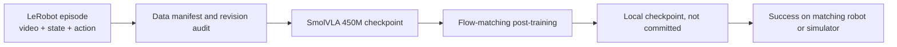

# Embodied multimodal post-training

<!-- source-sha256: 4e986b7875bbdc5367ecc78a9518ce83ed5319c6d6785ba5dda7f2c1dff27356 -->

[简体中文](../../multimodal-models/embodied.md)

`MM-003` uses official Hugging Face [SmolVLA](https://huggingface.co/lerobot/smolvla_base) and [SVLA SO100 PickPlace](https://huggingface.co/datasets/lerobot/svla_so100_pickplace) for embodied post-training. The dataset has 50 episodes and about 19,600 frames with cameras, joint states, and continuous actions. The model conditions on multiple views, state, and language instructions, predicting action chunks with flow matching.



Audit commands and local data without training:

```bash
auto-research embodied-post-train \
  --dataset-root data/svla_so100_pickplace \
  --checkpoint-path checkpoints/smolvla_base \
  --vlm-checkpoint-path checkpoints/SmolVLM2-500M-Video-Instruct \
  --offline --dry-run --device cuda \
  --steps 1 --batch-size 1
```

With official `lerobot[smolvla]` installed, remove `--dry-run` to train. `metrics.json` records model/data revisions, data-manifest SHA256, full argv, exit status, and log tail. Videos, checkpoints, and full logs are not committed. Download failures still record `status=failed`, exception type, and message, so failed materialization is not lost.

SmolVLA's `HuggingFaceTB/SmolVLM2-500M-Video-Instruct` dependency is pinned to a 40-character commit. Offline runs must pass its local snapshot explicitly, not just cache the outer policy. Defaults map SVLA `top/wrist` to policy `camera1/camera2` and add an empty camera. Override with `--rename-map` and `--empty-cameras` for other LeRobot datasets; metrics retain the mapping.

An A30 completed CUDA forward and backward on 1 real video batch: 99,880,992 trainable of 450,046,176 total parameters, step-1 loss `0.297`, gradient norm `6.400`, and a saved local checkpoint. See the [stable summary](../../experiments/roadmap-4-7.json) for pinned revisions and data manifest. This proves the training path runs. No robot or simulator episodes were run, so there is no success rate or claimed policy improvement.

Training loss is not robot success. Report success only on matching SO100/SO101 hardware or checkpoint-compatible RoboCasa/LIBERO episodes. Without an execution environment, report training-path validation only, not end-to-end embodied capability.
