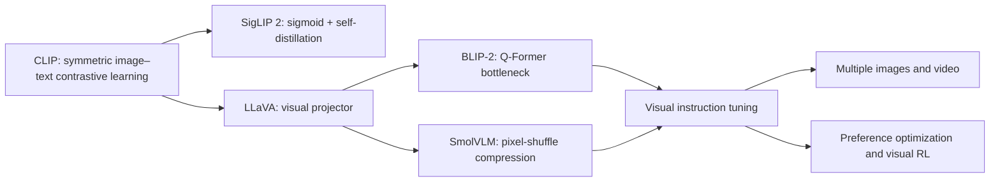

# Multimodal foundation models: paper lineage and gaps

<!-- source-sha256: 26c85fb6c21f557236197fcef996d677e5b0625facee0b2a269aa8ef6f4c778d -->

[简体中文](../../multimodal-models/lineage.md)

The project completed the training and evolve path for connector experiments, the L0 synthetic-image and L1 public-image (Fashion-MNIST/CIFAR-10) protocols, and integrated the core operators of CLIP, LLaVA, BLIP-2, SigLIP 2, and SmolVLM into independent adapters and a shared genome.

MR3 added framework-independent L2 scorers for ScienceQA, POPE, COCO, and Flickr, a fixed prediction protocol, and confidence intervals across seeds. MR4 integrated real public checkpoints, immutable revisions, offline snapshots, and per-example resumption. MR5 added frozen-checkpoint validation-only evolution and revisited the GPU paths. MR6 added bidirectional COCO/Flickr retrieval predictions and compact rank evidence for CLIP- and SigLIP-like checkpoints, and completed full-split evaluation of a single checkpoint on ScienceQA and POPE.

MR7 added the budget-matched cross-checkpoint matrix and an optional `lmms-eval` bridge. MR8 completed the full fair matrix using the local scorer. MR9 parsed upstream results into this repository's schema-v2 evidence format and ran standard tasks. Video, audio, embodied models, and large-scale multimodal post-training were deferred in this roadmap.
