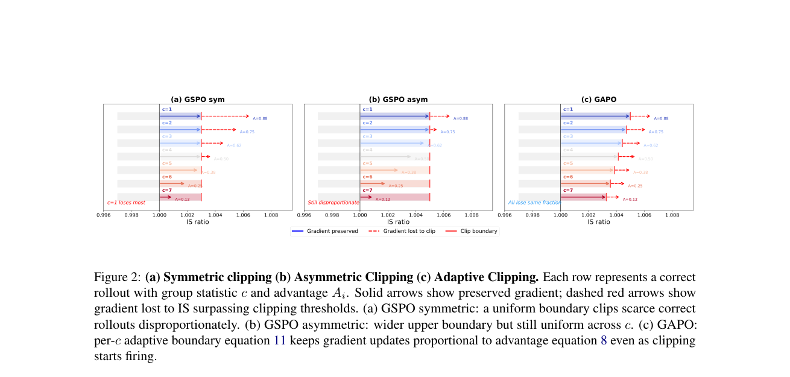

# GAPO: Difficulty-adaptive clipping preserves rare correct trajectories

<!-- source-sha256: 4701d3d27cae3bcbce8e47f5a262ce57f2c5d73a2a8364f506f1cc5a6459a1dd -->

[简体中文](../../../post-training/2609.00444-gapo/README.md)

> **Fidelity:** Objective mini-suite for adaptive per-group upper clipping in the shared group-relative runner.

## Paper information

| Field | Value |
|---|---|
| Paper | [arXiv 2609.00444](https://arxiv.org/abs/2609.00444) |
| Organization | University of Toronto / Amazon (first author affiliations) |
| First published | 2026-08-31 (arXiv v1) |
| Original author code | Yes: [Sheng-J/GAPO](https://github.com/Sheng-J/GAPO). |
| Local adapter or method | `gapo` |
| Local reproduction code | [`src/auto_research/post_training/latest_20260905.py`](https://github.com/daiwk/auto-research/blob/main/src/auto_research/post_training/latest_20260905.py) |

## Original paper summary

Fixed PPO/GSPO clipping applies the same threshold to easy and hard questions and cuts gradients earlier for rare correct rollouts on hard tasks. GAPO leaves reward and advantage unchanged and sets the positive-advantage upper clip from c correct of k rollouts.

```mermaid
flowchart LR
  R[k rollouts] --> C[Count correct c]
  C --> E[Adaptive epsilon_hi(c)]
  R --> A[Group-relative advantage]
  E --> L[GSPO/PPO clipped loss]
  A --> L
```

<!-- paper-figure:start -->
### Key figure from the paper

[](https://arxiv.org/pdf/2609.00444#page=3)

**Original Figure 2** shows the authors' design and key components. Image from the [original paper](https://arxiv.org/abs/2609.00444); copyright belongs to the authors. Click for its source.
<!-- paper-figure:end -->

### Core mechanism

$$
\epsilon_{hi}(c)=\epsilon_{lo}+(\epsilon_{hi}^{max}-\epsilon_{lo})\frac{k-c}{k-1}.
$$

### Paper results

The paper reports higher Pass@1 and Pass@k for Qwen and Llama math and code RLVR.

## Local reproduction and limits

`arithmetic-smoke` uses 100 steps and seeds 42/43/44 and records `group_correct_count`, `adaptive_upper_clip`, clip fraction, and accuracy. This is a NumPy distribution mini-suite, not full-parameter Qwen/Llama RLVR. No advertised CUDA path, so no GPU receipt is required. [Stable metrics](../../../post-training/2609.00444-gapo/metrics/arithmetic-smoke-seeds42-44.json).
