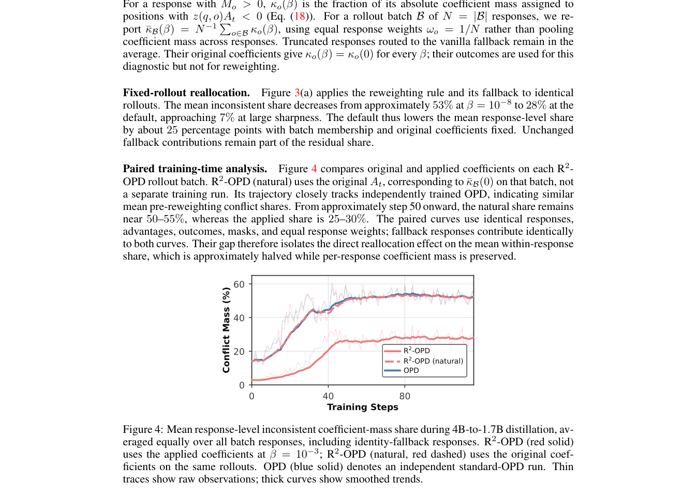

# Reward-Aligned Reweighting for On-Policy Distillation

<!-- source-sha256: 4793d3a5b71153d24d118159dcfd91268b0f5118a3e7235ea269711a5e5e3334 -->

[简体中文](../../../post-training/2609.35517-r2-opd/README.md)

> **Fidelity:** L1 diagnostic for continuous outcome/disagreement reweighting, not gains on seven math benchmarks.

## Paper information

| Field | Value |
|---|---|
| Paper | [Reward-Aligned Reweighting for On-Policy Distillation](https://arxiv.org/abs/2609.35517) |
| Organization | The University of Hong Kong (first author affiliation) |
| First published | 2026-09-28 (arXiv v1) |
| Original author code | No public author repository found as of 2026-09-30. |
| Local adapter or method | `r2-opd` |
| Local reproduction code | [`src/auto_research/post_training/latest_20260930_closure.py`](https://github.com/daiwk/auto-research/blob/main/src/auto_research/post_training/latest_20260930_closure.py) |

## Original paper summary

Agreement with verified outcomes and teacher/student disagreement redistribute dense distillation weights, increasing the relative impact of corrections with more outcome value.

<!-- paper-figure:start -->
### Key figure from the paper

**Original Figure 4** shows the authors' design and key components. Image from the [original paper](https://arxiv.org/abs/2609.35517); copyright belongs to the authors. Click for its source.
<!-- paper-figure:end -->

### Core mechanism

The reference kernel preserves defining gates, masks, recurrence, credit weighting, or promotion conditions. Tests cover gradient isolation, type boundaries, and determinism. Benchmark scores, speed, and training curves are paper results. The three-seed mini-suite checks mechanisms and invariants only, not paper-scale or online gains.

## Local reproduction and limits

`diagnostic_only=true`; exclude these results from formal capability ranking. The local run does not establish gains on the seven math benchmarks. [Stable metrics](../../../post-training/2609.35517-r2-opd/metrics/mechanism-seeds42-44.json).
