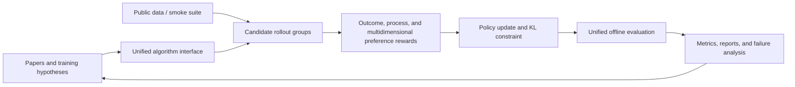

# LLM post-training research

<!-- source-sha256: 89ffc6019bf64fba975e539167b86027601927dcfa30e8dacba7e28dd6c6ce1f -->

[简体中文](../../post-training/README.md)

This is the LLM post-training branch of the [paper implementation and evaluation library](../research-library.md). It covers preference optimization, online reinforcement learning, on-policy distillation, process rewards, and data feedback loops. The focus is on trustworthy algorithm components and public evaluation. Mature components can join [automated evolution](../evolution-domains.md) alongside architectures, pretraining data, and hyperparameters.

!!! info "Reproduction fidelity"
    The candidate-policy suite is for inexpensive regression checks. IPO, SimPO, LUSPO, and CoBA-RL also have a real free-generation path with a character tokenizer and causal LM, including full sequence log-probabilities, a verifier, rollouts, and multiple seeds. The two fidelity levels are reported separately. Neither claims to reproduce the papers' large-model training.

## Quick links

- [LESSER: Post-training data selection with output-layer gradients](../../post-training/2610.03702-lesser/README-en.md): Extracts gradient features in the forward pass and uses a shared two-sided projection. The current L1 diagnostic checks the formula and selector only, without reporting large-model training gains.

- [Recursive OPSD: DCE + SRCL](../../reproductions/2609.30652-recursive-opsd/README-en.md): Meta's dynamic privileged teacher and answer-validated concise self-rewrites. A100 Qwen3-4B small-sample mechanism diagnostic; no performance-improvement claim.
- [MaD-RL distribution matching experiment](../experiments/mad-rl-mechanism.md): Four rewards from the Meta paper were run with free sampling on a small model. The original figures and paper-scale evaluation are incomplete; this is not a formal reproduction.

- [Sparse OPD](../../post-training/2609.04565-sparse-opd/README-en.md): Supervise only the one or two tokens with the largest teacher–student discrepancy per online trajectory.
- [GAPO](2609.00444-gapo/README.md): Adaptively raise the clipping ceiling for rare correct rollouts based on the number of correct answers in their group.

- [Foundation models in evolve](../evolution-domains.md): See how model architecture, data, and post-training are combined.
- [Method index](catalog.md): Browse baselines, implemented papers, upstream code, and local entry points by research direction.
- Browse [By organization](catalog/by-organization.md) · [By topic](catalog/by-topic.md) · [By year](catalog/by-year.md).
- [OPDSearch+](../../post-training/2608.24310-opd-search-plus/README-en.md): First apply frozen-teacher forward-KL distillation on online student search trajectories, then refine with RL and verifiable rewards.
- [OPDVR](../../post-training/2608.24696-opdvr/README-en.md): Correct the sign of the implicit sampled-token OPD reward using a correctness-constrained ReLU gate, without another loss hyperparameter.
- [V-Rubrics](../../post-training/2608.25580-v-rubrics/README-en.md): Decompose visual fidelity, reasoning consistency, and instruction following into atomic rubrics with local credit assignment.
- [Clue-OPSD](../../post-training/2608.25356-clue-opsd/README-en.md): Apply on-policy self-distillation only to clue tokens where a teacher hint can repair student reasoning.
- [GRIN](../../post-training/2608.25243-grin/README-en.md): Use group-relative improvement and difficulty-adaptive weights to reinforce reasoning rollouts with room to improve.
- [GRIP](../../post-training/2608.25583-grip/README-en.md): Combine process rubrics and outcome returns for finer credit assignment along long reasoning trajectories.
- [Paper lineage and scope](lineage.md): Audit the main methods, status of static capabilities, and boundaries of further evaluation.
- [Unified evaluation protocol](benchmark.md): Datasets, metrics, fair comparison rules, and acceptance criteria for new methods.
- [SRPO](../../post-training/2608.23493-srpo/README-en.md): Build a privileged teacher from the same model using a self-reflection patch and assign dense token-level credit.
- [ERPO](../../post-training/2608.23311-erpo/README-en.md): Stabilize the input distribution with reference typicality and Query-KL while preserving exploration on the answer side.
- [DPO](../../post-training/2305.18290-dpo/README-en.md): Reference-relative preference classification without a reward model.
- [KTO](../../post-training/2402.01306-kto/README-en.md): Prospect-theoretic objective requiring only an individual desirable/undesirable label.
- [ORPO](../../post-training/2403.07691-orpo/README-en.md): Combines SFT and odds-ratio preference optimization without a reference model.
- [DeepSeekMath / GRPO](../../post-training/2402.03300-grpo/README-en.md): Group-relative, critic-free reasoning RL.
- [TIS](../../post-training/web-2025-tis/README-en.md): Correct training–rollout mismatch with one-sided truncation of the probability ratio.
- [IcePop](../../post-training/2510.18855-icepop/README-en.md): Discard severely mismatched tokens using a fixed two-sided ratio mask.
- [Online IcePop](../../post-training/web-2025-online-icepop/README-en.md): Update once per rollout batch, removing the stale-policy ratio and PPO clipping.
- [RIPO](../../post-training/2607.10169-ripo/README-en.md): Fisher–Rao geometric clipping adapted to the old policy's probability.
- [KPop](../../post-training/2606.15079-kpop/README-en.md): Use a two-sided binary-KL mask to address asynchronous training–rollout mismatch.
- [GPPO](../../post-training/2508.07629-gppo/README-en.md): Keep PPO clipping on the forward pass while retaining gradients for out-of-bound samples.
- [Dr. GRPO](../../post-training/2503.20783-dr-grpo/README-en.md): Remove length and within-group variance normalization from the group update.
- [ARMOR](../../post-training/2607.10481-armor/README-en.md): Mix reference-anchor rollouts into training to prevent long-horizon degradation.
- [REINFORCE++](../../post-training/2501.03262-reinforce-plus/README-en.md): Replace prompt-local variance with a global advantage scale.
- [TACO](../../post-training/2607.07976-taco/README-en.md): Attenuate positive credit only for tokens with high tail risk.
- [CHORD](../../post-training/2508.11408-chord/README-en.md): Coordinate expert SFT with on-policy RL through annealing.
- [VAPO](../../post-training/2504.05118-vapo/README-en.md): Critic-based PPO with length-adaptive GAE.
- [InstructGPT / PPO-RLHF](../../post-training/2203.02155-ppo-rlhf/README-en.md): Classical RLHF using an old policy, critic, clipping, and KL.
- [RLOO](../../post-training/2402.14740-rloo/README-en.md): Leave-one-out REINFORCE at the full-response level.
- [ReMax](../../post-training/2310.10505-remax/README-en.md): Value-free RLHF using a greedy rollout baseline.
- [GKD](../../post-training/2306.13649-gkd/README-en.md): Student-generated trajectories, dense teacher feedback, and mixed on/off-policy training.
- [MiniLLM](../../post-training/2306.08543-minillm/README-en.md): Reverse KL, teacher-mixed sampling, and variance reduction.
- [OPSD](../../post-training/2601.18734-opsd/README-en.md): Use privileged solution context with the same model as teacher, then apply token-level self-distillation and pointwise clipping to on-policy student trajectories.
- [DASH](../../post-training/2608.06243-dash/README-en.md): Gate backward aggregation over the self-distillation horizon using local divergence, without an extra teacher forward pass.
- [U-OPSD](../../post-training/2608.06296-u-opsd/README-en.md): Build a pseudo-teacher entirely from agreement across model samples, with no external supervision.
- [RP-OPSD](../../post-training/2608.06347-rp-opsd/README-en.md): Find multilingual reasoning pivots from the distribution shift caused by ablating the reference solution.
- [PCSD](../../post-training/2608.01837-pcsd/README-en.md): Accumulate persistent teacher support and filter local noise using trend decay.
- [ADRS](../../post-training/2608.03223-adrs/README-en.md): Use a return-correlated TVA gate to incorporate teacher token scores into the original advantage.
- [Distilled RL](../../post-training/2607.17247-distilled-rl/README-en.md): Fine-grained RL with a reverse teacher ratio, negative-sample reset, and geometric normalization.
- [MOPD](../../post-training/2606.30406-mopd/README-en.md): Combine independent domain RL teachers on student rollouts.
- [OPDLM](../../post-training/2606.06712-opd-lm/README-en.md): Transfer knowledge on-policy from a frozen autoregressive teacher to a bidirectional diffusion student.
- [OPCD](../../post-training/2602.12275-opcd/README-en.md): Train a context-free student to match a teacher with experience or system prompts, distilling test-time contextual capability into the parameters.
- [DAPO](../../post-training/2503.14476-dapo/README-en.md): Clip-Higher, dynamic sampling, token loss, and overlength penalty.
- [GSPO](../../post-training/2507.18071-gspo/README-en.md): Length-normalized sequence-level importance ratio.
- [Lightning OPD](../../post-training/2604.13010-lightning-opd/README-en.md): On-policy distillation using offline cached teacher distributions.
- [GPRL](../../post-training/2605.18721-gprl/README-en.md): Group-relative RL for multidimensional preferences.
- [TCR](../../post-training/2607.19824-tcr/README-en.md): Thinking checklist and residual process reward.
- [IPO](../../post-training/2310.12036-ipo/README-en.md): Squared regression on a finite preference log-ratio gap.
- [SimPO](../../post-training/2405.14734-simpo/README-en.md): Reference-free, length-normalized preference objective.
- [LUSPO](../../post-training/2602.05261-luspo/README-en.md): Correct length bias in the sequence policy objective.
- [CoBA-RL](../../post-training/2606.22317-coba-rl/README-en.md): Probe capability boundaries, use teacher guidance, and apply curriculum RL.
- [PACT](../../post-training/2609.26355-pact/README-en.md): Update the actor first, then train a prefix critic with the updated policy's importance ratio.
- [Constitutional AI](../../post-training/2212.08073-constitutional-ai/README-en.md): Self-critique and revision followed by RLAIF on AI-generated preferences.
- [RRHF](../../post-training/2304.05302-rrhf/README-en.md): Full-response reward ranking and SFT on the best response.
- [RAFT](../../post-training/2304.06767-raft/README-en.md): Sample from the current policy, select by reward, and iterate SFT.
- [SLiC-HF](../../post-training/2305.10425-slic-hf/README-en.md): Sequence-likelihood margin with supervised regularization.
- [SteerLM](../../post-training/2310.05344-steerlm/README-en.md): Multi-attribute annotation, conditional SFT, and controllable goals at inference.
- [SPIN](../../post-training/2401.01335-spin/README-en.md): Generate negatives from the previous policy and iterate self-play.
- [Relay-OPD](../../post-training/2607.26057-relay-opd/README-en.md): Detect failed prefixes and hand off to the teacher within a limited budget.
- [β-OPSD](../../post-training/2607.28582-beta-opsd/README-en.md): Turn the KL-regularized optimal policy into an adjustable geometric interpolation target for distillation.
- [VAD](../../post-training/2607.28590-vad/README-en.md): Attribute the distribution difference of one teacher with and without visual evidence and reconstruct the OPD target.
- [Flux-OPD](../../post-training/2607.28022-flux-opd/README-en.md): Anchor to a stable teacher and attenuate evolving corrections based on context conflict.
- [CoRT](../../post-training/2607.25659-cort/README-en.md): Assign token-level rubric credit using counterfactual replay.
- [ReCo](../../post-training/2607.26862-reco/README-en.md): Reweight GRPO by expected response frequency and token variance ratios.
- [RLAIF](../../post-training/2309.00267-rlaif/README-en.md), [Process supervision](../../post-training/2305.20050-process-supervision/README-en.md), [Math-Shepherd](../../post-training/2312.08935-math-shepherd/README-en.md): Fill in the main AI-feedback and per-step reward methods.
- [Self-Rewarding](../../post-training/2401.10020-self-rewarding/README-en.md), [Absolute Zero](../../post-training/2505.03335-absolute-zero/README-en.md), [SPIRAL](../../post-training/2506.24119-spiral/README-en.md): Cover self-judged preferences, task generation from no data, and language-game self-play.
- [LUFFY](../../post-training/2504.14945-luffy/README-en.md), [TTRL](../../post-training/2504.16084-ttrl/README-en.md), [INTUITOR](../../post-training/2505.19590-intuitor/README-en.md), [CISPO](../../post-training/2506.13585-cispo/README-en.md), [ConSPO](../../post-training/2605.12969-conspo/README-en.md): Cover off-policy guidance, test-time RL, intrinsic rewards, and stable sequence objectives.
- [Stabilizing RL with LLMs](../../post-training/2512.01374-minirl/README-en.md), [Missing Old Logits](../../post-training/2605.12070-missing-old-logits/README-en.md), [STARE](../../post-training/2606.19236-stare/README-en.md): Cover MoE Routing Replay, asynchronous old-logit repair, and a surprisal-driven entropy feedback loop.

### Post-training adapters in other directories

These implementations retain their original detail URLs. The current navigation classifies them under LLM post-training, not foundation models or industrial search, recommendation, and ads.

- [SIS](../../reproductions/2607.04728-sis/README-en.md): Use rejection sampling to transform some stale-policy tokens into on-policy tokens.
- [Off-Context GRPO](../../reproductions/2607.19313-off-context-grpo/README-en.md): Generate rollouts using privileged processes, then correct to the context-free policy with an importance ratio.
- [DynamicRubric](../../reproductions/2607.20083-dynamic-rubric/README-en.md): Co-evolve the rubric evaluator and policy during training.

## 2026-08-09 P0/P1 additions

- [RRC](../../post-training/2608.06310-rrc/README-en.md): Turn relative rankings from a generative reward model into self-competitive and anchor-guided rewards.

## 2026-08-13 MR7 additions

- [Preference Tree Optimization](../../post-training/2608.12062-pto/README-en.md): Simulate future dialogue-tree branches to build long-term preferences, then use the look-ahead reward for DPO.
- [C²-DPO](../../post-training/2608.12158-c2-dpo/README-en.md): Compare preference margins under full and degraded context; use Contextual Preference Gain to reduce multimodal hallucinations.
- [RAIL](../../post-training/2608.05080-rail/README-en.md): Learn when to intervene in rollouts and how much budget to spend based on recoverability gains.
- [SpecRoll](../../post-training/2608.04962-specroll/README-en.md): Adapt to an evolving policy with fast and slow paths, using an exact verifier to preserve the rollout distribution.

三者均接入统一 post-training runner 与组合式 evolve genome；稳定指标分别保存在各论文目录的 `metrics/arithmetic-smoke-seed42.json`，不再以日期批次文件作为事实源。

## 2026-08-24 additions

- [GCPO](../../post-training/2608.11674-gcpo/README-en.md): Diagnose the overlap between rollout updates and the dominant singular subspace of pretrained weights, and restrict updates with hard two-sided orthogonal projection.

<!-- historical-post-training:start -->
## 2026 historical scan B08–B09

- [Beyond Imitation: Filtering On-Policy Distillation by Reasoning Progress](../../post-training/2608.19408-r2-opd/README-en.md): Rank reasoning spans by teacher reward and independent progress reward, masking distillation when they disagree.
- [SR-OPSD: Self-Referenced On-Policy Self-Distillation](../../post-training/2608.09745-sr-opsd/README-en.md): Geometrically interpolate the self-teacher and reference to obtain a target, then use Rényi divergence to control projection geometry and density-ratio sensitivity.
- [On-Policy Delta Distillation for Multilingual Math Reasoning](../../post-training/2608.05802-opd2/README-en.md): Distill the probability change of a post-trained teacher relative to its base model, reducing the copying of pre-existing teacher biases.
- [CausalOPD: First-Wrong-Step Supervision for Distilling Causal Chain Reasoning](../../post-training/2608.03673-causal-opd/README-en.md): Identify the first incorrect step of an on-policy causal chain, repair it with short-horizon RL, and advance the curriculum from evidence to mechanism to conclusion.
- [SMOPD: Multi-Reward Reinforcement Learning via Specialize-and-Merge Online Policy Distillation](../../post-training/2608.03092-smopd/README-en.md): Train specialist teachers separately by reward priority, then merge their capabilities on the student's own trajectories.
- [Distill Where You Fail: Recovering Learning Signals of Negative RL-Groups from Adaptive Teacher Guidance](../../post-training/2608.00782-rstg/README-en.md): Activate the teacher only for negative zero-variance groups, distill at high-entropy or high-gap tokens, and include SFT on correct teacher trajectories.
- [Learn What's Left, Not What's Mastered: Saturation Aware Advantage Reweighting for Multi-Reward Policy Optimization](../../post-training/2608.16072-sa-mrpo/README-en.md): Normalize advantages per reward dimension and shift the gradient budget to unmastered objectives according to batch saturation.
- [Rubric Dropout: A Simple Way to Mitigate Reward Hacking in Rubric-as-Reward RL](../../post-training/2608.11669-rubric-dropout/README-en.md): Share a randomly reduced subset of rubrics within each rollout group so the policy cannot consistently exploit a fixed judge proxy.
- [Beyond On-Policy Exploration: Integrating External Policy Rollouts for Reinforcement Learning in Diffusion Language Models](../../post-training/2608.01717-erils/README-en.md): Constrain external rollout lengths and handle on-policy and external rewards separately to avoid joint normalization collapse.
- [Contrastive Reinforced Policy Optimization via Privileged Self-Distillation](../../post-training/2607.28026-crpo/README-en.md): Use predictive entropy to distinguish reflective exploration positives from exposure-bias negatives, then contrast privileged self-distillation signals within a group.
- [SERPO: Self-Evolving Rubric Policy Optimization for Open-Ended Test-Time Reinforcement Learning](../../post-training/2607.26873-serpo/README-en.md): Co-evolve a Good–Normal–Bad response archive, query-specific rubrics, and the actor policy in a closed loop.
- [ISO: An RLVR-Native Optimization Stack](../../post-training/2607.19331-iso-rlvr/README-en.md): Freeze pretrained singular values and optimize only the input/output singular frames; also provides a data-free specialist merger.

<!-- historical-post-training:end -->

## Research loop



## Current implementations

| Category | Method | Core mechanism | Public evaluation | Status |
|---|---|---|---|---|
| Adaptive self-distillation | [DASH](../../post-training/2608.06243-dash/README-en.md) | Clipped local divergence, stop-gradient gate, backward horizon | Arithmetic candidate | Mechanism reproduction |
| Direct preference optimization | [DPO](../../post-training/2305.18290-dpo/README-en.md) | Reference-relative pairwise classification | GSM8K candidate | Mechanism reproduction |
| Binary feedback alignment | [KTO](../../post-training/2402.01306-kto/README-en.md) | Prospect utility, desirable/undesirable feedback, KL reference point | GSM8K candidate | Mechanism reproduction |
| Single-stage preference optimization | [ORPO](../../post-training/2403.07691-orpo/README-en.md) | SFT NLL and odds-ratio penalty, no reference | GSM8K candidate | Mechanism reproduction |
| Online reasoning RL | [GRPO](../../post-training/2402.03300-grpo/README-en.md) | Group advantage, old-policy clipping, KL, no critic | GSM8K candidate | Mechanism reproduction |
| Training–rollout mismatch correction | [TIS](../../post-training/web-2025-tis/README-en.md) | Training/rollout ratio, one-sided upper truncation, retain low ratios | GSM8K candidate | Mechanism reproduction |
| MoE training–rollout mismatch | [IcePop](../../post-training/2510.18855-icepop/README-en.md) | Fixed two-sided ratio mask, unmodified IS weights inside the interval | GSM8K candidate | Mechanism reproduction |
| Strictly online mismatch correction | [Online IcePop](../../post-training/web-2025-online-icepop/README-en.md) | One update per rollout, policy ratio of 1, IcePop mask | GSM8K candidate | Mechanism reproduction |
| Geometric trust region | [RIPO](../../post-training/2607.10169-ripo/README-en.md) | Probability-dependent Fisher–Rao clipping | GSM8K candidate | Mechanism reproduction |
| Asynchronous training–rollout mismatch | [KPop](../../post-training/2606.15079-kpop/README-en.md) | Two-sided binary-KL keep/mask | GSM8K candidate | Mechanism reproduction |
| Gradient-preserving clipping | [GPPO](../../post-training/2508.07629-gppo/README-en.md) | Clipped forward pass, boundary-weighted backward pass | GSM8K candidate | Mechanism reproduction |
| GRPO aggregation bias | [Dr. GRPO](../../post-training/2503.20783-dr-grpo/README-en.md) | Group mean, no length or group standard deviation normalization | GSM8K candidate | Mechanism reproduction |
| Reference anchor | [ARMOR](../../post-training/2607.10481-armor/README-en.md) | Frozen reference and on-policy mixed rollouts | GSM8K candidate | Mechanism reproduction |
| Global advantage estimation | [REINFORCE++](../../post-training/2501.03262-reinforce-plus/README-en.md) | EMA global advantage scale | GSM8K candidate | Mechanism reproduction |
| Token credit | [TACO](../../post-training/2607.07976-taco/README-en.md) | Tail risk attenuates positive advantage | GSM8K candidate | Mechanism reproduction |
| Hybrid SFT–RL | [CHORD](../../post-training/2508.11408-chord/README-en.md) | Decayed expert SFT and group RL | GSM8K candidate | Mechanism reproduction |
| Critic PPO | [VAPO](../../post-training/2504.05118-vapo/README-en.md) | Length-adaptive GAE and actor–critic | GSM8K candidate | Mechanism reproduction |
| Classic online RL | [PPO-RLHF](../../post-training/2203.02155-ppo-rlhf/README-en.md) | Old policy, clipped surrogate, critic, KL | GSM8K candidate | Mechanism reproduction |
| Classic online RL | [RLOO](../../post-training/2402.14740-rloo/README-en.md) | Response-level REINFORCE, leave-one-out baseline | GSM8K candidate | Mechanism reproduction |
| Classic online RL | [ReMax](../../post-training/2310.10505-remax/README-en.md) | Sampled reward minus greedy reward, no critic | GSM8K candidate | Mechanism reproduction |
| Classic on-policy KD | [GKD](../../post-training/2306.13649-gkd/README-en.md) | Student rollouts, teacher feedback, mixed on/off-policy training | GSM8K candidate | Mechanism reproduction |
| Generative model distillation | [MiniLLM](../../post-training/2306.08543-minillm/README-en.md) | Reverse KL, teacher mix, variance baseline | GSM8K candidate | Mechanism reproduction |
| On-policy self-distillation | [OPSD](../../post-training/2601.18734-opsd/README-en.md) | Privileged solution context, student rollouts, token-level divergence and clipping | GSM8K candidate | Mechanism reproduction |
| Context distillation | [OPCD](../../post-training/2602.12275-opcd/README-en.md) | Context-conditioned teacher, context-free student, reverse KL | GSM8K candidate | Mechanism reproduction |
| Long-reasoning RL | [DAPO](../../post-training/2503.14476-dapo/README-en.md) | Asymmetric clipping, dynamic sampling, token loss, overlength shaping | GSM8K candidate | Mechanism reproduction |
| Stable sequence RL | [GSPO](../../post-training/2507.18071-gspo/README-en.md) | Sequence ratio, group advantage, sequence-level clipping | GSM8K candidate | Mechanism reproduction |
| Distillation | [Lightning OPD](../../post-training/2604.13010-lightning-opd/README-en.md) | Teacher distribution precomputed on SFT rollouts; no online teacher calls during training | GSM8K candidate | Mechanism reproduction |
| Multi-objective RL | [GPRL](../../post-training/2605.18721-gprl/README-en.md) | Per-dimension group normalization and drift control | GSM8K candidate | Mechanism reproduction |
| Process rewards | [TCR](../../post-training/2607.19824-tcr/README-en.md) | Thinking checklist, EMA residual reward | GSM8K candidate | Mechanism reproduction |
| Offline preferences | [IPO](../../post-training/2310.12036-ipo/README-en.md) | Squared regression on the reference-relative gap | arithmetic / GSM8K free generation | Token-level reproduction |
| Offline preferences | [SimPO](../../post-training/2405.14734-simpo/README-en.md) | Length normalization, reference-free margin | arithmetic / GSM8K free generation | Token-level reproduction |
| Length-unbiased RL | [LUSPO](../../post-training/2602.05261-luspo/README-en.md) | Length-unbiased sequence ratio | arithmetic / GSM8K free generation | Token-level reproduction |
| Curriculum RL | [CoBA-RL](../../post-training/2606.22317-coba-rl/README-en.md) | Dynamic capability boundary and teacher guidance | arithmetic / GSM8K free generation | Token-level reproduction |
| Actor–critic RL | [PACT](../../post-training/2609.26355-pact/README-en.md) | Actor first, token IS and probabilistic critic | arithmetic / GSM8K free generation | Small-model mechanism check |
| AI-feedback safety alignment | [Constitutional AI](../../post-training/2212.08073-constitutional-ai/README-en.md) | Constitutional critique/revision and AI preferences | GSM8K candidate | Mechanism reproduction |
| Full-ranking preferences | [RRHF](../../post-training/2304.05302-rrhf/README-en.md) | Reward ordering, ranking hinge, SFT on the best response | GSM8K candidate | Mechanism reproduction |
| Selection-based fine-tuning | [RAFT](../../post-training/2304.06767-raft/README-en.md) | Policy sampling, top-1 reward filtering, SFT | GSM8K candidate | Mechanism reproduction |
| Sequence calibration | [SLiC-HF](../../post-training/2305.10425-slic-hf/README-en.md) | Preference margin, SFT/reference regularization | GSM8K candidate | Mechanism reproduction |
| Controllable SFT | [SteerLM](../../post-training/2310.05344-steerlm/README-en.md) | Multi-attribute annotation and conditional generation objective | GSM8K candidate | Mechanism reproduction |
| Self-play | [SPIN](../../post-training/2401.01335-spin/README-en.md) | Previous-policy negatives, preference updates, opponent refresh | GSM8K candidate | Mechanism reproduction |
| On-policy distillation | [Relay-OPD](../../post-training/2607.26057-relay-opd/README-en.md) | Failed-prefix trigger, bounded teacher takeover, student recovery | GSM8K candidate | Mechanism reproduction |
| On-policy self-distillation | [β-OPSD](../../post-training/2607.28582-beta-opsd/README-en.md) | Geometric reference/teacher interpolation and return-to-go | GSM8K candidate | Mechanism reproduction |
| Multimodal OPD | [VAD](../../post-training/2607.28590-vad/README-en.md) | Evidence intervention, one-sided projection, and student-anchored target | GSM8K candidate | Mechanism reproduction |
| Context distillation | [Flux-OPD](../../post-training/2607.28022-flux-opd/README-en.md) | Context-free anchor, differential correction, and conflict weights | GSM8K candidate | Mechanism reproduction |
| Token credit | [CoRT](../../post-training/2607.25659-cort/README-en.md) | Rubric-/criteria-free counterfactual replay and token weights | GSM8K candidate | Mechanism reproduction |
| Distribution-preserving RL | [ReCo](../../post-training/2607.26862-reco/README-en.md) | Response-frequency weights, token variance ratio, and clipped group update | Arithmetic / GSM8K candidate | Mechanism reproduction |

## Public experiment snapshots

The fixed GSM8K candidate run uses 512 training examples, 128 validation examples, 300 steps, and seed 42. Accuracy measures exact answers from a six-candidate policy, **not free-generation Pass@1**.

| Method | Accuracy before training | Accuracy after training | KL(reference) |
|---|---:|---:|---:|
| DPO | 0.1641 | 0.8047 | 0.0683 |
| KTO | 0.1641 | 0.8359 | 0.0143 |
| ORPO | 0.1641 | **0.8438** | 0.8973 |
| GRPO | 0.1641 | 0.7812 | 1.0401 |
| ReCo | 0.1719 | **0.8750** | 0.2857 |
| DAPO | 0.1641 | 0.7578 | 1.0870 |
| GSPO | 0.1641 | 0.8281 | 0.7017 |
| PPO-RLHF | 0.1641 | 0.8125 | 0.8731 |
| RLOO | 0.1641 | 0.8281 | 0.5707 |
| ReMax | 0.1641 | 0.7031 | 0.7939 |
| OPSD | 0.2500 | 0.9062 | 0.3336 |
| OPCD | 0.2500 | **0.9688** | 0.5479 |
| Lightning OPD | 0.1641 | **0.8359** | 0.8269 |
| GPRL | 0.1641 | 0.3672 | 1.1022 |
| TCR | 0.1641 | **0.8359** | 0.5629 |
| Constitutional AI | 0.1641 | **0.8438** | 1.0214 |
| RRHF | 0.1641 | 0.8125 | 0.8344 |
| RAFT | 0.1641 | **0.8438** | 0.8789 |
| SLiC-HF | 0.1641 | 0.7812 | 0.2512 |
| SteerLM | 0.1641 | 0.8516 | 0.9112 |
| SPIN | 0.1641 | **0.8594** | 0.1294 |
| Relay-OPD | 0.1719 | **0.8906** | 0.5014 |
| CoRT | 0.1719 | **0.8906** | 0.0201 |

The newly added algorithms use the same candidate policy, but run on 256 training examples and 64 validation examples for 120 steps with seed 42 for quick regression checks. Compare these values within this table, not against the 300-step results above.

| Method | Accuracy before training | Accuracy after training | KL(reference) |
|---|---:|---:|---:|
| RIPO | 0.1719 | 0.8125 | 0.3228 |
| TIS | 0.1719 | **0.8906** | 0.5348 |
| IcePop | 0.1719 | **0.8906** | 0.5833 |
| Online IcePop | 0.1719 | 0.7969 | 0.7429 |
| KPop | 0.1719 | **0.8906** | 0.3490 |
| GPPO | 0.1719 | 0.8594 | 0.3507 |
| Dr. GRPO | 0.1719 | **0.8906** | **0.0325** |
| ARMOR | 0.1719 | 0.8750 | 0.0192 |
| REINFORCE++ | 0.1719 | 0.8594 | 0.2152 |
| TACO | 0.1719 | **0.8906** | 0.3490 |
| CHORD | 0.1719 | 0.7969 | 0.5713 |
| VAPO | 0.1719 | 0.8594 | **0.0122** |
| β-OPSD | 0.1719 | 0.7656 | 0.2789 |
| Flux-OPD | 0.1719 | **0.8438** | 0.5283 |

See the [Unified evaluation protocol](benchmark.md) for definitions, smoke results, and interpretation. Committed metric artifacts:

- Candidate-suite results: [`post-training-gsm8k-candidate-seed42.json`](../../experiments/post-training-gsm8k-candidate-seed42.json).
- β-OPSD and Flux-OPD: [`beta-flux-opd-gsm8k-seed42.json`](../../experiments/beta-flux-opd-gsm8k-seed42.json).
- Classic RL: [`classic-post-training-gsm8k-seed42.json`](../../experiments/classic-post-training-gsm8k-seed42.json).
- Free generation, three seeds: [`free-generation-post-training-seeds42-44.json`](../../experiments/free-generation-post-training-seeds42-44.json).
- Classic gaps: [`p0-missing-post-training-gsm8k-seed42.json`](../../experiments/p0-missing-post-training-gsm8k-seed42.json).
- P1 candidates: [`p1-alignment-candidates-gsm8k-seed42.json`](../../experiments/p1-alignment-candidates-gsm8k-seed42.json).
- OPD and token credit: [`post-training-20260729-seed42.json`](../../experiments/post-training-20260729-seed42.json).
- Classic Agentic RL and OPD additions: [`classic-agentic-rl-opd-seed42.json`](../../experiments/classic-agentic-rl-opd-seed42.json).
- Other previously omitted methods: [`omitted-agentic-rl-opd-seed42.json`](../../experiments/omitted-agentic-rl-opd-seed42.json).
- RL algorithms from the summary: [`rl-papers-summary-seed42.json`](../../experiments/rl-papers-summary-seed42.json).

The L2 small-budget setup uses arithmetic free generation, 48 training examples, a 20-step SFT warmup, 6 post-training updates, and seeds 42/43/44. Exact accuracy was 0 for all four methods. SimPO's format rate improved from 0 to 0.3333 and its mean verifier reward from 0.1000 to 0.1333; no other final metric improved. This confirms the sequence path ran, but the budget is not sufficient to claim reproduction of the reported effect.

## 2026-08-29 additions

- [TTPO](../../post-training/2608.27448-ttpo/README-en.md): Majority-vote routing for OPSD and grouped RL.
- [Weak-Model Guidance](../../post-training/2608.27420-weak-guide-rlvr/README-en.md): Restore RLVR exploration with weak-model prefixes.
- [Uncertainty-Calibrated MOPD](../../post-training/2608.26735-uc-mopd/README-en.md): Dual-temperature trajectory filtering and CLL token gating.
- [SPEAR](../../post-training/2608.26550-spear/README-en.md): Symbolic milestones and order-sensitive process rewards.

Batch index: [`latest-20260829-seed42.json`](../../experiments/latest-20260829-seed42.json).

## Quick start

```bash
auto-research post-train --algorithm lightning-opd \
  --dataset arithmetic-smoke --steps 100 --seed 42

auto-research post-train --algorithm gprl \
  --dataset gsm8k-candidate --maximum-examples 512 --steps 300

auto-research post-train --algorithm rloo \
  --dataset gsm8k-candidate --maximum-examples 512 --steps 300 --offline

auto-research post-train --algorithm dapo \
  --dataset gsm8k-candidate --maximum-examples 512 --steps 300 --offline

auto-research post-train --algorithm simpo \
  --dataset arithmetic-generate --maximum-examples 48 \
  --steps 6 --seeds 42,43,44 --offline
```

Each run writes to `runs/post-training/<algorithm>-<dataset>-seed<seed>/` with `metrics.json` and a Chinese `report.md`. Checkpoints stay local and are not committed to GitHub.

## Adding new methods

A new paper needs the algorithm implementation, a detail page, a method-index entry, an experiment under the unified protocol, and stable metrics. Every paper page includes paper information, background and main changes, architecture, core equations, reported results, the local mapping, reproduction experiments, and fidelity limits. Keep the landing page navigable as the collection grows.
