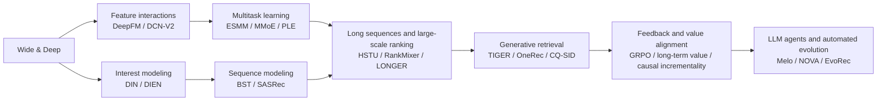

# Search, ads, recommendation, and LLM applications: lineage and gaps

<!-- source-sha256: d0fc6946e0a2c5e53c2a582e0119d6c09506e60bca8cbd8028053fd003025fa1 -->

[简体中文](../../reproductions/lineage.md)

This page maps major research lineages, how their approaches evolved, and what remains missing. See the [reproduction overview](README.md) and individual papers for formulas, online results, and local experiments. Expanding the catalog does not relax admission rules.

## Lineage coverage

| Lineage | Representative methods | Repository coverage | Status |
|---|---|---|---|
| Classic CTR and feature interaction | Wide & Deep, DeepFM, DIN, DCN-V2 | Wide/deep models, FM, candidate-aware interest, explicit feature crosses | Implemented |
| Sequential interest and long histories | DIEN, BST, SASRec, HSTU, LONGER, RankMixer, HyFormer | GRU interest evolution, causal attention, token mixing, long-sequence compression | Implemented |
| Multitask learning and conversion | ESMM, MMoE, PLE, TWICE | Entire-space modeling, task gates, specialized and shared experts, dual clocks for delayed conversion | Implemented |
| Dual-encoder and graph retrieval | YouTube DNN, CS3, RankGraph-2, HARNESS-LM | Sampled retrieval, dual-encoder cyclic correction, multi-hop PPR, asymmetric lightweight retrieval | Implemented |
| Generative recommendation | TIGER, OneRec, OneMall, CQ-SID, RecGPT-V3 | Semantic IDs, sequence generation, multi-scenario prompts, generative correction, and latent intent | Implemented |
| LLM content and knowledge augmentation | KAR, NoteLLM, SERAL, RecoReward, Melo | Knowledge generation, content compression, cognitive profiles, recommender rewards, agent grounding | Implemented |
| Reranking and blending | SORT-Gen, Memento, DeGRe, DRL-PUT | Listwise value, MMR, look-ahead distillation, utility-policy reweighting | Implemented |
| Content understanding and relevance screening | MM-LLM, MIM, PinCLIP, CORE, ASARL | Multimodal representations, content/collaborative alignment, relevance cascades, and data screening | Implemented |
| Privacy and policy risk | RAMP, Proximity Features, Causal Retrieval, UAME | Missing fields, privacy compliance, incremental triggers, and uncertainty constraints | Partial |
| Ad generation and long-term value | GR4AD, UniVA, GrowthGR, SWAG, Causal Retrieval | Generative ads, value alignment, long-term objectives, sliding-window bidding, and causal incrementality | Implemented |
| Freshness, cold start, and exploration | PinCLIP, Pin-SCALE, YouTube Freshness, Pinequalizer | Content/collaborative alignment, engagement SIDs, IPS, uncertainty, and exposure debiasing | Implemented |
| Training and serving efficiency | OneTrans, SOLARIS, Rec-Distill, TokenMixer-Large | KV caching, asynchronous latents, distillation, and sparse capacity scaling | Implemented |
| Self-evolving recommenders | Self-Evolving RecSys, NOVA, EvoRec | Experiment memory, validation cascades, and dual-track model/method evolution | Integrated with evolve |

## Technical evolution

These are composable capability layers, not a strict publication timeline. Traditional ranking remains a serving baseline for most generative and LLM systems. Generative models, agents, and RL are marked implemented only after their core mechanisms run on public data.

## Industrial evidence threshold

- New industrial papers must disclose quantitative production A/B results or a statistically significant full rollout explicitly accepted by the user.
- Report online lifts, local public-data results, and component ablations separately. None substitutes for another.
- Named classic exceptions such as DeepFM, YouTube DNN, ESMM, MMoE, and PLE fill gaps in the technical lineage. They are not precedents for waiving online evidence on later papers.
- If system-level A/B cannot isolate model, product, and UI effects, state the attribution limits explicitly, as for Melo.

See the full [selection and reporting rules](README.md#selection-policy).

## Current gaps

| Gap | Reason | Prerequisite for implementation |
|---|---|---|
| Content safety, fraud, and ad compliance | Current implementations mainly cover relevance and privacy constraints and cannot replace safety moderation | Labeled public data, precision/recall/false-positive metrics, and production guardrails |
| Private large-scale ad auctions and conversion logs | Public data lacks bids, budgets, GMV, and mature labels | Public logs or an equivalent benchmark that preserves the decision constraints |
| End-to-end recreation of LLM recommendation products | Retrieval indexes, model checkpoints, and traffic orchestration are usually private | Official code or model, or an auditable public end-to-end environment |
| AIGQ, RaG, RoleGen, LCU | Missing rewards, video feedback, conversion trajectories, or public data access, respectively | The corresponding public data and executable feedback loop |
| RecoChain / DIG | Quantitative production A/B evidence has not been verified | Verifiable production experiment numbers in the paper body |

These remain gaps. Do not create adapters that provide only a name, a formula, or fixed scores.
