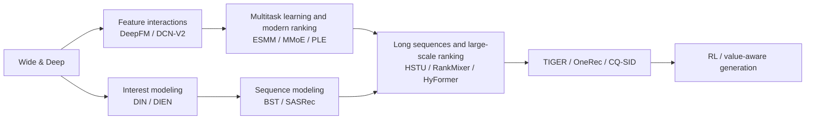
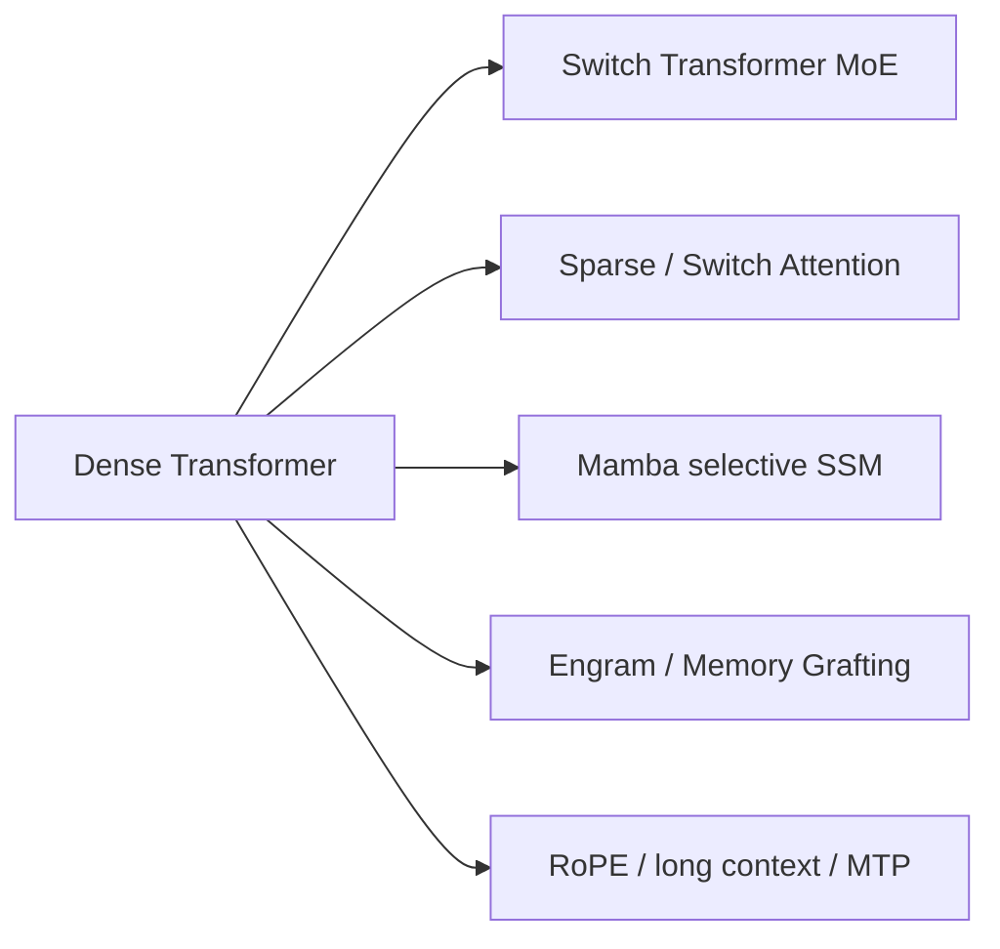

# Cross-domain paper lineages and gaps

<!-- source-sha256: d329871038f40c21d70227a13ee5f9191b6674b0db082f9d5efa7485bfe8e850 -->

[简体中文](../research-lineage.md)

This long-term audit covers **search, ads and recommendation; foundation models; LLM post-training; and agents**. Individual paper READMEs remain authoritative for implementations and metrics. This page asks whether the major lineages are covered and what remains missing.

> A second-level topic review on 2026-08-08 confirmed real gaps. The earlier “P0/P1 complete” status referred only to a 15-paper batch, not the whole library. See the [all-domain gap audit](full-domain-gap-review-20260808.md) for evidence, priorities, and rejected candidates.

## Common admission criteria

| Domain | Evidence needed for implementation | Default public evaluation |
| --- | --- | --- |
| Industrial search, ads, and recommendation | Quantitative online A/B or full-rollout evidence explicitly accepted by the user; classic baselines are named exceptions only | MovieLens / Amazon / KuaiRand, full-catalog ranking |
| Foundation models | Public benchmarks, same-budget controls, trainable core operators | WikiText-2, Tiny Shakespeare, multimodal and efficiency suites |
| LLM post-training | Executable preference/RL objective and public evaluation | GSM8K candidate, preference pairs, process traces |
| Agents | Auditable planning, tools, memory, or reflection trajectories | Deterministic tools and cross-episode mini-suites |

## Search, ads, and recommendation: From classic ranking to generative recommendation

Coverage includes classic feature interactions, sequential interests, long-sequence ranking, dual-encoder retrieval, Semantic ID generation, LLM content and knowledge augmentation, sampling and distillation, RL, long-term value, and serving. The topic index separates retrieval, coarse/fine ranking, reranking and blending, content understanding, moderation and risk, and commercial ad decisions.

| Classic exception | Value | Current status |
| --- | --- | --- |
| DeepFM | Common CTR baseline with shared embeddings across FM and deep branches | Implemented as a user-approved classic exception |
| YouTube DNN | Representative two-stage industrial retrieval | Retrieval and sampled softmax implemented as a user-approved classic exception |
| ESMM / MMoE / PLE | Main multitask CVR and shared-bottom lineage | Public multitask protocol and separate implementations |

No quantitative online A/B evidence meeting the industrial bar has been verified for RecoChain or DIG (2026). No placeholder adapters were created. GloRank, Dual-Rerank, OneRanker, RADAR, DualGR, MPFormer, HAP, OnePiece, IntSR, CDM, and CWM from the 2026-08-08 review are implemented. Netflix GenRec was added on 2026-08-13 alongside the existing JD.com paper with the same name.

## Foundation models: Architecture, pretraining, multimodality, and efficiency

Coverage includes dense baselines, sparse MoE, Mamba, dynamic and sparse attention, conditional memory, long-context position encoding, MTP, quantization, RoPE/ALiBi, GQA, Hymba, MoBA, DoReMi and data mixtures, BLT, and classic multimodal methods. Trainable operators join the LLM/VLM evolve search space.

See [foundation model research](foundation-models/README.md) for browsing, classification, and evaluation.

- RoPE / ALiBi: Standalone same-budget long-context adapters and evolve operators exist.
- Chinchilla scaling: Requires curves over multiple compute and data budgets; one small-model run is not a substitute.
- New MoE routing and linear sequence models: Admit only when real operators, gradients, and public benchmarks are verifiable.

## LLM post-training

The lineage covers PPO-RLHF, Constitutional AI, RRHF, RAFT, DPO, KTO, ORPO, IPO, SimPO, GRPO, RLOO, ReMax, DAPO, GSPO, LUSPO, CoBA-RL, Lightning OPD, Relay-OPD, GPRL, TCR, and CoRT. Four sequence objectives have real-tokenizer, free-generation, multi-seed paths. The P1 additions SLiC-HF, SteerLM, and SPIN cover sequence calibration, multi-attribute conditional SFT, and self-play. See [post-training lineages](post-training/lineage.md) for differences.

Paper retrieval, auditable objective mapping, and compositional genomes run through the unified multi-round controller. Further work is to scale public rollouts and unify reporting for reward, KL, length bias, and group normalization.

## Agents

Classic coverage includes ReAct, MRKL, HuggingGPT, Toolformer, Tree of Thoughts, Reflexion, Self-Refine, LATS, ReWOO, AutoGen, WebGPT, SayCan, PAL, ART, Generative Agents, MemGPT, MetaGPT, CRITIC, SWE-agent, OpenHands, Agent Lightning, SEED, CAST, TurnOPD, Voyager, HiSkill, UniMem, and recent memory and planning methods. Software agents have real file editing and regression test paths. See [agent lineages](agent-research/lineage.md).

Memory, planner, tool, critic, policy, recovery, and capacity are composable genome axes. The same task suite measures success, token/tool costs, cross-episode reuse, and recovery from errors. Real code executors have a fair comparison matrix. Official SWE-bench Lite, the full ToolHop suite, and real browser environments remain deferred at the user's request; local fixtures are not official benchmark evidence.

## Completed batches and new priorities

1. **Earlier P0 batch complete:** Wide & Deep, DCN-V2, DIEN, BST, CS3, CQ-SID, Switch Transformer, Mamba, and Switch Attention. This does not establish completion of later audit findings.
2. **P1 infrastructure complete:** Paper-constrained genomes for new LLM architectures, post-training, and agents join the unified multi-round controller.
3. **P1 classic papers complete:** DeepFM, YouTube DNN, ESMM, MMoE, and PLE were implemented as user-approved classic exceptions.
4. **2026-08-08 P0/P1 queue closed:** See the [all-domain gap audit](full-domain-gap-review-20260808.md) for results and scope. New candidates do not reuse that day's queue.

## Status as of 2026-08-24

The [unified roadmap and TODOs](research-roadmap.md) maintain priorities, IDs, acceptance criteria, and status. Registered static P0/P1 items are closed. This page does not duplicate the queue. Further work comes from new discovery or deferred items reactivated by the user.
